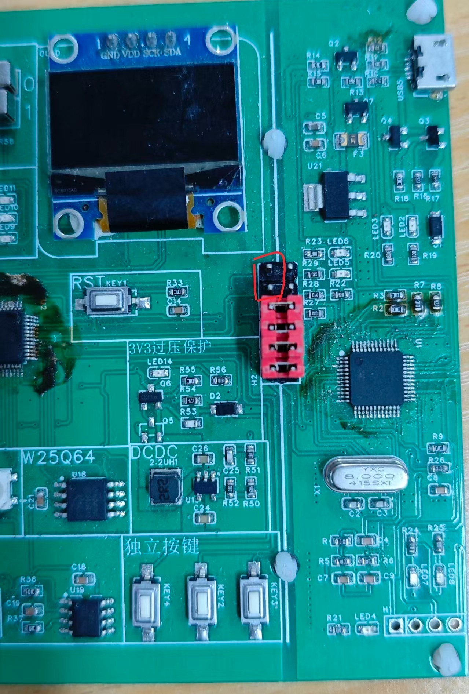
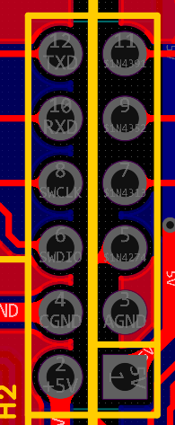
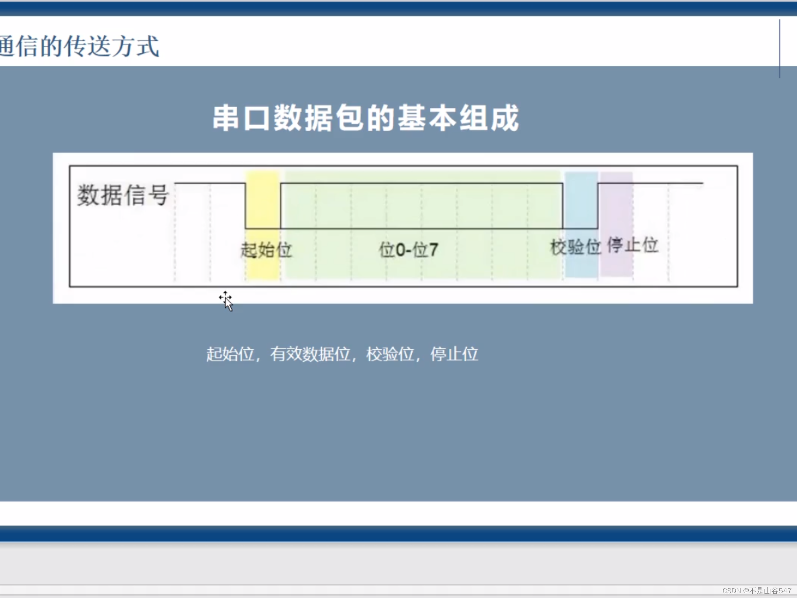
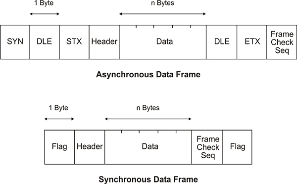
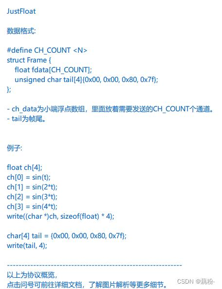
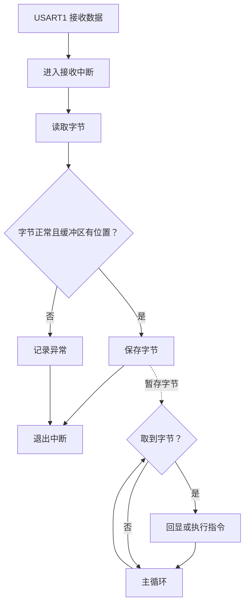

# STM32 入门培训教材

## 提高篇

### 提 4 串口接收与中断：让单片机听懂电脑

> 这一节回扣基础篇第 6 章，建议先跑通再回来看。第 6 章让开发板把信息“说”给电脑，本章再给它补上“听”和“回应”的能力。

#### 4.1 本章目标与实验预览

第 6 章里，串口助手主要负责接收：开发板主动发送计数，你在电脑上观察。现在把方向反过来，电脑发送一个字符，开发板接住它，再给出回应。这样你就能在运行过程中向开发板下达简单指令，无需每次修改代码再重新下载。

可以把两个实验想成一次对话练习。第一步是“我说什么，你重复什么”，确认双方确实听见了；第二步是“我说一个约定好的口令，你完成对应动作”，让收到的数据参与控制。

学完这一章，你能：

1. 说明板载 ST-Link 虚拟串口的双向通信路径，分清通信、下载和供电如何由同一根 USB 线完成。
2. 把 USART1 从只发送改为同时发送、接收。
3. 说明接收方向、接收中断和 NVIC 配置各自解决什么问题。
4. 在中断中及时读取数据，在主循环中完成回显、指令处理与反馈。
5. 使用 `1`、`0`、`?` 控制和查询板载 LED，并根据现象定位接线或代码问题。

| 实验 | 电脑端操作 | 开发板的回应 | 主要验证什么 |
|---|---|---|---|
| 实验一：字符回显 | 发送文本 `A` | 返回一个 `A` | 接收、数据交接、发送这条路径是否连通 |
| 实验二：指令控制 | 发送文本 `1`、`0`、`?` | 点亮、熄灭或查询 LED，并返回结果 | 收到的字节能否触发约定动作 |

本章一次指令就是一个 ASCII 字符，不需要按回车才执行。实验一与实验二使用相同的 `Serial.c/.h`，只替换 `main.c`。先完成回显，再做控制，有助于分清“串口没有收到”和“指令处理有问题”。

#### 4.2 需要准备与硬件连接

##### 4.2.1 实验条件

| 项 | 内容 |
|---|---|
| 开发板 | 社团 STM32F103C8T6 开发板（板载 ST-Link，串口和 SWD 均已在板上连接） |
| 通信设备 | 板载 ST-Link 虚拟串口，无需 USB 转串口模块或杜邦线 |
| USB 连接 | 一根支持数据传输的 Micro USB 线，连接开发板 USB 口与电脑；只支持充电的线无法下载和通信 |
| 供电 | 由这根 USB 线统一供电，不需要外接电源 |
| 下载 | 板载 ST-Link，SWD 已在板上连通，同一根 USB 线同时完成下载与通信 |
| 前置章节 | 第 6 章串口发送、第 7 章中断基础；优先级细节参看提 1 |
| 软件 | Keil5、ST-Link 驱动、VOFA+ 串口助手（免费，下载与设置见第 6 章 6.3.5） |
| 工程环境 | 五目录标准工程，SPL V3.5.0；串口重定向沿用 Arm Compiler 5 + MicroLIB |
| 本章修改 | `Hardware/Serial.c`、`Hardware/Serial.h`、`User/main.c` |
| LED 资源 | 实验二使用 PA3 对应的板载 LED，低电平点亮、高电平熄灭 |

还没有安装 ST-Link 驱动时，先按第 6 章完成安装：

- [STSW-LINK009 ST-LINK USB 驱动下载页（ST 官方）](https://www.st.com/zh/development-tools/stsw-link009.html)

电脑上选择的是板载 ST-Link 虚拟串口对应的 COM 端口，名称通常类似 `STMicroelectronics STLink Virtual COM Port (COMx)`。这根 USB 线同时负责下载和串口通信，无需额外接线；但程序下载成功，不代表本章的接收功能已经在软件上开启。

##### 4.2.2 接收方向：物理已连好，软件上开启

第 6 章代码只打开发送方向。本章要让开发板接收数据，需要把 USART1 改为同时发送、接收。

**和发送一样，接收方向的物理连接在出厂时已经在板上连通，你不需要接任何一根杜邦线，也不需要单独供电。**PA9、PA10 都在板内走线连到板载 ST-Link，由它完成 TTL 电平与 USB 信号之间的转换。

| 引脚 | 串口功能 | 板上路径 | 数据方向 |
|---|---|---|---|
| PA9，USART1_TX | 发送 | 单片机 → 板上走线 → 板载 ST-Link → USB → 电脑 | 开发板 → 电脑，输出欢迎信息、回显和指令结果 |
| PA10，USART1_RX | 接收 | 电脑 → USB → 板载 ST-Link → 板上走线 → 单片机 | 电脑 → 开发板，接收电脑发送的字符 |





TX 和 RX 都以设备自身为主体。板载 ST-Link 与单片机之间已经按“单片机 TX 接 ST-Link 的 RX、单片机 RX 接 ST-Link 的 TX”交叉连好，所以你无需自己接线。以后外接其他串口模块时，也要遵循 **TX 接对方 RX** 这一方向。

你要做的硬件操作只有一个：用一根支持数据传输的 USB 线把开发板的 USB 口和电脑连起来，供电、下载和双向串口通信都由它完成。

PA3 的 LED 已连接在开发板上，实验二无需额外连接 LED。它采用低电平点亮的接法，所以“开启 LED”对应把 PA3 拉低；不要把收到的数字 `1` 直接理解成必须输出高电平。

##### 4.2.3 串口助手设置

社团统一使用 VOFA+，协议引擎选 `RawData`，数据接口选 `串口`。接收和发送都在下方控制台完成。

| 设置项 | 两个实验的设置 |
|---|---|
| COM 端口 | 设备管理器中板载 ST-Link 虚拟串口（`STLink Virtual COM Port`） |
| 协议引擎 | `RawData`（原样显示，不做解析） |
| 波特率 | 9600 |
| 数据位、停止位 | 8、1 |
| 校验、流控 | 无、无 |
| 接收显示 | 控制台选 `Abc`（文本）模式，勾选 `Rx`，编码 `UTF-8` |
| 发送方式 | 文本发送，先关闭十六进制发送（`Hex` 不按下） |
| 自动发送 | 关闭，先手动发送 |
| 自动附加回车换行 | 首次验证时关闭 |
| 本地回显或显示发送内容 | 回显实验时关闭，避免把软件自身显示误当成开发板返回 |

发送时在控制台的发送输入框中填写字符，点击发送即可。不同串口助手的按钮名称可能不同，按功能核对即可。打开串口后再按开发板复位键，以接住只在启动时输出一次的欢迎信息。

#### 4.3 数据到了以后，谁来处理

##### 4.3.1 接收按字节进行，不按整句话进行

串口接收像门口逐张收到纸条。电脑发送 `ABC`，USART1 会依次接收 `A`、`B`、`C`，本章的接收中断也会逐字节处理。它不会因为电脑端点击了一次“发送”，就自动知道这三个字符属于一条完整指令。

本章采用 9600、8N1。一个字符需要起始位、8 个数据位和停止位，共 10 位；连续传输时，一个字节约占 `10 / 9600 ≈ 1.04ms`。这说明接收处理不能一直拖着不做。

USART1 内部有接收数据寄存器，可以把它先理解为“硬件收件位置”。接收完成后，`RXNE` 表示这里有数据等待读取。它不是用来保存任意长度文字的仓库：旧数据没有及时取走，又有新数据到达，可能出现接收溢出错误 `ORE`。

这一个字节在线上并不是“嗖”地一下整体过去，而是被拆成一位一位的电平，按固定顺序发送，称为一帧。如下图所示，空闲时线是高电平；发送方先把线拉低一个位时间，这是**起始位**，等于提醒对方“我要开始了”；接着是 8 个**数据位**（低位在前）；如果开启校验，还会跟一个**校验位**；最后保持一段时间高电平，是**停止位**，表示“这一个字节发完了”。这些起始位、停止位都是硬件自动添加和识别的，你写程序时只管把字节交给串口，不用手动拼。



##### 4.3.2 轮询与中断：主动去看，还是等待通知

| 方式 | 如何工作 | 主循环的负担 | 需要注意 |
|---|---|---|---|
| 轮询接收 | 主循环反复检查 `RXNE`，有数据就读取 | 必须经常去看接收状态 | 长延时或耗时处理可能使读取不及时 |
| 中断接收 | 外设产生请求，由中断机制进入处理函数 | 平时可以处理其他任务 | 要配置中断，并保持处理函数简短 |

轮询像每隔一会儿去门口看有没有纸条。中断像门口有通知铃，有新纸条时提出通知，请你暂时处理一下。**中断提出请求后，也要等优先级和屏蔽状态允许，才能进入处理函数**，并非无论当前情况如何都立即执行。

中断接收的优势是能及时把数据从硬件中取出来。它并没有替你理解指令，也没有让所有后续工作自动完成。

##### 4.3.3 三件事不要混为一件事

| 配置 | 解决什么问题 | 没完成会怎样 |
|---|---|---|
| `USART_Mode_Rx` | 允许 USART1 接收数据 | 接收方向没有开启 |
| `USART_ITConfig(..., USART_IT_RXNE, ENABLE)` | 允许接收事件提出中断请求 | 可以有接收数据，但本章的接收中断路径没有打开 |
| NVIC 配置 | 允许中断控制器受理 USART1 中断，并安排优先级 | 外设提出请求，处理函数仍不能按本章方式运行 |

可以把它们想成“打开收件入口”“允许按铃”“值班人员受理通知”。三个环节各有作用，不能用其中一个替代另外两个。

##### 4.3.4 数据包的发送与解析：从一个个字节到一条消息

前面解决的都是“一个字节”。但实际一条消息往往是好几个字节，比如 `LED=ON`、`count=12`。这里有个关键问题：**串口里的字节是一个接一个、像流水一样连续过来的，接收方怎么知道“这一条消息从哪开始、到哪结束”？**

办法是双方事先约定一个“数据包”的格式，发送方按格式打包，接收方按格式拆包。这里要先分清两个层次，新手最容易混：

- **物理帧（一个字节）**：起始位、数据位、校验位、停止位，见图 4-3，由硬件自动加，你不用管。
- **应用数据包（一条消息）**：由多个字节组成，格式要你自己定，比如“怎么开头、怎么结尾、怎么知道有没有传错”。

一个典型的数据包通常包含下面几部分，不一定每部分都要有：

| 部分 | 作用 | 生活中的类比 |
|---|---|---|
| 帧头 | 标志一条消息开始，有时还带地址、命令编号 | 信封的开头、“你好” |
| 数据长度 | 说明后面跟着几个字节 | 提前告诉你“这封信有几页” |
| 数据 | 真正要传的内容 | 信纸正文 |
| 校验 | 让对方判断数据有没有在传输中出错 | 末尾的“核对暗号” |
| 帧尾／结束符 | 标志一条消息结束 | 句号、“完毕” |



新手先掌握两种最常用的约定，VOFA+ 正好把它们都做成了现成的协议。

**方式一：结束符（按行解析）——最简单，先学这个。**

约定每条消息以一个换行符 `\n` 结尾，就像一句话说完加个句号。

- 发送：正常打印，结尾带 `\n`，例如 `Serial_Printf("LED=ON\n");`。
- 接收：逐字节收，先存进一个小缓存；每收到一个 `\n`，就知道“一条凑齐了”，把缓存里的内容取出来处理，再清空缓存，等下一条。

这正是 VOFA+ 的 **FireWater** 协议：发送的是可见文字，多个数据用逗号隔开，最后用换行结束。它适合调试、发命令、传少量数据。

下面这段代码复用了前面的 `Serial_ReadByte`，演示在主循环里“逐字节攒、遇到换行就解析”，可以直接套用到自己的工程：

```c
char line[32];      /* 暂存一条消息，长度按最长消息预留 */
uint8_t len = 0;
uint8_t rx;

while (1)
{
    if (Serial_ReadByte(&rx) != 0)
    {
        if (rx == '\n')
        {
            line[len] = '\0';   /* 一条凑齐，补上字符串结尾 */
            /* 在这里解析 line 的内容，再执行对应动作 */
            len = 0;            /* 清空，准备拼下一条 */
        }
        else if (len < sizeof(line) - 1)
        {
            line[len] = (char)rx;
            len++;
        }
    }
}
```

**方式二：帧头加数据加帧尾（二进制）——更省带宽、更可靠。**

当要传的数据多、频率高，或者要把传感器数字画成波形时，文本方式又长又慢，这时用二进制。以 VOFA+ 的 **JustFloat** 协议为例：

- 数据是若干个 float 浮点数，每个 float 占 4 个字节，按小端顺序发送；
- 每一组数据末尾固定跟 4 个字节的帧尾：`0x00 0x00 0x80 0x7F`；
- 接收方逐字节收，每看到这 4 个帧尾，就知道“一组到齐了”，再把前面的字节按每 4 个还原成一个 float 显示成波形。



二进制协议里不能再靠 `\n` 当结束标志，因为某个数据字节本身可能正好等于换行的编号 `0x0A`，会被误判成“结束”。所以要用专门约定的帧头、帧尾，这也是它比文本方式稍复杂的原因。

**接收端解析的核心思想：状态机。**

不要指望“一次就收到一整条消息”，而是一个字节一个字节地判断：我现在是在“等结束标志”，还是“正在攒数据”；收到这个字节后该做什么、该转到哪个状态。这种“处于什么状态、收到什么就做什么”的固定流程，就叫状态机。它和前面的环形缓冲区配合：接收中断只负责尽快把字节存进缓冲区，主循环再从缓冲区取字节，按状态机把字节拼成完整数据包、解析并执行。

| 要解决的问题 | 结束符方式（FireWater） | 二进制方式（JustFloat） |
|---|---|---|
| 怎么知道一条消息结束 | 收到换行 `\n` | 收到固定帧尾 0x00、0x00、0x80、0x7F |
| 数据长什么样 | 可见的文字 | float 等二进制字节 |
| 适合场景 | 调试、命令、少量数据 | 波形、多通道、高频数据 |
| 优点 | 简单直观，人能直接看懂 | 省带宽、传输效率高 |
| 要注意 | 数据内容里别随便带换行 | 要约定字节顺序和帧头帧尾 |

#### 4.4 从发送初始化改为收发初始化

第 6 章的四个基本步骤继续保留：打开时钟、配置引脚、设置串口、开启串口。本章增加接收引脚和中断配置。

| 初始化环节 | 本章配置 | 与第 6 章相比 |
|---|---|---|
| 时钟 | 使能 GPIOA、USART1 | 保留 |
| PA9 | `GPIO_Mode_AF_PP`，复用推挽输出 | 保留发送出口 |
| PA10 | `GPIO_Mode_IPU`，上拉输入 | 新增接收入口 |
| 通信规则 | 9600、8 位、1 位停止、无校验、无流控 | 保留 |
| 通信方向 | `USART_Mode_Tx \| USART_Mode_Rx` | 从只发送改为收发 |
| 接收软件状态 | 初始化缓冲区读写位置和计数 | 新增数据暂存能力 |
| 接收中断 | 使能 `USART_IT_RXNE` | 新增外设通知 |
| NVIC | 配置 `USART1_IRQn` 并使能 | 新增中断受理 |
| 外设开启 | `USART_Cmd(USART1, ENABLE)` | 在准备完成后开启 |

PA9 需要向外输出波形，所以使用复用推挽输出。PA10 接收别人送来的波形，所以使用输入模式。两根引脚属于同一个 GPIOA，也要分别提交配置，不能把它们一起设成输出模式。

上拉输入给接收线提供一个默认的高电平状态，与普通异步串口的空闲状态相符；实际通信时，电平变化由板载 ST-Link 的 TXD 在板上驱动。它不负责把不匹配的电压转换成合适电压。

GPIO 配置结构体的 `GPIO_Speed` 在输出模式下用于选择输出速度档位。本章给输入配置也完整填写这个成员，但它不决定接收速度；串口的波特率仍由 `USART_BaudRate` 设置。

**本章独立示例明确采用 `NVIC_PriorityGroup_2`，在 `main` 启动阶段配置一次。**`Serial_Init` 不修改全工程的优先级分组。整合到已有工程时，先核对已有分组，再按全工程约定设置本章优先级，不能让每个外设初始化函数分别改一次分组。这里是本章示例的配置选择，其他章节的实际配置仍需对照。

#### 4.5 接收相关函数逐个说明

##### 4.5.1 `USART_ITConfig`：允许指定事件提出中断

调用形式：`USART_ITConfig(串口外设, 中断源, ENABLE或DISABLE)`，没有返回值。

本章使用 `USART_ITConfig(USART1, USART_IT_RXNE, ENABLE)`：

| 参数 | 本章取值 | 含义 |
|---|---|---|
| 串口外设 | `USART1` | 操作第 1 个串口外设 |
| 中断源 | `USART_IT_RXNE` | 选择接收数据就绪相关中断 |
| 状态 | `ENABLE` | 允许该中断源提出请求 |

**它还可以做什么？**按外设支持情况，可以使能发送完成、空闲检测等中断源；使用 `DISABLE` 可关闭选中的中断源。改变第二个参数后，处理函数也必须增加相应处理，不能只开开关。

注意区分 `USART_IT_RXNE` 与 `USART_FLAG_RXNE`。前者给中断配置、判断接口使用；后者给状态标志接口使用。名称相似不代表可以任意交换。

本章也不使能 `USART_IT_TXE`。发送就绪状态很常见，随意使能却不处理，会造成频繁进入中断。先只打开本次实验需要的接收中断源。

##### 4.5.2 `NVIC_PriorityGroupConfig` 与 `NVIC_Init`：安排受理规则

NVIC 可以理解为“中断的总调度中心”。外设提出请求以后，它按照全工程的分组、优先级和使能状态决定如何受理。

`NVIC_PriorityGroupConfig(NVIC_PriorityGroup_2)` 没有返回值，用来选择全局分组。本示例组 2 分配 2 位抢占优先级、2 位子优先级（也称响应优先级），对应取值都为 0～3。更深入的优先级和嵌套关系参看提 1。

`NVIC_Init(&NVIC_InitStructure)` 没有返回值，把填写好的配置应用到指定中断通道。

| 结构体成员 | 本章值 | 本次作用 |
|---|---|---|
| `NVIC_IRQChannel` | `USART1_IRQn` | 选择 USART1 的中断通道 |
| `NVIC_IRQChannelPreemptionPriority` | `1` | 设置组 2 下的抢占优先级 |
| `NVIC_IRQChannelSubPriority` | `1` | 设置组 2 下的子优先级 |
| `NVIC_IRQChannelCmd` | `ENABLE` | 允许 NVIC 受理该通道 |

**它还可以做什么？**同一个初始化接口也可以配置其他中断通道。优先级数值越小，优先级越高，但具体比较和嵌套行为受分组影响；不能只记住某个数字就脱离全工程配置使用。`DISABLE` 用于关闭对应 NVIC 通道，不等于关闭 USART1 本身。

`USART1_IRQn` 是通道标识，`USART1_IRQHandler` 是处理函数名，`USART1` 是外设标识。它们分别出现在不同接口中，不是同一个名称的不同写法。

##### 4.5.3 `USART_GetITStatus`：确认本次需要处理的来源

调用形式：`USART_GetITStatus(串口外设, 中断源)`，返回 `SET` 或 `RESET`。

本章使用 `USART_GetITStatus(USART1, USART_IT_RXNE)`。它结合对应状态与中断使能情况进行判断，在处理函数中确认是否有本章启用的接收事件需要处理。它像先看清通知单，避免把其他事件当成接收数据。

**它还可以做什么？**同一个 USART 处理函数可能服务多个中断源，需要逐个判断并做相应处理。状态标志查询 `USART_GetFlagStatus` 则常用于轮询，它与中断状态判断的用途有区别。

查询不会把字符自动交给主循环，也不等于已经处理了中断。判断以后，还要完成实际读取和保存。

##### 4.5.4 `USART_ReceiveData`：取走接收的数据

调用形式：`USART_ReceiveData(串口外设)`，返回 `uint16_t`。

本章使用 `USART_ReceiveData(USART1)`，在 8 位、无校验配置下取其低 8 位，保存为 `uint8_t`。库接口保留 16 位返回类型，是为了覆盖串口支持的其他数据宽度，不能因此把本章每次接收理解成两个字节。

**它还可以做什么？**轮询接收也用这个函数，只是先在主循环判断数据就绪。它只读取当前数据，不会一次得到完整字符串，也不检查这个字节是不是合法指令。

在 STM32F103 中，读取接收数据寄存器会清除 `RXNE`。本章先判断状态、再读取数据，因此普通接收流程中不需要额外调用 `USART_ClearITPendingBit` 来清除 `RXNE`。

`ORE` 等错误标志的处理还有规定的顺序：先读取状态，再读取数据。完整代码通过状态查询函数和 `USART_ReceiveData` 完成这一过程，并记录错误事件。**不要套用“所有中断都在最后调用同一个清除函数”的规则。**

##### 4.5.5 `USART1_IRQHandler`：名称正确，才能接到通知

这是与启动文件中 USART1 中断向量对应的处理函数。发生允许受理的中断时，单片机通过向量表进入它；主循环不需要手动调用。

本章把实现放在 `Serial.c`，函数名必须完整写成 `USART1_IRQHandler`，不能写成自己的缩写，也不能加 `static`。若工程的 `User/stm32f10x_it.c` 已有同名实现，保留一份实现即可。启动文件中的弱定义可由本章函数覆盖，不需要修改启动文件。

函数的位置可以由工程统一安排，但**整个工程只能有一份同名的有效实现**。不要同时在 `Serial.c` 和中断文件中各写一遍。

#### 4.6 中断与主循环怎样交接数据

##### 4.6.1 中断取纸条，主循环读内容

本章明确分工：

| 位置 | 负责什么 | 原因 |
|---|---|---|
| 接收中断 | 判断来源、读取字节、暂存数据、记录接收异常 | 尽快腾出硬件接收位置 |
| 主循环 | 取出字节、回显、判断指令、控制 LED、输出反馈 | 这些操作可能耗时，便于逐步调试 |

如果在中断里打印一大段文字，就像收到纸条以后站在门口读完一篇文章才回去工作，后面的纸条容易来不及取。本章保留第 6 章的阻塞发送函数，但只在主循环调用，不在接收中断中调用 `printf`、`Serial_Printf` 或长延时。

中断返回后，主程序从被打断的位置继续执行。**中断及时取走了字节，不等于主循环已立即执行指令**；如果主循环在忙，指令会先排队。



图 4-1：中断负责及时接收，主循环负责处理。虚线表示通过软件缓冲区交接数据，不表示中断直接调用主循环。

##### 4.6.2 为什么不只用一个变量加一个标志

一个接收变量加一个“有新数据”标志，能演示手动单字符接收。但如果 `A` 尚未处理，`B` 就到达，后一个字节可能覆盖前一个字节。再加上取数据、清标志之间可能被中断打断，处理方式不当还会丢掉通知。

本章使用一个 64 字节的**环形缓冲区**，把它想成一排可以循环使用的信箱格子。中断往写入位置放数据，主循环从读取位置取数据；走到最后一个格子，再回到开头。读者首次实验可以先把它作为已有的暂存功能使用，再回来看内部实现。

| 名称 | 含义 | 谁修改 |
|---|---|---|
| `rx_buffer` | 保存尚未处理的字节 | 中断写入，主循环读取 |
| `rx_head` | 下一次写入的位置 | 接收中断 |
| `rx_tail` | 下一次读取的位置 | 主循环 |
| `rx_head == rx_tail` | 缓冲区为空 | 主循环据此判断有没有数据 |
| 下一写入位置等于 `rx_tail` | 缓冲区已满 | 中断丢弃新字节，增加溢出计数 |

这个实现故意留出一个空位置，用来区分“空”和“满”，所以 **数组长 64，实际最多暂存 63 个字节**。它只能承受有限的积压；持续输入比处理更快时，仍会溢出。尤其是每收到一个字符就打印一长行，会让输出量比输入量大得多，缓冲区不能永久弥补这一差距。

##### 4.6.3 `volatile` 与短暂的交接保护

这些共享变量使用 `volatile`，提醒编译器：它们可能由中断改变，读取时不能一直使用先前保存的旧值。它像在变量旁贴上“内容可能随时更新”的标签。

**`volatile` 不会把多个步骤变成不可分割的一步，也不会增加缓冲容量。**本章 `Serial_ReadByte` 在检查、取出和移动读取位置的短过程里暂时屏蔽可屏蔽中断，再恢复进入前的屏蔽状态。保护范围只包含交接操作，打印和执行指令都放在外面。

| CMSIS 接口 | 本章作用 |
|---|---|
| `__get_PRIMASK()` | 保存进入交接前的中断屏蔽状态 |
| `__disable_irq()` | 暂时屏蔽可屏蔽中断，让交接步骤连续完成 |
| `__set_PRIMASK(irq_state)` | 恢复原来的状态 |

保存再恢复，是为了避免调用前已屏蔽中断，却在函数结束时无条件把它打开。这些是模板 CMSIS 提供的内核接口，不需要自己编写，也不要为了使用它们替换模板的内核文件。

##### 4.6.4 本章新增的接收接口

| 接口 | 参数与返回值 | 用途 |
|---|---|---|
| `Serial_ReadByte(&rx_data)` | 成功返回 1 并写入字节；没有数据返回 0，变量保持原值 | 主循环按顺序取一个字节 |
| `Serial_GetRxOverflowCount()` | 无参数，返回 `uint32_t` | 查看软件缓冲区满后丢弃新字节的次数 |
| `Serial_GetRxErrorCount()` | 无参数，返回 `uint32_t` | 查看硬件接收错误事件的次数 |

`&rx_data` 是把变量地址交给函数，让它把收到的字节写进去。返回值表示“有没有取到”，字节本身放进 `rx_data`。两者分开以后，收到 `0x00` 也能正确表达，不能用“数据等于 0”判断“没收到”。

错误事件计数包括接收溢出、帧错误、噪声等本例检测到的情况，它是**错误事件次数，不是精确丢失字节总数**。发生错误时，本例不把这次读出的字节当成有效指令。两个计数在 `Serial_Init` 中清零，运行时用于排错。

接口约定：`Serial_Init` 启动时调用一次；由一个主循环负责取数据；本例发送接口由主循环使用。不要在其他中断里同时使用这套格式化输出。

#### 4.7 实验一：先完成字符回显

1. 复制第 6 章工程，使用 4.9 的 `Serial.h`、`Serial.c` 替换原串口文件，不要额外加入一套同名串口模块。
2. 检查标准库分组有 `stm32f10x_rcc.c`、`stm32f10x_gpio.c`、`stm32f10x_usart.c` 和 `misc.c`。`misc.c` 提供本章使用的 NVIC 标准库接口，`misc.h` 应在头文件搜索路径中。
3. 把 4.9.3 的完整回显入口保存为 `User/main.c`。工程中只保留一个 `main` 和一个有效的 `USART1_IRQHandler` 实现。
4. 保持 Arm Compiler 5 与 `Use MicroLIB` 设置；本章继续由 `fputc` 完成标准输出重定向。模板已有另一份 `fputc` 时，保留一套实现。
5. 编译并下载。PA10 接收线已在板上连好，无需接线；打开串口，按复位键。
6. 收到 `echo: ready` 后，在文本发送框中输入一个 `A`，点击发送，应收到一个 `A`。
7. 再发送 `ABC`，应按原顺序收到 `ABC`。本实验返回原始字节，不自动增加换行。

回显的路径是：电脑发出字节，经 USB、板载 ST-Link、PA10 到达 USART1；中断读取并暂存；主循环取出后通过 PA9、板载 ST-Link、USB 返回电脑。

**看到发送框里有 `A`，不等于开发板已回显。**关闭本地回显，查看接收区；也可以观察接收计数是否增加。确认串口助手如何区分发送与接收，是本实验的一部分。

文本发送与十六进制发送也要分清：

| 电脑端设置 | 输入 | 实际发送字节 | 回显表现 |
|---|---|---|---|
| 文本发送 | `1` | `0x31`，ASCII 字符 `'1'` | 文本接收看到 `1` |
| 十六进制发送 | `31` | `0x31` | 文本接收同样看到 `1` |
| 十六进制发送 | `01` | `0x01` | 属于控制字符，文本区可能看不到 |
| 十六进制发送 | `00` | `0x00` | 切到十六进制接收才能直观看到 `00` |

先做回显，是为了把双向通信路径验证完整。回显正常以后，再替换为指令实验，出现问题时就可以重点检查指令规则和 LED 操作。

#### 4.8 实验二：把字符变成控制指令

保留实验一的串口文件，把 `main.c` 替换为 4.9.4 的完整版本。这个版本在主循环判断收到的字节：

| 指令 | 动作 | 返回内容 |
|---|---|---|
| 文本 `1` | PA3 输出低电平，点亮 LED | `OK: LED=ON` |
| 文本 `0` | PA3 输出高电平，熄灭 LED | `OK: LED=OFF` |
| 文本 `?` | 查询当前 LED 控制状态与接收计数 | `LED=ON` 或 `LED=OFF`，随后输出计数 |
| 回车、换行 | 忽略 | 不输出错误 |
| 其他字节 | 不改变 LED | `ERR: unknown byte=0x...` |

启动时 LED 为熄灭状态。发送 `1` 后看灯，再发送 `?` 看状态；发送 `0` 后重复核对。这样同时检查实物动作和程序记录是否一致。

本章在入口文件中提供两个静态函数 `App_LED_Init`、`App_LED_Set`，操作已明确的 PA3 LED，不依赖尚未提供的公共 `LED.c/.h` 接口。它们只属于本章应用文件，不会定义新的公共 `LED_Init`。整合配套 LED 模块时，应按其实际函数签名接入。

`switch` 中的 `case '1'` 匹配的是字符，对应 `0x31`；不是数值 `1`。如果电脑以十六进制方式发送 `01`，本例会返回未知字节错误，而不是点亮 LED。

回车换行为什么单独忽略？有些串口助手会自动在内容后添加 `\r\n`。发送 `1\r\n` 时，开发板实际收到三个字节：`'1'`、`'\r'`、`'\n'`。本例执行第一字节的指令，忽略后面两个字节，避免出现无意义的错误反馈。

本例是单字符控制，发送 `10` 会依次执行“开启”和“关闭”，最后 LED 熄灭；它不会把 `10` 当成一个数值十。查询返回的是程序保存的控制状态，没有独立检测 LED 是否实际发光，所以还要观察实物现象。

#### 4.9 完整代码

以下两个入口版本共用 4.9.1、4.9.2。每次只选择一个 `main.c`，不需要重新拼接模块中的片段。

这些文件基于标准工程模板使用，模板应保留启动文件、系统文件、CMSIS 与 SPL。头文件搜索路径包含 `Hardware` 和相应标准库目录；芯片宏定义和主频设置沿用已跑通的工程。首次读取只看完整文件的分工即可，之后再对照 4.4～4.6 理解内部细节。

##### 4.9.1 `Hardware/Serial.h`

```c
#ifndef __SERIAL_H
#define __SERIAL_H

#include "stm32f10x.h"

void Serial_Init(void);
void Serial_SendByte(uint8_t data);
void Serial_SendString(const char *text);
void Serial_Printf(const char *format, ...);

uint8_t Serial_ReadByte(uint8_t *data);
uint32_t Serial_GetRxOverflowCount(void);
uint32_t Serial_GetRxErrorCount(void);

#endif
```

##### 4.9.2 `Hardware/Serial.c`

```c
#include "Serial.h"
#include "misc.h"
#include <stdio.h>
#include <stdarg.h>

#define SERIAL_RX_BUFFER_SIZE 64u

/* 保留一个空位置区分空与满，最多暂存63个字节。 */
static volatile uint8_t rx_buffer[SERIAL_RX_BUFFER_SIZE];
static volatile uint16_t rx_head = 0;
static volatile uint16_t rx_tail = 0;
static volatile uint32_t rx_overflow_count = 0;
static volatile uint32_t rx_error_count = 0;

/**
 * @brief  将正常接收的字节放入缓冲区，仅由接收中断调用
 * @param  data：本次收到的字节
 * @retval 无；缓冲区满时丢弃新字节并记录次数
 */
static void Serial_PushRxByte(uint8_t data)
{
    uint16_t next_head;

    next_head = (uint16_t)(rx_head + 1u);
    if (next_head >= SERIAL_RX_BUFFER_SIZE)
    {
        next_head = 0;
    }

    if (next_head == rx_tail)
    {
        rx_overflow_count++;
        return;
    }

    rx_buffer[rx_head] = data;
    rx_head = next_head;
}

/**
 * @brief  初始化USART1收发及接收中断，分组由main统一设置
 * @param  无
 * @retval 无；启动时调用一次
 */
void Serial_Init(void)
{
    GPIO_InitTypeDef GPIO_InitStructure;
    USART_InitTypeDef USART_InitStructure;
    NVIC_InitTypeDef NVIC_InitStructure;

    /* 先使软件收件箱为空，再开启接收路径。 */
    rx_head = 0;
    rx_tail = 0;
    rx_overflow_count = 0;
    rx_error_count = 0;

    RCC_APB2PeriphClockCmd(RCC_APB2Periph_GPIOA, ENABLE);  /* GPIOA时钟，允许配置PA9/PA10。 */
    RCC_APB2PeriphClockCmd(RCC_APB2Periph_USART1, ENABLE); /* USART1时钟，允许配置串口外设。 */

    GPIO_InitStructure.GPIO_Pin = GPIO_Pin_9;          /* PA9：USART1默认发送引脚。 */
    GPIO_InitStructure.GPIO_Speed = GPIO_Speed_50MHz; /* 输出速度档位，不是波特率。 */
    GPIO_InitStructure.GPIO_Mode = GPIO_Mode_AF_PP;   /* 发送波形由USART1控制。 */
    GPIO_Init(GPIOA, &GPIO_InitStructure);             /* 对GPIOA应用上述完整配置。 */

    GPIO_InitStructure.GPIO_Pin = GPIO_Pin_10;         /* PA10：USART1默认接收引脚。 */
    GPIO_InitStructure.GPIO_Speed = GPIO_Speed_50MHz;  /* 完整赋值；输入模式不使用输出速度档位。 */
    GPIO_InitStructure.GPIO_Mode = GPIO_Mode_IPU;      /* 上拉输入，空闲时提供默认高电平。 */
    GPIO_Init(GPIOA, &GPIO_InitStructure);              /* 接收引脚单独应用配置。 */

    USART_InitStructure.USART_BaudRate = 9600;                       /* 电脑端同样设置9600。 */
    USART_InitStructure.USART_WordLength = USART_WordLength_8b;       /* 无校验时使用8个数据位。 */
    USART_InitStructure.USART_StopBits = USART_StopBits_1;            /* 使用1个停止位。 */
    USART_InitStructure.USART_Parity = USART_Parity_No;               /* 本实验无校验位。 */
    USART_InitStructure.USART_HardwareFlowControl = USART_HardwareFlowControl_None; /* 不使用流控线。 */
    USART_InitStructure.USART_Mode = USART_Mode_Tx | USART_Mode_Rx;  /* 同时开启发送和接收方向。 */
    USART_Init(USART1, &USART_InitStructure);                         /* 对USART1应用通信规则。 */

    USART_ITConfig(USART1, USART_IT_RXNE, ENABLE); /* 允许接收数据就绪提出中断请求。 */

    NVIC_InitStructure.NVIC_IRQChannel = USART1_IRQn;                  /* 受理USART1中断通道。 */
    NVIC_InitStructure.NVIC_IRQChannelPreemptionPriority = 1;          /* 本例组2下的抢占优先级。 */
    NVIC_InitStructure.NVIC_IRQChannelSubPriority = 1;                 /* 本例组2下的子优先级。 */
    NVIC_InitStructure.NVIC_IRQChannelCmd = ENABLE;                    /* 打开该NVIC通道。 */
    NVIC_Init(&NVIC_InitStructure);                                   /* 应用通道与优先级配置。 */

    USART_Cmd(USART1, ENABLE); /* 准备完成后开启USART1。 */
}

/**
 * @brief  由主循环按先入先出顺序取一个字节
 * @param  data：接收结果变量的地址，不得为空指针
 * @retval 1：成功取到；0：无数据或参数为空，原变量保持不变
 */
uint8_t Serial_ReadByte(uint8_t *data)
{
    uint32_t irq_state;
    uint8_t received = 0;

    if (data == 0)
    {
        return 0;
    }

    irq_state = __get_PRIMASK();
    __disable_irq();

    if (rx_head != rx_tail)
    {
        *data = rx_buffer[rx_tail];
        rx_tail++;
        if (rx_tail >= SERIAL_RX_BUFFER_SIZE)
        {
            rx_tail = 0;
        }
        received = 1;
    }

    /* 恢复调用前的状态，避免无条件打开原本已关闭的中断。 */
    __set_PRIMASK(irq_state);
    return received;
}

/**
 * @brief  查看软件缓冲区满后丢弃新字节的次数
 * @param  无
 * @retval 自初始化以来的溢出次数
 */
uint32_t Serial_GetRxOverflowCount(void)
{
    return rx_overflow_count;
}

/**
 * @brief  查看硬件接收错误事件次数，用于定位接收异常
 * @param  无
 * @retval 自初始化以来的错误事件次数，不代表精确丢字节总数
 */
uint32_t Serial_GetRxErrorCount(void)
{
    return rx_error_count;
}

/**
 * @brief  接收中断中读取数据并暂存，不在这里打印或执行指令
 * @param  无
 * @retval 无
 */
void USART1_IRQHandler(void)
{
    uint8_t data;
    uint8_t error_detected = 0;

    if (USART_GetITStatus(USART1, USART_IT_RXNE) == SET)
    {
        /* 查询状态在前，读取数据在后，符合本芯片相关错误标志的处理顺序。 */
        if ((USART_GetFlagStatus(USART1, USART_FLAG_ORE) == SET) ||
            (USART_GetFlagStatus(USART1, USART_FLAG_FE) == SET) ||
            (USART_GetFlagStatus(USART1, USART_FLAG_NE) == SET) ||
            (USART_GetFlagStatus(USART1, USART_FLAG_PE) == SET))
        {
            error_detected = 1;
        }

        data = (uint8_t)USART_ReceiveData(USART1); /* 取走字节，同时清除RXNE。 */

        if (error_detected != 0)
        {
            rx_error_count++; /* 本例丢弃异常字节，避免把它当成控制指令。 */
        }
        else
        {
            Serial_PushRxByte(data);
        }
    }
    else if (USART_GetFlagStatus(USART1, USART_FLAG_ORE) == SET)
    {
        /* ORE也可能提出请求；即使没有普通RXNE事件，也按状态→数据顺序处理。 */
        (void)USART_ReceiveData(USART1);
        rx_error_count++;
    }
}

/**
 * @brief  等待串口可接收新数据后提交一个字节
 * @param  data：待发送的字节
 * @retval 无；返回时不保证该字节已全部离开发送引脚
 */
void Serial_SendByte(uint8_t data)
{
    while (USART_GetFlagStatus(USART1, USART_FLAG_TXE) == RESET)
    {
        /* 保持第6章的阻塞发送接口。 */
    }
    USART_SendData(USART1, data);
}

/**
 * @brief  发送以零字符结尾的字符串，不发送结尾零字符
 * @param  text：有效字符串的地址，不得为空指针
 * @retval 无
 */
void Serial_SendString(const char *text)
{
    while (*text != '\0')
    {
        Serial_SendByte((uint8_t)*text);
        text++;
    }
}

/**
 * @brief  为Arm Compiler 5 + MicroLIB提供标准输出字符入口
 * @param  ch：标准库交给本函数的字符
 * @param  stream：标准库传入的流，本章统一输出到USART1
 * @retval 已提交的字符
 */
int fputc(int ch, FILE *stream)
{
    (void)stream;
    Serial_SendByte((uint8_t)ch);
    return ch;
}

/**
 * @brief  格式化输出，沿用基础篇的公共调用接口
 * @param  format：格式字符串；后续参数须与格式符匹配
 * @retval 无
 */
void Serial_Printf(const char *format, ...)
{
    va_list args;

    va_start(args, format);
    vprintf(format, args);
    va_end(args);
}
```

错误处理没有把清除标志与取数据分成两次读取：每个处理分支只调用一次 `USART_ReceiveData`。`rx_error_count` 的增加说明需要检查接线、波特率、干扰或中断延迟，已经丢失的数据不会因此恢复。

第 6 章的输出路径继续有效：`Serial_Printf → vprintf → fputc → Serial_SendByte → USART1`。重定向只处理输出，`scanf` 不会因本章增加接收中断就自动可用。

##### 4.9.3 实验一的 `User/main.c`：字符回显

```c
#include "stm32f10x.h"
#include "misc.h"
#include "Serial.h"

/**
 * @brief  将正常收到的字节原样返回电脑
 * @param  无
 * @retval 正常运行时不返回
 */
int main(void)
{
    uint8_t rx_data;

    /* 本章独立示例采用组2；集成工程按已有的全局分组统一配置。 */
    NVIC_PriorityGroupConfig(NVIC_PriorityGroup_2);
    Serial_Init();

    Serial_SendString("echo: ready\r\n");

    while (1)
    {
        if (Serial_ReadByte(&rx_data) != 0)
        {
            Serial_SendByte(rx_data);
        }
    }
}
```

这个主循环没有等待收到数据的死循环，也没有一秒延时。有数据时取出并返回，没有数据时继续下一轮检查。两种情况都由函数返回值明确区分。

##### 4.9.4 实验二的 `User/main.c`：指令控制 LED

```c
#include "stm32f10x.h"
#include "misc.h"
#include "Serial.h"

/**
 * @brief  初始化PA3板载LED，低电平点亮，初始熄灭
 * @param  无
 * @retval 无
 */
static void App_LED_Init(void)
{
    GPIO_InitTypeDef GPIO_InitStructure;

    RCC_APB2PeriphClockCmd(RCC_APB2Periph_GPIOA, ENABLE); /* 允许访问GPIOA。 */
    GPIO_SetBits(GPIOA, GPIO_Pin_3); /* 先设置熄灭电平，再切换到输出模式。 */

    GPIO_InitStructure.GPIO_Pin = GPIO_Pin_3;          /* 本实验使用PA3的板载LED。 */
    GPIO_InitStructure.GPIO_Speed = GPIO_Speed_50MHz; /* 输出速度档位，不是闪烁频率。 */
    GPIO_InitStructure.GPIO_Mode = GPIO_Mode_Out_PP;  /* 主循环直接控制引脚电平。 */
    GPIO_Init(GPIOA, &GPIO_InitStructure);             /* 应用GPIOA的PA3配置。 */
}

/**
 * @brief  按逻辑开关状态控制低电平点亮的LED
 * @param  on：非零为开启，零为关闭
 * @retval 无
 */
static void App_LED_Set(uint8_t on)
{
    if (on != 0)
    {
        GPIO_ResetBits(GPIOA, GPIO_Pin_3);
    }
    else
    {
        GPIO_SetBits(GPIOA, GPIO_Pin_3);
    }
}

/**
 * @brief  在主循环执行单字符指令并返回结果
 * @param  无
 * @retval 正常运行时不返回
 */
int main(void)
{
    uint8_t rx_data;
    uint8_t led_state = 0;

    NVIC_PriorityGroupConfig(NVIC_PriorityGroup_2); /* 本章独立示例统一设置一次分组。 */
    App_LED_Init();
    Serial_Init();

    Serial_SendString("cmd: ready\r\n");
    Serial_SendString("1=ON, 0=OFF, ?=STATE\r\n");

    while (1)
    {
        if (Serial_ReadByte(&rx_data) != 0)
        {
            switch (rx_data)
            {
                case '1':
                    App_LED_Set(1);
                    led_state = 1;
                    Serial_SendString("OK: LED=ON\r\n");
                    break;

                case '0':
                    App_LED_Set(0);
                    led_state = 0;
                    Serial_SendString("OK: LED=OFF\r\n");
                    break;

                case '?':
                    if (led_state != 0)
                    {
                        Serial_SendString("LED=ON\r\n");
                    }
                    else
                    {
                        Serial_SendString("LED=OFF\r\n");
                    }

                    Serial_Printf("rx_overflow=%lu, rx_error=%lu\r\n",
                                  (unsigned long)Serial_GetRxOverflowCount(),
                                  (unsigned long)Serial_GetRxErrorCount());
                    break;

                case '\r':
                case '\n':
                    /* 兼容串口助手自动追加的回车换行。 */
                    break;

                default:
                    Serial_Printf("ERR: unknown byte=0x%02X\r\n",
                                  (unsigned int)rx_data);
                    break;
            }
        }
    }
}
```

本章不需要调用 `Delay_ms`，所以两个入口都没有包含 `Delay.h`。模板可以保留延时模块，但不要把第 6 章用于观察计数的一秒延时照搬进这个主循环。

#### 4.10 现象验证与常见错误

##### 4.10.1 按顺序验证

| 验证动作 | 预期现象 | 说明 |
|---|---|---|
| 下载回显版本，打开串口后复位 | 接收到 `echo: ready` | 先验证开发板到电脑的发送方向 |
| 文本发送 `A`，关闭本地回显 | 接收区出现一个 `A` | 验证电脑到开发板，再返回电脑的完整路径 |
| 文本发送 `ABC` | 接收区按顺序出现 `ABC` | 验证逐字节保存与读取 |
| 回显版本中十六进制发送 `00` | 十六进制接收区看到 `00` | 验证有效零字节与“无数据”没有混淆 |
| 下载控制版本，打开串口后复位 | 欢迎信息出现，PA3 LED 熄灭 | 确认已切换到正确入口版本 |
| 文本发送 `1` | LED 点亮，返回 `OK: LED=ON` | 同时观察实物与反馈 |
| 文本发送 `?` | 返回 `LED=ON` 和接收计数 | 正常手动实验中，两类计数应保持 0 |
| 文本发送 `0`，再发 `?` | LED 熄灭，返回 `LED=OFF` | 验证状态跟随控制更新 |
| 文本发送 `X` | 返回 `ERR: unknown byte=0x58` | 无效指令不改变 LED |
| 发送带回车换行的 `1` | 执行一次开启，不为回车换行报错 | 验证结束符兼容处理 |

文中输出是预期内容，实测时请记录自己的串口截图、LED 现象和接收计数。不要把示例输出当成已完成的硬件验证。

##### 4.10.2 常见错误对照表

| 问题 | 优先检查 | 处理方法 |
|---|---|---|
| 没有 COM 端口或端口带感叹号 | ST-Link 驱动、USB 线和 USB 接口 | 按第 6 章安装官方驱动，换支持数据传输的线并重新识别设备 |
| 串口打不开 | 端口被其他软件占用 | 关闭其他终端，确认选择了板载 ST-Link 虚拟串口 |
| 启动信息完全没有出现 | USB 连接、ST-Link 虚拟串口、串口参数 | 先恢复第 6 章的发送成功现象 |
| 有欢迎信息，发送字符却无回应 | 接收模式、中断开关、NVIC、发送设置 | 按这几项顺序检查，发送正常只能证明一个方向 |
| 外接模块时按 TX→TX、RX→RX 连接 | 把名称当成电脑方向 | 板载已交叉连好；外接模块时按 4.2 的交叉关系连接 |
| 电脑端显示字符，但不能确认来自开发板 | 本地回显、发送记录与接收区 | 关闭本地回显，核对接收计数和显示区域 |
| 完全不进入接收处理函数 | 函数名、源文件加入工程、有效实现位置 | 核对 `USART1_IRQHandler`，不要手动调用模拟中断 |
| 链接提示 `USART1_IRQHandler` 重复定义 | 模块和 `stm32f10x_it.c` 各有实现 | 保留一份有效实现 |
| 链接提示 NVIC 函数未定义 | `misc.c` 未加入标准库分组 | 补齐模板中的对应库文件 |
| 格式化输出异常或符号重复 | 编译器、MicroLIB、`fputc` 实现 | 沿用第 6 章设置，保留一份重定向 |
| 输入 `1` 却报未知字节 `0x01` | 十六进制发送被开启 | 改为文本 `1`，或十六进制发送 `31` |
| 一条指令后连续出现错误 | 自动换行、其他附加字节、不是本章代码 | 保留回车换行忽略逻辑，先关闭附加选项 |
| 反馈正确，LED 动作相反 | PA3 LED 的点亮极性 | 本板低电平点亮，开启使用 `GPIO_ResetBits` |
| 指令反馈延迟、`rx_overflow` 增加 | 主循环延时、输入过快、输出文字过多 | 减少耗时处理，降低发送频率，不靠无限增大缓冲区解决 |
| `rx_error` 增加 | 两端参数、信号质量、长时间屏蔽中断 | 先统一 9600、8N1，再逐项检查 |
| 接收中断频繁重复进入 | 是否读取数据、是否误开 TXE 中断、是否遗漏 ORE 处理 | 按 4.5 和完整处理函数核对来源及清除方式 |
| 接收正常却 `scanf` 不可用 | 把输出重定向误当成输入重定向 | 本章通过 `Serial_ReadByte` 接收，未提供 `scanf` 输入适配 |

排错时，先看“电脑能否识别 ST-Link 虚拟串口”，再看“开发板能否输出欢迎信息”，接着看“回显是否正常”，最后检查“指令和 LED 是否对应”。每次只改变一项，比同时改波特率和代码更容易定位问题。

#### 4.11 小练习与后续学习

1. **增加一个指令。**约定 `2` 切换 LED 开关状态。验收：每发送一次，状态切换一次；`?` 返回的状态与实物一致。把操作放在主循环。
2. **解释初始化分工。**分别说明 `USART_Mode_Rx`、`USART_ITConfig`、`NVIC_Init` 的作用，再说明为何只开启接收方向还不够完成本章中断实验。
3. **观察字符与原始数值。**比较文本 `1`、十六进制 `31`、十六进制 `01` 的结果，说出各自发送的字节。
4. **修改通信速度。**把两端都改为 `115200`，重复回显和指令验证。解释为何只改开发板或只改电脑端会出现异常。
5. **观察处理速度的影响。**在主循环取到数据后的处理部分加入较长延时，使用一组已知字符比较发送与接收数量，并观察溢出计数。实验后删除延时；不要把延时加进中断或交接保护区。

如果把指令改为 `ON\r\n`、`OFF\r\n`，就要增加“拼成一条指令”的规则：逐字节积累、识别结束符、限制最大长度、处理超长输入。串口收到的是字节，完整指令的边界由你设计的通信规则确定。中文文字还可能由多个字节组成，不能把每个接收字节都当成一个中文字符。

**下一章是提 5：DMA（直接内存访问）。**先沿用本章熟悉的串口发送路径，学习 DMA 如何把一段数据自动送到串口，再学习 ADC 采样结果如何自动进入数组。之后在提 7 学习 IIC 时序及软件、硬件方案的区别。

本章接收采用中断和软件缓冲区；接收缓冲区不是 DMA。即使后续采用 DMA，指令解析、缓冲容量、数据有效性和处理速度仍需要明确安排。

参考资料：

- [ST STM32F103x8／xB 数据手册](https://www.st.com/resource/en/datasheet/stm32f103c8.pdf)：芯片引脚和电气条件。
- [ST RM0008 参考手册](https://www.st.com/resource/en/reference_manual/rm0008-stm32f101xx-stm32f102xx-stm32f103xx-stm32f105xx-and-stm32f107xx-advanced-armbased-32bit-mcus-stmicroelectronics.pdf)：USART 接收、中断与状态标志的处理顺序。
- [Arm CMSIS 内核寄存器访问说明](https://arm-software.github.io/CMSIS_5/Core/html/group__Core__Register__gr.html)：中断屏蔽与恢复接口的概念；实际使用培训模板配套的 CMSIS。
- [Keil MDK5 入门手册](https://www2.keil.com/docs/default-source/default-document-library/mdk5-getting-started.pdf?sfvrsn=2)：编译环境和标准输入输出重定向。
- [STSW-LINK009 ST-LINK USB 驱动（ST 官方）](https://www.st.com/zh/development-tools/stsw-link009.html)：板载 ST-Link 及其虚拟串口所需的 USB 驱动。
- [VOFA+ 官网](https://www.vofa.plus/)：本章使用的串口助手，Windows 版个人使用免费，下载与设置见第 6 章 6.3.5。

