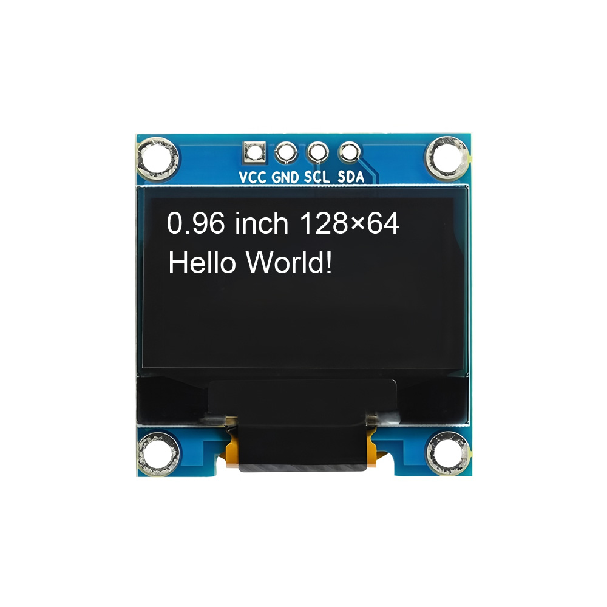
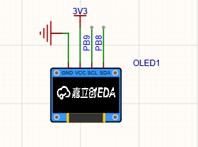
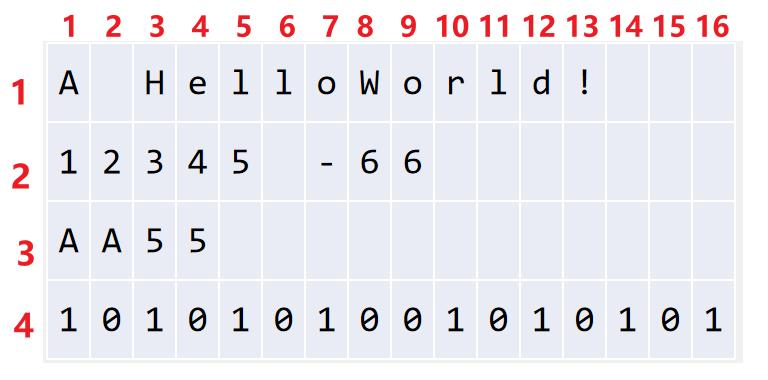
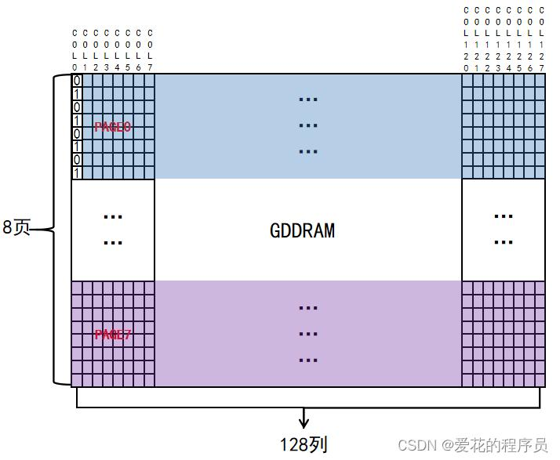
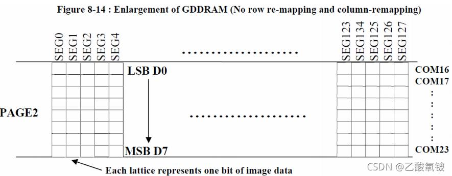
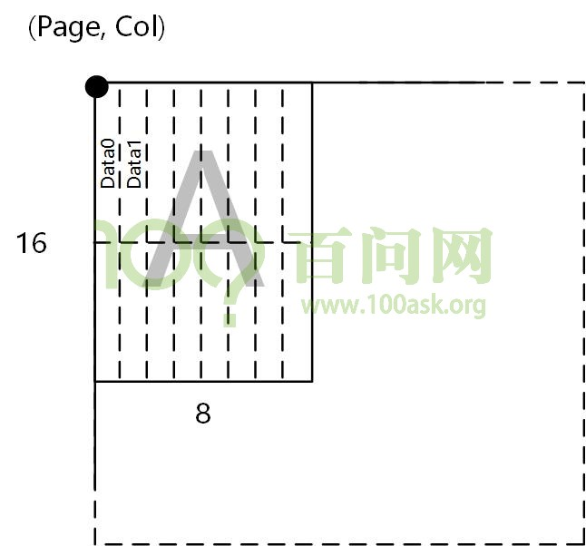
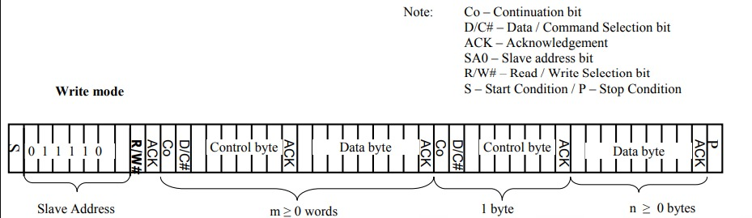

## 提高篇

### 提 8 I2C应用（一）：OLED 显示

上一章（提7）我们把 I2C 的时序——START、地址、ACK、STOP——逐拍讲清楚了。这一章我们把它用起来，点亮一块 0.96 寸的 OLED 屏幕，让它显示文字和数字。

这一章你会看到，驱动 OLED 的代码其实就是把上一章学的“起始—地址—数据—停止”重复发，只不过发的内容是这块屏幕控制器规定好的命令和点阵数据。

---

#### 8.1 本章要完成什么

| 学习任务 | 能看到什么 |
|---|---|
| 认识 OLED 模块、接好四根线 | 模块上电、能烧录程序 |
| 看懂屏幕是怎么“画”出来的 | 明白 128×64、8页、字模是什么意思 |
| 看懂写命令和写数据的区别 | 0x78、0x00、0x40 分别代表什么 |
| 用现成驱动显示字符、数字 | 屏幕上显示 Hello World 和一个跳动的计数器 |

本章的驱动代码沿用你工程里的 `OLED.c` / `OLED.h`，它**自己内置了一套软件 I2C**，不需要额外调用 `MyI2C.c`，直接就能用。

---

#### 8.2 认识这块 OLED 模块

我们用的是最常见的 **0.96 寸 OLED 显示屏，分辨率 128×64，驱动芯片是 SSD1306，通信方式是 I2C**。模块只有四根针：



四根针的作用：

| 针脚 | 作用 | 接到开发板 |
|---|---|---|
| GND | 地 | GND |
| VCC | 电源 | 3V3（模块一般 3.3V～5V 都能工作，这里统一接 3V3） |
| SCL | I2C 时钟线 | **PB9** |
| SDA | I2C 数据线 | **PB8** |

> 注意：不同厂家的模块针脚顺序可能不一样（有的是 GND、VCC、SCL、SDA，有的是 VCC、GND、SCL、SDA），**接线前一定要看模块丝印上的字母，对号入座，不要只记顺序**。

---

#### 8.3 硬件接线

我们的开发板已经把 ST-Link 烧录器集成在板上了，所以**一根 USB 线同时负责供电和烧录**，不用另外接仿真器，也不用单独供电。把 OLED 模块按下面接好即可：



| OLED 模块 | 开发板 | 说明 |
|---|---|---|
| VCC | 3V3 | 供电 |
| GND | GND | 共地 |
| SCL | PB9 | 时钟线 |
| SDA | PB8 | 数据线 |

接好后开发板用一根 USB 线连电脑即可。SDA、SCL 上的上拉电阻在我们板子上已经焊好了（2.2kΩ），不用自己额外加。

---

#### 8.4 屏幕是怎么“画”出来的

在看代码之前，先把下面几个概念弄明白，后面的函数你一看就懂。

##### 8.4.1 128×64 与 4 行 16 列

屏幕横向有 **128 个像素点**，纵向有 **64 个像素点**，一共 128×64＝8192 个小点，每个点可以单独亮或灭。

显示一个英文字符（字母、数字）一般用 **8 列 × 16 行** 共 128 个点。所以整屏可以显示：

- 横向：128 ÷ 8 ＝ **16 列**字符；
- 纵向：64 ÷ 16 ＝ **4 行**字符。

这就是为什么驱动函数里“行号”范围是 1～4、“列号”范围是 1～16。



##### 8.4.2 显存 GDDRAM 和 8 个“页”

SSD1306 内部有一块叫 **GDDRAM** 的显示缓存，你可以把它理解成一块 128×64 的小黑板。为了方便操作，控制器把纵向的 64 行**每 8 行分成一页**，一共分成 **8 页（Page0～Page7）**，每一页有 128 列。



想让屏幕某个区域亮，本质就是往 GDDRAM 对应的页和列里写数据。

##### 8.4.3 一个字节＝一列 8 个点（竖着排）

这是最关键、最容易绕晕的一点：**写进 GDDRAM 的一个字节，不是横着的 8 个点，而是竖着的一列 8 个点**。

一个字节有 8 位（D0～D7），这 8 位对应某一列从上到下的 8 个像素：D0 是最上面一个点，D7 是最下面一个点。哪一位写 1，对应的点就亮；写 0 就灭。



比如往某一列写 `0x01`（二进制 0000 0001），只有最上面那个点亮；写 `0xFF`（1111 1111），这一列 8 个点全亮。

##### 8.4.4 一个英文字符长什么样

一个英文字符是 8 列宽、16 行高。因为一页只有 8 行，所以一个字符要**跨两页**：

- 上半部分（8 列 × 8 行）放在第 N 页，发 8 个字节；
- 下半部分（8 列 × 8 行）放在第 N＋1 页，再发 8 个字节。

每个字符的“长相”用 16 个字节记录下来，这就是**字模**。所有可见 ASCII 字符的字模组成一张字库表（`OLED_F8x16`），存在 `OLED_Font.h` 里。



显示字符时，用字符的 ASCII 码减去空格的 ASCII 码（`Char - ' '`），就能在字库表里查到它对应的 16 个字节。

##### 8.4.5 命令和数据，靠“控制字节”区分

我们通过 I2C 发给屏幕的东西有两种：

- **命令（Command）**：用来设置屏幕，比如开关显示、设置显示位置、设置对比度；
- **数据（Data）**：真正要显示的点阵数据。

问题是，I2C 只会老老实实发字节，屏幕怎么知道这一个字节是命令还是数据？SSD1306 规定：**每发一段内容前，先发一个控制字节**。

- 控制字节发 **0x00**：后面跟着的是**命令**；
- 控制字节发 **0x40**：后面跟着的是**数据**。

一次完整的 I2C 写入顺序是：

```
START → 从机地址(0x78) → 控制字节(0x00命令 / 0x40数据) → 具体内容 → STOP
```

其中 **0x78 就是这块屏幕的写地址**（7位地址 0x3C 左移一位、最低位补 0 得到）。



对应到代码里，就是下面两个函数：

```c
void OLED_WriteCommand(uint8_t Command)
{
    OLED_I2C_Start();
    OLED_I2C_SendByte(0x78);     // 从机地址（写）
    OLED_I2C_SendByte(0x00);     // 控制字节：0x00 表示后面是命令
    OLED_I2C_SendByte(Command);
    OLED_I2C_Stop();
}

void OLED_WriteData(uint8_t Data)
{
    OLED_I2C_Start();
    OLED_I2C_SendByte(0x78);     // 从机地址（写）
    OLED_I2C_SendByte(0x40);     // 控制字节：0x40 表示后面是显示数据
    OLED_I2C_SendByte(Data);
    OLED_I2C_Stop();
}
```

---

#### 8.5 工程要加哪些文件

在标准的 STM32 工程（SPL 库）里，把下面这些文件加进 `Hardware` 分组并加入编译：

| 文件 | 作用 |
|---|---|
| `OLED.c` / `OLED.h` | OLED 驱动（内置软件 I2C 和显示函数） |
| `OLED_Font.h` | 8×16 ASCII 字库（`OLED_F8x16` 数组），你工程里已有 |
| `Delay.c` / `Delay.h` | 提供 `Delay_ms` 等延时（main 里刷新用） |

> `OLED_Font.h` 是字库文件，里面按 ASCII 顺序存了空格到波浪号共 95 个字符的点阵。你现成的工程里已经带了，直接 include 即可；如果新建工程没有这个文件，把原来工程里的 `OLED_Font.h` 拷过来。

---

#### 8.6 驱动代码讲解

下面是完整的 `OLED.c`，和你工程里的一致，引脚已经是 **SCL=PB9、SDA=PB8**。我们分段看。

##### 8.6.1 引脚和软件 I2C

```c
#include "stm32f10x.h"
#include "OLED_Font.h"

/*引脚配置：SCL=PB9，SDA=PB8*/
#define OLED_W_SCL(x)      GPIO_WriteBit(GPIOB, GPIO_Pin_9, (BitAction)(x))
#define OLED_W_SDA(x)      GPIO_WriteBit(GPIOB, GPIO_Pin_8, (BitAction)(x))

/*引脚初始化：开漏输出，空闲时两根线都拉高*/
void OLED_I2C_Init(void)
{
    RCC_APB2PeriphClockCmd(RCC_APB2Periph_GPIOB, ENABLE);

    GPIO_InitTypeDef GPIO_InitStructure;
    GPIO_InitStructure.GPIO_Mode = GPIO_Mode_Out_OD;   // 开漏输出，I2C 要求
    GPIO_InitStructure.GPIO_Speed = GPIO_Speed_50MHz;
    GPIO_InitStructure.GPIO_Pin = GPIO_Pin_8;
    GPIO_Init(GPIOB, &GPIO_InitStructure);
    GPIO_InitStructure.GPIO_Pin = GPIO_Pin_9;
    GPIO_Init(GPIOB, &GPIO_InitStructure);

    OLED_W_SCL(1);
    OLED_W_SDA(1);
}
```

起始和停止条件，完全对应提7 讲的时序（SCL 高电平时 SDA 跳变）：

```c
void OLED_I2C_Start(void)
{
    OLED_W_SDA(1);
    OLED_W_SCL(1);
    OLED_W_SDA(0);   // SCL高时 SDA 由高变低 = START
    OLED_W_SCL(0);
}

void OLED_I2C_Stop(void)
{
    OLED_W_SDA(0);
    OLED_W_SCL(1);
    OLED_W_SDA(1);   // SCL高时 SDA 由低变高 = STOP
}
```

发送一个字节，高位先发，发完 8 位再补一个时钟（本驱动不检查应答，SSD1306 会正常工作）：

```c
void OLED_I2C_SendByte(uint8_t Byte)
{
    uint8_t i;
    for (i = 0; i < 8; i++)
    {
        OLED_W_SDA(Byte & (0x80 >> i));   // 从最高位开始，一位一位送到 SDA
        OLED_W_SCL(1);                     // SCL 拉高，从机在这期间采样
        OLED_W_SCL(0);
    }
    OLED_W_SCL(1);   // 第 9 个时钟，本驱动不处理应答
    OLED_W_SCL(0);
}
```

##### 8.6.2 设置光标位置

SSD1306 用三条命令定位写入位置：

- `0xB0 | 页号`：设置页地址（Y 方向，0～7）；
- `0x00 | 列地址低4位`、`0x10 | 列地址高4位`：设置列地址（X 方向，0～127）。

```c
void OLED_SetCursor(uint8_t Y, uint8_t X)
{
    OLED_WriteCommand(0xB0 | Y);                  // 设置页（Y）
    OLED_WriteCommand(0x10 | ((X & 0xF0) >> 4));  // 设置列高4位
    OLED_WriteCommand(0x00 | (X & 0x0F));         // 设置列低4位
}
```

##### 8.6.3 清屏

清屏就是把 8 页、每页 128 列全部写成 0（所有点都灭）：

```c
void OLED_Clear(void)
{
    uint8_t i, j;
    for (j = 0; j < 8; j++)
    {
        OLED_SetCursor(j, 0);
        for (i = 0; i < 128; i++)
        {
            OLED_WriteData(0x00);
        }
    }
}
```

##### 8.6.4 显示一个字符

对应 8.4.4 节：先在第（行-1）×2 页写上半 8 个字节，再在下一页写下半 8 个字节。

```c
void OLED_ShowChar(uint8_t Line, uint8_t Column, char Char)
{
    uint8_t i;
    OLED_SetCursor((Line - 1) * 2, (Column - 1) * 8);       // 上半部分
    for (i = 0; i < 8; i++)
    {
        OLED_WriteData(OLED_F8x16[Char - ' '][i]);
    }
    OLED_SetCursor((Line - 1) * 2 + 1, (Column - 1) * 8);   // 下半部分
    for (i = 0; i < 8; i++)
    {
        OLED_WriteData(OLED_F8x16[Char - ' '][i + 8]);
    }
}
```

在它的基础上，循环显示每个字符就得到字符串函数：

```c
void OLED_ShowString(uint8_t Line, uint8_t Column, char *String)
{
    uint8_t i;
    for (i = 0; String[i] != '\0'; i++)
    {
        OLED_ShowChar(Line, Column + i, String[i]);
    }
}
```

##### 8.6.5 显示数字

驱动提供了十进制、带符号、十六进制、二进制四种数字显示，原理都是逐位取出数字再显示对应字符。最常用的是无符号十进制 `OLED_ShowNum`：

```c
uint32_t OLED_Pow(uint32_t X, uint32_t Y)   // 求 X 的 Y 次方
{
    uint32_t Result = 1;
    while (Y--) Result *= X;
    return Result;
}

void OLED_ShowNum(uint8_t Line, uint8_t Column, uint32_t Number, uint8_t Length)
{
    uint8_t i;
    for (i = 0; i < Length; i++)
    {
        OLED_ShowChar(Line, Column + i,
            Number / OLED_Pow(10, Length - i - 1) % 10 + '0');
    }
}
```

`OLED.h` 里可以直接调用的函数汇总：

| 函数 | 作用 |
|---|---|
| `OLED_Init()` | 初始化屏幕（上电后调用一次） |
| `OLED_Clear()` | 清屏 |
| `OLED_ShowString(行,列,字符串)` | 显示字符串 |
| `OLED_ShowChar(行,列,字符)` | 显示单个字符 |
| `OLED_ShowNum(行,列,无符号数,位数)` | 显示十进制无符号数 |
| `OLED_ShowSignedNum(行,列,带符号数,位数)` | 显示带正负号的十进制数 |
| `OLED_ShowHexNum(行,列,数,位数)` | 显示十六进制数 |
| `OLED_ShowBinNum(行,列,数,位数)` | 显示二进制数 |

##### 8.6.6 初始化命令

`OLED_Init()` 在上电延时后，先初始化 I2C 引脚，再向 SSD1306 发一连串配置命令（关显示、设时钟、设对比度、开充电泵、开显示等），最后清屏。**这些命令是 SSD1306 手册规定的固定套路，初学阶段照抄即可，不需要逐条记忆**。完整命令见 `OLED.c` 末尾的 `OLED_Init()`，其中最关键的两条是：

- `0x8D` 后面跟 `0x14`：开启内部充电泵（不加电屏幕不亮）；
- `0xAF`：开启显示。

---

#### 8.7 动手实验：Hello World 与计数器

新建 `main.c`，内容如下：

```c
#include "stm32f10x.h"
#include "Delay.h"
#include "OLED.h"

int main(void)
{
    uint32_t cnt = 0;

    OLED_Init();                          // 初始化 OLED

    OLED_ShowString(1, 1, "Hello World!"); // 第1行显示字符串
    OLED_ShowString(2, 1, "STM32 I2C");
    OLED_ShowString(3, 1, "Count:");

    while (1)
    {
        OLED_ShowNum(3, 7, cnt, 5);       // 第3行第7列显示计数，占5位
        cnt++;
        Delay_ms(500);                    // 每0.5秒加1
    }
}
```

编译、烧录后（一根 USB 线，板载 ST-Link 直接烧），屏幕上应显示：

```
Hello World!
STM32 I2C
Count:00000
```

其中最后一行的数字每 0.5 秒加 1。

---

#### 8.8 常见问题

| 现象 | 先排查什么 |
|---|---|
| 整屏不亮 | VCC/GND 是否接反；`OLED_Init` 里充电泵 `0x8D,0x14` 和开显示 `0xAF` 是否发了 |
| 花屏、显示错乱 | SCL、SDA 是否接反（应是 SCL=PB9、SDA=PB8）；屏幕方向是否和初始化里的 `0xA1`、`0xC8` 一致 |
| 屏幕全亮但没字 | 上拉电阻是否正常；I2C 引脚是否被别的模块占用 |
| 个别字符显示不对 | `OLED_Font.h` 字库是否正确加入；`OLED_F8x16` 数组是否完整 |
| 数字位数显示奇怪 | `OLED_ShowNum` 的“位数”要够大，位数不足会截断 |
| 移植到别的开发板不显示 | 先核对引脚宏 `OLED_W_SCL` / `OLED_W_SDA` 是否和实际接线一致 |

---

#### 8.9 小结

这一章我们把 I2C 时序用到了实处：

- 屏幕是 128×64，内部显存分 8 页，**一个字节控制一列竖着的 8 个点**；
- 一个英文字符是 8×16，跨两页、共 16 个字模字节；
- 用 I2C 写屏幕时，先写从机地址 **0x78**，再用控制字节 **0x00（命令）或 0x40（数据）** 区分内容；
- 写命令负责设置屏幕，写数据负责点亮像素；
- 我们只需要调用 `OLED_ShowString`、`OLED_ShowNum` 等高层函数，底层时序由 `OLED.c` 内置的软件 I2C 完成。

下一章，我们继续用同一条 I2C 总线去读两个传感器：磁力计 QMC5883L 和六轴姿态传感器 QMI8658。这一次 STM32 不只是“写”，还要从传感器“读”回数据。
