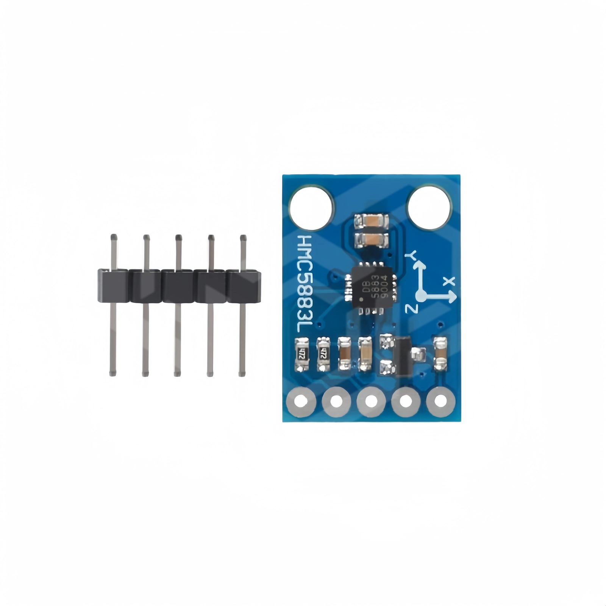
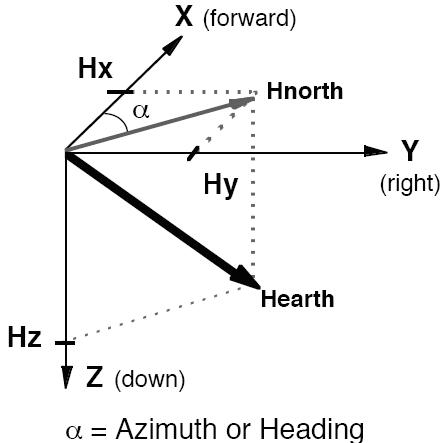
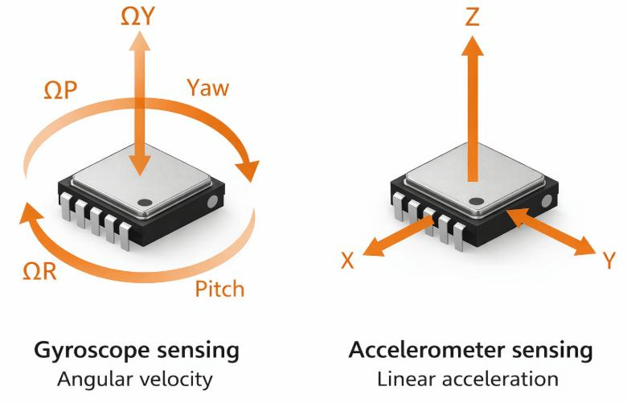
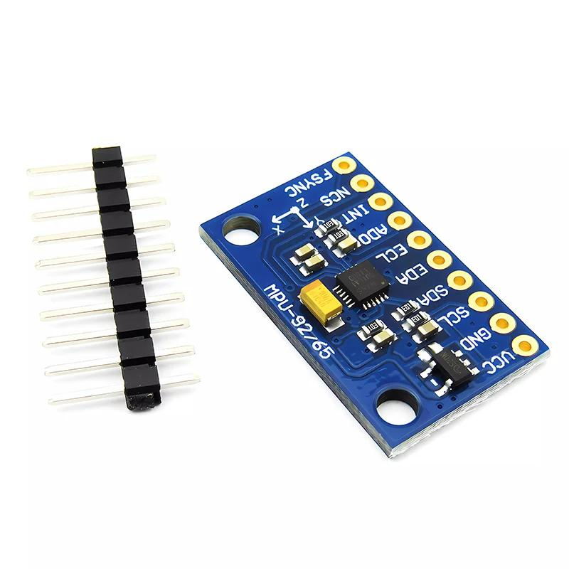
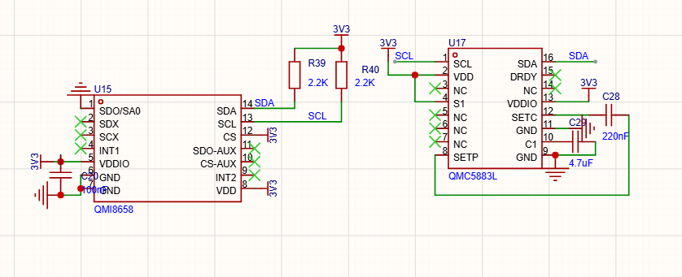
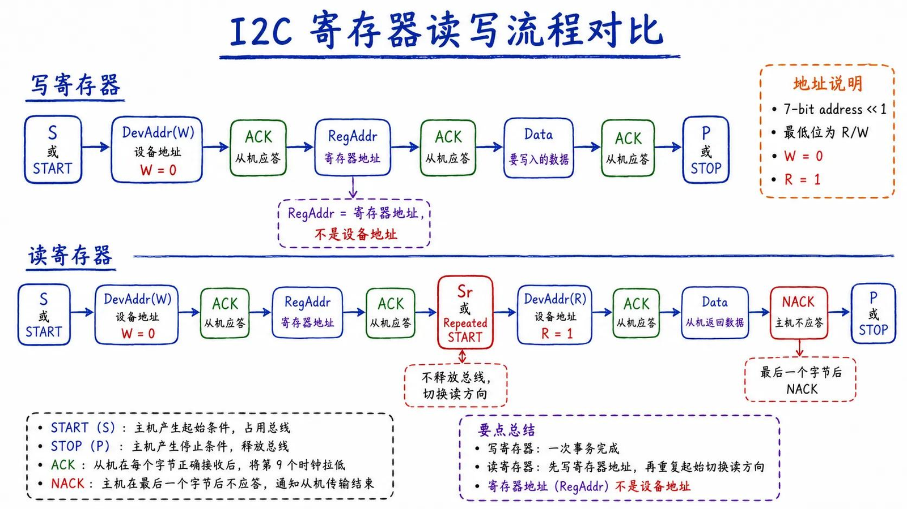

## 提高篇

### 提 9 I2C应用（二）：QMC5883 电子罗盘与 QMI8658 六轴传感器

上一章（提8）我们用 I2C 往 OLED 屏幕里“写”命令和数据。这一章反过来——从两个传感器里“读”数据：

- **QMC5883L**：三轴磁力计，可以当地电子罗盘，测出板子朝向；
- **QMI8658**：六轴姿态传感器，内部有三轴加速度计和三轴陀螺仪。

它们和 OLED **共用同一条 I2C 总线（SCL=PB9、SDA=PB8）**，只是设备地址不同。读完这一章，你会真正理解 I2C 的“读寄存器”是怎么一回事。

---

#### 9.1 本章要完成什么

| 学习任务 | 能看到什么 |
|---|---|
| 看懂两个传感器分别测什么 | 明白磁力计、加速度计、陀螺仪的区别 |
| 掌握 I2C“读寄存器”的完整流程 | 学会“先写寄存器指针、再重复起始、再读” |
| 让三个设备共用一条总线 | 理解设备地址为什么不能冲突 |
| 串口读出数据 | VOFA+ 里看到航向角和六轴原始数据实时变化 |

---

#### 9.2 两个传感器是干什么的

##### 9.2.1 三轴磁力计 QMC5883L——电子罗盘

**磁力计测量的是周围磁场的方向和大小**。地球本身就是一个大磁体，在水平放置时，地磁场在 X、Y 两个水平方向上的分量，其合矢量始终指向磁北。磁力计测出 X、Y 两个分量后，用反正切函数 `atan2(Y, X)` 就能算出当前方向与磁北的夹角，这就是**航向角（方位角）**，和指南针是一个道理。



它输出三个值：X、Y、Z 三个方向上的磁场分量，都是 **16 位有符号整数**（有正负）。求航向角时只需要水平的 X、Y 两轴。



##### 9.2.2 六轴 QMI8658——加速度计加陀螺仪

QMI8658 内部集成了两种传感器：

- **三轴加速度计（Accelerometer）**：测量三个方向的加速度，单位是重力加速度 g。静止平放时，垂直方向会测到约 1g（重力），所以它能判断板子的**倾斜方向和姿态**；
- **三轴陀螺仪（Gyroscope）**：测量板子绕三个轴转动的**角速度**（转得有多快），单位是 °/s。

一个看“现在朝哪个方向”，一个看“正在怎么转”，两者配合就能得到板子的运动姿态。



我们板子上的 QMI8658 是贴片芯片（原理图里的 U15）。它和常见的六轴模块（下图的 MPU6050/MPU6500）原理、用法几乎一样，只是芯片和地址不同。



##### 9.2.3 三个设备怎样共用一条总线

我们板子上的 OLED、QMC5883、QMI8658 三个芯片，**SDA、SCL 全部并联在一起**，共用 PB8、PB9 这两根线；SDA、SCL 各通过一个 2.2kΩ 电阻上拉到 3V3。



三个设备靠**不同的设备地址**区分，互不冲突：

| 设备 | 7位地址 | 代码里写地址的写法 | 写 / 读地址字节 |
|---|---|---|---|
| OLED（SSD1306） | 0x3C | 直接写 0x78 | 0x78 / 0x79 |
| QMC5883L | 0x0D | 直接写 0x1A | 0x1A / 0x1B |
| QMI8658 | 0x6B | 传 7 位地址，代码里 `(dAddr<<1)` | 0xD6 / 0xD7 |

> 这里有个新手最容易绕晕的点：**同一个地址，代码里有两种写法**。
> - QMC 的代码直接用“已经左移一位”的 8 位地址（0x1A、0x1B）；
> - QMI 的代码传的是 7 位地址（0x6B），在底层用 `(dAddr<<1)|0` 拼出写、`(dAddr<<1)|1` 拼出读。
>
> 两种写法算出来的字节是一样的，只是“左移”这一步放在了不同的地方。读代码时注意看它用的是哪一种。

再补充两个和 QMI8658 地址有关的硬件细节（原理图上都已经接好）：

- **SDO/SA0 脚决定地址**：这根脚接 3V3 时，QMI8658 的地址是 0x6B；接 GND 时是 0x6A。本板这根脚接的是 3V3，所以代码里用 0x6B；
- **CS 脚决定通信方式**：CS 接高（3V3）时芯片工作在 **I2C 模式**，接低时是 SPI 模式。本板 CS 接 3V3，所以走 I2C。

---

#### 9.3 读传感器的关键：先写寄存器指针，再读

向传感器“写”数据，和上一章写 OLED 一样：

```
START → 地址(W) → 寄存器地址 → 数据 → STOP
```

但**“读”某个寄存器要绕一下**：从机（传感器）那么多寄存器，你得先告诉它“我要读哪个寄存器”，然后再把方向切过来读。标准流程是：

1. START；
2. 发设备地址＋**写位 W**（这一步只是为了告诉它寄存器地址）；
3. 发要读的**寄存器地址**；
4. **不发 STOP，再发一次 START（叫重复起始 Repeated START）**；
5. 发设备地址＋**读位 R**；
6. 从机开始把数据发出来，主机每收一个字节回 ACK，**最后一个字节回 NACK**（告诉它“读到这里就够了”）；
7. STOP。



两个关键细节：

- **重复起始**：第 3 步和第 4 步之间没有 STOP，而是直接再发一个 START，这叫 Repeated START。这样从机一直保持“你要读的寄存器”这个状态，不会被重置；
- **ACK 还是 NACK**：中间还要继续读，就回 ACK（拉低）；读到最后一个字节，回 NACK（释放 SDA），再 STOP，从机就停止发送。这就是为什么连续读多个字节时，只有最后一个要回 NACK。

---

#### 9.4 共用的软件 I2C：MyI2C

两个传感器都通过 `MyI2C.c` 这一套软件 I2C 收发。这里**已经把引脚按原理图改成了 SCL=PB9、SDA=PB8**，和 OLED.c 是同一对引脚，所以三者可以共线。

`MyI2C.h`：

```c
#ifndef __MYI2C_H
#define __MYI2C_H
#include "stm32f10x.h"

/* 本工程共用一条软件 I2C：SCL=PB9，SDA=PB8（与原理图一致） */
void MyI2C_Init(void);
void MyI2C_Start(void);
void MyI2C_Stop(void);
void MyI2C_SendByte(uint8_t Byte);
void MyI2C_SendAck(uint8_t Ack);
uint8_t MyI2C_ReceiveByte(void);
uint8_t MyI2C_ReceiveAck(void);

#endif
```

`MyI2C.c` 的关键部分：

```c
#include "stm32f10x.h"
#include "Delay.h"

/* 引脚：SCL=PB9，SDA=PB8 */
void MyI2C_W_SCL(uint8_t BitValue)
{
    GPIO_WriteBit(GPIOB, GPIO_Pin_9, (BitAction)BitValue);
    Delay_us(10);
}
void MyI2C_W_SDA(uint8_t BitValue)
{
    GPIO_WriteBit(GPIOB, GPIO_Pin_8, (BitAction)BitValue);
    Delay_us(10);
}
uint8_t MyI2C_R_SDA(void)
{
    uint8_t BitValue;
    BitValue = GPIO_ReadInputDataBit(GPIOB, GPIO_Pin_8);
    Delay_us(10);
    return BitValue;
}
void MyI2C_Init(void)
{
    RCC_APB2PeriphClockCmd(RCC_APB2Periph_GPIOB, ENABLE);
    GPIO_InitTypeDef GPIO_InitStructure;
    GPIO_InitStructure.GPIO_Mode = GPIO_Mode_Out_OD;          // 开漏输出
    GPIO_InitStructure.GPIO_Pin = GPIO_Pin_9 | GPIO_Pin_8;
    GPIO_InitStructure.GPIO_Speed = GPIO_Speed_50MHz;
    GPIO_Init(GPIOB, &GPIO_InitStructure);
    GPIO_SetBits(GPIOB, GPIO_Pin_9 | GPIO_Pin_8);            // 空闲释放为高
}
```

起始、停止、发字节、发应答、收字节、收应答，和提7、提8 完全对应：

```c
void MyI2C_Start(void)
{
    MyI2C_W_SDA(1);
    MyI2C_W_SCL(1);
    MyI2C_W_SDA(0);
    MyI2C_W_SCL(0);
}
void MyI2C_SendByte(uint8_t Byte)
{
    uint8_t i;
    for (i = 0; i < 8; i++)
    {
        MyI2C_W_SDA(Byte & (0x80 >> i));
        MyI2C_W_SCL(1);
        MyI2C_W_SCL(0);
    }
}
void MyI2C_SendAck(uint8_t Ack)
{
    MyI2C_W_SDA(Ack);      // 0=ACK，1=NACK
    MyI2C_W_SCL(1);
    MyI2C_W_SCL(0);
}
uint8_t MyI2C_ReceiveByte(void)
{
    uint8_t Byte = 0x00, i;
    MyI2C_W_SDA(1);                       // 释放 SDA，交给从机
    for (i = 0; i < 8; i++)
    {
        MyI2C_W_SCL(1);
        if (MyI2C_R_SDA() == 1) { Byte |= (0x80 >> i); }
        MyI2C_W_SCL(0);
    }
    return Byte;
}
uint8_t MyI2C_ReceiveAck(void)
{
    uint8_t Ack;
    MyI2C_W_SDA(1);
    MyI2C_W_SCL(1);
    Ack = MyI2C_R_SDA();
    MyI2C_W_SCL(0);
    return Ack;             // 0=ACK，1=NACK
}
void MyI2C_Stop(void)
{
    MyI2C_W_SDA(0);
    MyI2C_W_SCL(1);
    MyI2C_W_SDA(1);
}
```

> 和 OLED 共用总线时：`OLED.c` 内部也有一套 I2C，引脚相同（都是 PB8/PB9），两者都把引脚配成开漏、且函数名不同，可以放在一个工程里，重复初始化不会冲突。

---

#### 9.5 磁力计 QMC5883L

##### 9.5.1 用到的寄存器

QMC5883 的数据和控制寄存器地址都很短：

| 寄存器 | 地址 | 含义 |
|---|---|---|
| X_LSB / X_MSB | 0x00 / 0x01 | X 轴磁场低字节 / 高字节 |
| Y_LSB / Y_MSB | 0x02 / 0x03 | Y 轴 |
| Z_LSB / Z_MSB | 0x04 / 0x05 | Z 轴 |
| STATUS | 0x06 | 状态 |
| CONFIG1 | 0x09 | 过采样、量程、输出速率、工作模式 |
| CONFIG2 | 0x0A | 中断等 |
| CONFIG3 | 0x0B | 内部 Set/Reset 控制 |
| CHIP_ID | 0x0D | 芯片 ID（一般为 0xFF） |

初始化只需两句话：

- 往 `CONFIG3(0x0B)` 写 `0x01`：开启内部 Set/Reset 电路；
- 往 `CONFIG1(0x09)` 写 `0x09`：含义是“过采样 512、量程 ±2G、输出速率 100Hz、连续测量模式”。

##### 9.5.2 单字节读写

写寄存器就是标准“地址＋寄存器＋数据”：

```c
u8 QMC5883_Write(u8 Slave_Address, u8 Register_Address, u8 Register_Data)
{
    MyI2C_Start();
    MyI2C_SendByte(Slave_Address);
    MyI2C_ReceiveAck();
    MyI2C_SendByte(Register_Address);
    MyI2C_ReceiveAck();
    MyI2C_SendByte(Register_Data);
    MyI2C_ReceiveAck();
    MyI2C_Stop();
    return 0;
}
```

读单个寄存器，就是 9.3 节的“先写寄存器指针、再重复起始、再读”：

```c
u8 QMC5883_Read(u8 Slave_Address, u8 Register_Address)
{
    u8 Data = 0;
    MyI2C_Start();
    MyI2C_SendByte(Slave_Address);          // 0x1A，写：设置寄存器指针
    MyI2C_ReceiveAck();
    MyI2C_SendByte(Register_Address);
    MyI2C_ReceiveAck();
    MyI2C_Start();                          // 重复起始
    MyI2C_SendByte(Slave_Address + 1);      // 0x1B，读
    MyI2C_ReceiveAck();
    Data = MyI2C_ReceiveByte();
    MyI2C_SendAck(1);                       // 最后一个字节 NACK
    MyI2C_Stop();
    return Data;
}
```

##### 9.5.3 连续读六个字节（推荐）

X、Y、Z 共 6 个字节，地址是连续的（0x00～0x05）。QMC5883 支持寄存器地址自动递增，所以**用一次事务连续读 6 个字节**，比每个字节都重新发起一次完整传输更稳、更快：

```c
void QMC5883_ReadXYZ(short *X, short *Y, short *Z)
{
    u8 buf[6], i;

    MyI2C_Start();
    MyI2C_SendByte(QMC5883L_ADDRESS);
    MyI2C_ReceiveAck();
    MyI2C_SendByte(QMC5883L_DATA_X_LSB);    // 寄存器指针指向 0x00
    MyI2C_ReceiveAck();

    MyI2C_Start();                          // 重复起始，切换为读
    MyI2C_SendByte(QMC5883L_ADDRESS + 1);
    MyI2C_ReceiveAck();

    for (i = 0; i < 6; i++)
    {
        buf[i] = MyI2C_ReceiveByte();
        MyI2C_SendAck(i < 5 ? 0 : 1);       // 前5字节 ACK，最后一个 NACK
    }
    MyI2C_Stop();

    /* 低字节在前、高字节在后；磁场有正负，用 short 拼接 */
    *X = (short)((buf[1] << 8) | buf[0]);
    *Y = (short)((buf[3] << 8) | buf[2]);
    *Z = (short)((buf[5] << 8) | buf[4]);
}
```

> 注意两点：① 数据**低字节在前、高字节在后**；② 磁场分量有正负，所以用**有符号 `short`** 拼接，不能用无符号类型，否则反方向时数值会变成很大的正数，航向角就错了。

##### 9.5.4 初始化和航向角

```c
short QMC_X, QMC_Y, QMC_Z;
float QMC_Angle;

void QMC5883_Init(void)
{
    MyI2C_Init();
    QMC5883_Write(QMC5883L_ADDRESS, QMC5883L_CONFIG_3, 0x01);
    QMC5883_Write(QMC5883L_ADDRESS, QMC5883L_CONFIG_1, 0x09);
}

void QMC5883_Get_Val(void)
{
    QMC5883_ReadXYZ(&QMC_X, &QMC_Y, &QMC_Z);

    /* 保持水平时，用 X、Y 求航向角；atan2 结果是弧度，乘 57.3 转成角度 */
    QMC_Angle = atan2((double)QMC_Y, (double)QMC_X) * 57.3;
    if (QMC_Angle < 0)
    {
        QMC_Angle += 360;                   // 把 -180~180 换算成 0~360
    }
}
```

`atan2(Y, X)` 算出来的角度范围是 -180°～180°，加一步判断把它换算成罗盘习惯的 0°～360°（0° 大致指向磁北，角度顺时针增大）。

---

#### 9.6 六轴 QMI8658

##### 9.6.1 先用 WHO_AM_I 确认芯片在不在

QMI8658 的 0x00 寄存器是 **WHO_AM_I（身份码）**，固定返回 `0x05`。上电初始化时先读它，读出 0x05 说明芯片接线正常、I2C 通信成功。

> 原代码这里有个隐患：读一次身份码后，用 `while(身份码 != 0x05) 死等`，循环里又不重新读取。万一接线不通，第一次读错，程序就会永远卡死在这里。我们改成**最多重试 20 次，找不到就返回错误并退出**，不再死循环。

##### 9.6.2 初始化流程

QMI8658 用 7 位地址 0x6B，底层用 `(dAddr<<1)|0/1` 拼读写字节。初始化顺序是：

1. 往 `CTRL9(0x0A)` 写 `0xA2`：软复位，等几十毫秒；
2. 读 `WHO_AM_I(0x00)`，确认等于 0x05；
3. 写 CTRL1、CTRL2、CTRL3：配置加速度计、陀螺仪的量程和输出速率；
4. 写 CTRL5、CTRL6：低通、按需模式等（这里写 0）；
5. 往 `CTRL7(0x08)` 写 `0x03`：同时使能加速度计和陀螺仪。

```c
u8 QMI8658_Init(void)
{
    u8 uChipID = 0;
    u8 retry = 0;

    QMI8658_WriteReg(AMI8658C_I2C_Add, QMI8658C_RegAdd_CTRL9, 0xA2);
    Delay_ms(20);

    do
    {
        uChipID = QMI8658_ReadReg(AMI8658C_I2C_Add, QMI8658C_RegAdd_WHO_AM_I);
        retry++;
        Delay_ms(5);
    } while (uChipID != 0x05 && retry < 20);

    if (uChipID != 0x05)
    {
        return 1;                           // 找不到芯片，返回 1（不卡死）
    }

    QMI8658_WriteReg(AMI8658C_I2C_Add, QMI8658C_RegAdd_CTRL1, 0x40);
    QMI8658_WriteReg(AMI8658C_I2C_Add, QMI8658C_RegAdd_CTRL2, 0x33);
    QMI8658_WriteReg(AMI8658C_I2C_Add, QMI8658C_RegAdd_CTRL3, 0x73);
    QMI8658_WriteReg(AMI8658C_I2C_Add, QMI8658C_RegAdd_CTRL5, 0x00);
    QMI8658_WriteReg(AMI8658C_I2C_Add, QMI8658C_RegAdd_CTRL6, 0x00);
    QMI8658_WriteReg(AMI8658C_I2C_Add, QMI8658C_RegAdd_CTRL7, 0x03);

    return 0;
}
```

##### 9.6.3 读一个寄存器和连续读六轴

单字节读和 QMC 一样，注意读完要给 NACK：

```c
u8 QMI8658_ReadReg(u8 dAddr, u8 Reg)
{
    u8 Value = 0;
    MyI2C_Start();
    MyI2C_SendByte((dAddr << 1) | 0);
    if (MyI2C_ReceiveAck()) { MyI2C_Stop(); return 0; }
    MyI2C_SendByte(Reg);
    if (MyI2C_ReceiveAck()) { MyI2C_Stop(); return 0; }
    MyI2C_Start();
    MyI2C_SendByte((dAddr << 1) | 1);
    if (MyI2C_ReceiveAck()) { MyI2C_Stop(); return 0; }
    Value = MyI2C_ReceiveByte();
    MyI2C_SendAck(1);                       // 最后一个字节 NACK
    MyI2C_Stop();
    return Value;
}
```

六轴数据寄存器是连续的：从 `AX_L(0x35)` 一直到 `GZ_H(0x40)`，共 12 个字节，顺序是 AX、AY、AZ、GX、GY、GZ，每轴低字节在前。一次连续读 12 个字节即可：

```c
void QMI8658_ReadAccGyro(QMI8658C_Data *d)
{
    u8 buf[12], i;

    MyI2C_Start();
    MyI2C_SendByte((AMI8658C_I2C_Add << 1) | 0);
    MyI2C_ReceiveAck();
    MyI2C_SendByte(QMI8658C_RegAdd_AX_L);  // 寄存器指针指向 0x35
    MyI2C_ReceiveAck();

    MyI2C_Start();
    MyI2C_SendByte((AMI8658C_I2C_Add << 1) | 1);
    MyI2C_ReceiveAck();

    for (i = 0; i < 12; i++)
    {
        buf[i] = MyI2C_ReceiveByte();
        MyI2C_SendAck(i < 11 ? 0 : 1);     // 前11字节 ACK，最后 NACK
    }
    MyI2C_Stop();

    d->AX = (short)((buf[1]  << 8) | buf[0]);
    d->AY = (short)((buf[3]  << 8) | buf[2]);
    d->AZ = (short)((buf[5]  << 8) | buf[4]);
    d->GX = (short)((buf[7]  << 8) | buf[6]);
    d->GY = (short)((buf[9]  << 8) | buf[8]);
    d->GZ = (short)((buf[11] << 8) | buf[10]);
}
```

数据用 `QMI8658C_Data` 结构体接收（头文件里已定义，含 AX/AZ/.../GZ 六个 `short`）。

> 入门阶段先看**原始值的变化**就够了：静止平放时 AZ 接近一个固定值（对应 1g 重力），抬起/倾斜或转动板子时相应轴的数值会明显变化。
> 想换算成物理单位，通用公式是：
> - 加速度（g）＝ 原始值 × 量程 ÷ 32768；
> - 角速度（°/s）＝ 原始值 × 量程 ÷ 32768。
>
> 具体量程取决于你在 CTRL2、CTRL3 里写的配置值，需要时对照 QMI8658 数据手册确认。

---

#### 9.7 动手实验：串口打印数据

把 `MyI2C`、`QMC5883`、`QMI8658C` 三个模块加进工程（`Serial`、`Delay` 用前面章节现成的），主程序如下：

```c
#include "stm32f10x.h"
#include "Delay.h"
#include "Serial.h"
#include "MyI2C.h"
#include "QMC5883.h"
#include "QMI8658C.h"
#include <stdio.h>

QMI8658C_Data imu;

int main(void)
{
    Serial_Init();                 // 串口 9600 8N1
    MyI2C_Init();                  // 软件 I2C：SCL=PB9，SDA=PB8

    QMC5883_Init();                // 磁力计

    if (QMI8658_Init() != 0)
    {
        Serial_Printf("QMI8658 not found! Check wiring.\r\n");
    }

    Delay_ms(100);
    while (1)
    {
        QMC5883_Get_Val();                  // 读 X/Y/Z，算航向角
        QMI8658_ReadAccGyro(&imu);          // 读六轴

        Serial_Printf("Angle=%d  AX=%d AY=%d AZ=%d  GX=%d GY=%d GZ=%d\r\n",
                      (int)QMC_Angle,
                      imu.AX, imu.AY, imu.AZ,
                      imu.GX, imu.GY, imu.GZ);

        Delay_ms(100);
    }
}
```

烧录后打开 **VOFA+**（或任意串口助手，波特率 9600），可以看到：

- 板子水平静止时，慢慢转动板子，`Angle` 会在 0～360 之间变化；
- 倾斜板子时，`AX/AY/AZ` 中相应方向的数值变化；
- 快速转动板子时，`GX/GY/GZ` 会瞬间出现较大的值，停住后又回到接近 0。

---

#### 9.8 常见问题

| 现象 | 先排查什么 |
|---|---|
| 串口一直打印 `QMI8658 not found` | SCL/SDA 是否接反（SCL=PB9、SDA=PB8）；芯片是否和 OLED 共用同一对线；上拉是否正常 |
| 角度乱跳、转一圈不是 0~360 | 板子尽量保持水平；附近有磁铁、音箱、电机等强磁场会干扰；X/Y 要用有符号 `short` |
| QMI 数值全是 0 | CTRL7 是否写了 0x03 使能两个传感器；是否在读之前完成了初始化 |
| 角度反方向或偏差固定 | 与板子 X/Y 轴方向、安装方向有关，可对调 X/Y 或加固定偏移，属于正常现象 |
| 单字节能读、连续读乱码 | 检查最后一个字节是否给了 NACK，中间字节是否给 ACK |
| OLED 和传感器互相影响 | 确认两者 SCL/SDA 完全一致、地址不同；初始化时把引脚都配成开漏；同一时刻只让一个主机收发 |
| 数据偶尔出错 | 检查共地、上拉电阻、接线是否过长；软件 I2C 延时 `Delay_us(10)` 可适当调大 |

---

#### 9.9 小结

这一章我们把 I2C 的“读”彻底走通了：

- **读寄存器**要先写寄存器指针，再用**重复起始**切成读方向，连续读时中间 ACK、最后 NACK；
- 三个设备**共用 SCL=PB9、SDA=PB8 一条总线**，靠不同地址区分（OLED 0x3C、QMC 0x0D、QMI 0x6B）；
- QMC5883 读出水平 X/Y 磁场，用 `atan2(Y,X)` 得到 0～360° 航向角；
- QMI8658 先用 WHO_AM_I 确认身份，再连续读 12 字节拿到加速度和陀螺仪六轴数据；
- 初始化里的身份码检查**一定要有重试出口**，不能在接线不通时永久卡死。

至此，I2C 的时序、写设备（OLED）、读设备（传感器）我们都跑通了。下一章可以继续学习 I2C 之外的其他通信方式，或者把传感器数据显示到 OLED 上，做成一个能看的电子罗盘。
