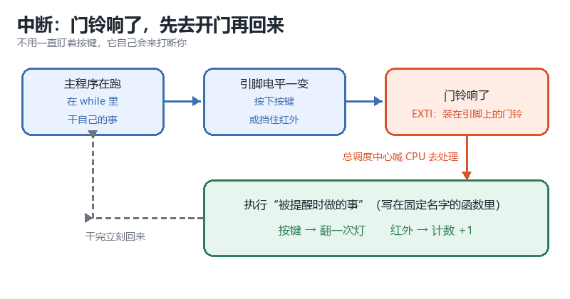
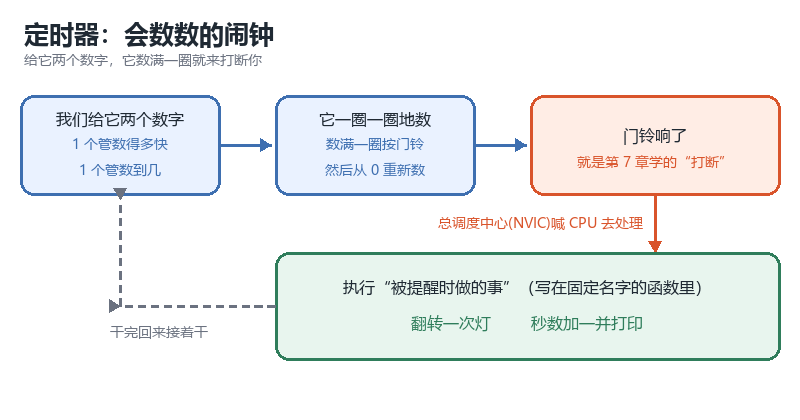
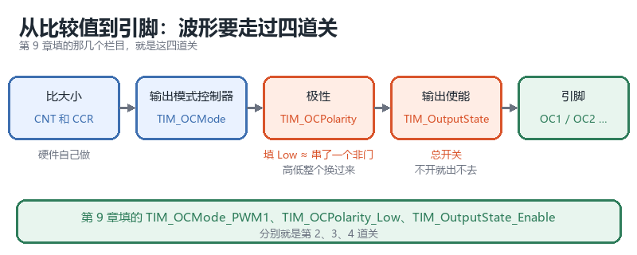
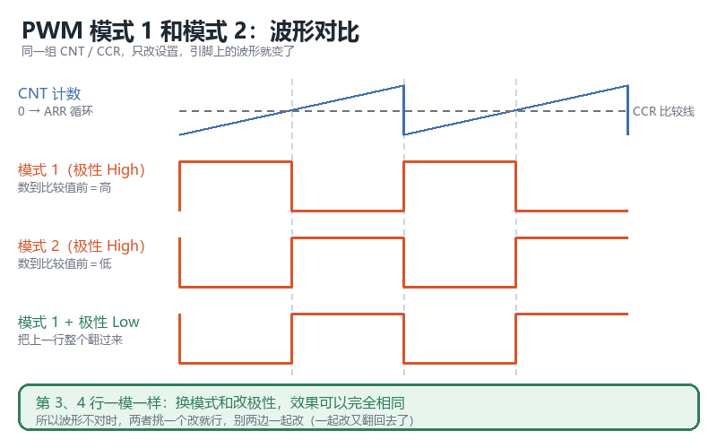

# STM32 入门培训教材

## 本分册目录

| 单元 | 依赖 |
|---|---|
| 第 7 章 中断是什么 + EXTI 外部中断 | 第 4 章（GPIO 输出）、第 5 章（按键上拉输入）、第 6 章（串口打印） | 
| 第 8 章 定时器：定时中断 | 第 7 章 |
| 第 9 章 PWM | 第 8 章 |
| 提高篇 提 1 中断与 NVIC 优先级详解 | 第 7 章 |
| 提高篇 提 2 定时器内部结构、输入捕获 / PWMI、编码器 | 第 8 章 |
| 提高篇 提 3 PWM 输出比较模式详解 | 第 9 章 |

---

## 基础篇

### 第 7 章 中断是什么 + EXTI 外部中断

#### 7.1 本章目标

学完这一章，你将：

- 实现按一下 PA11，LED **立刻**翻转一次（不用在循环里一直盯着按键看）
- 用红外对射做一个"过门计数"：手扫过一次，串口助手上的数字加一
- 知道"被提醒时要做的事"写在哪里，以及为什么那个函数名一个字都不能写错

#### 7.2 需要准备

| 项 | 内容 |
|---|---|
| 硬件 | 开发板（STM32F103**CBT6**，128KB Flash / 20KB RAM）、ST-Link（按键 PA11、红外对射 PA0、LED PA3 全是板载，**一根线都不用接**） |
| 前置章节 | 第 4 章（GPIO 输出）、第 5 章（按键上拉输入）、第 6 章（串口打印） |
| 软件 | Keil5（MDK5）、串口助手 |
| 配套工程 | `Project.uvprojx`：目标器件 **STM32F103CB**；宏定义 `USE_STDPERIPH_DRIVER`；包含路径 `.\Start;.\User;.\Library;.\System;.\Hardware`；分组 Start / Library / System / Hardware / User；已勾选 **Use MicroLIB**，C 语言选项为 **C99** |
| 本章改动 | 只改 `User/main.c`（把整个文件换成 7.6 的代码），工程其余文件不动 |
| 工程里已有什么 | `Hardware/CountSensor.c/.h`：PA0 红外计次模块（EXTI0 下降沿 + 消抖 + `CountSensor_Get()`）；`Hardware/Key.c/.h`：3 个按键轮询（PB5 / PA11 / PA12，`Key_getnum()` 返回 1 / 2 / 3）；`System/Delay.c`：`Delay_ms()` |
| 还必须补什么 | 工程里**没有串口模块**：把第 6 章的 `Serial.c/.h` 复制到 `Hardware`，并在 Keil 的 Hardware 分组里加入，否则 `#include "Serial.h"` 编译不过 |

#### 7.3 硬件连接

本章全部使用板载资源，**不需要接任何线**。

| 外设 | 引脚 | 工作模式 |
|---|---|---|
| 按键 | PA11 | 上拉输入（按下变低电平；在工程 `Key.c` 里是 3 个按键中的 2 号键） |
| 红外对射 | PA0 | **下拉输入 `GPIO_Mode_IPD`**；空闲高电平、遮挡时变低，下降沿触发 |
| LED | PA3 | 推挽输出（低电平点亮） |

#### 7.4 原理

##### 7.4.1 为什么"一直盯着看"会漏掉

第 5 章的按键程序，是在 `while(1)` 里一遍一遍地"看一眼"按键。这种做法叫**轮询**，它有一个毛病：**你得一直盯着**。只要稍微一分神，按键按下那一瞬间就漏掉了。

换个思路。想象你在房间里打游戏：

1. 你正在打游戏（主程序在 `while(1)` 里跑）
2. 门铃响了（引脚电平一变，**门铃响**）
3. 你暂停游戏去开门（CPU 跳去执行一段专门处理这件事的代码）
4. 开完门，回来接着打游戏（CPU 回到刚才停下的位置继续跑）

你不用一直盯着门——门铃响了，它自然会来打断你。这就是**中断**。



"按门铃的人"可以是按键、红外对射，也可以是第 8 章那个"到点就响"的定时器。本章将以按键和红外进行讲解。

##### 7.4.2 门铃装在哪、谁来喊人

本章会出现两个新名词，关于他们各记一句话就可以了：

| 名字 | 简要解释 |
|---|---|
| EXTI（外部中断） | 装在引脚上的"门铃按钮"：引脚电平一跳变，"门铃"就响 |
| 中断的总调度中心(NVIC) | 所有门铃都接到它这里，由它喊 CPU 去执行"被提醒要去做的事" |

本章要做的事只有四件：把 PA11 接到门铃上 → 告诉门铃"按下时才响" → 把总调度中心的开关打开（一段固定代码）→ 写好"被提醒要去做的事"。
这四件事做完，按键就能打断主程序了。

> 门铃响了之后 CPU 具体做了什么、几个门铃同时响该谁先来？详见提高篇 提 1：中断与 NVIC 优先级详解。

#### 7.5 上手步骤

##### 7.5.1 第一步：按键一按，灯就翻（PA11）

**目标**：按一下 PA11，PA3 上的 LED 翻转一次。

配置五步，一步一个动作。

**第 1 步：打开开关（这次多一个 AFIO）**
`AFIO` 是"把引脚接到门铃上"要用的，**漏了它按键会完全没反应**。

```c
RCC_APB2PeriphClockCmd(RCC_APB2Periph_GPIOA | RCC_APB2Periph_AFIO, ENABLE);
```

顺手把两个引脚也配好：PA3 是推挽输出（第 4 章写法），PA11 是上拉输入（第 5 章写法）。

```c
GPIO_InitStructure.GPIO_Pin = GPIO_Pin_3;              // PA3：LED
GPIO_InitStructure.GPIO_Mode = GPIO_Mode_Out_PP;
GPIO_Init(GPIOA, &GPIO_InitStructure);

GPIO_InitStructure.GPIO_Pin = GPIO_Pin_11;             // PA11：按键
GPIO_InitStructure.GPIO_Mode = GPIO_Mode_IPU;
GPIO_Init(GPIOA, &GPIO_InitStructure);
```

**第 2 步：把 PA11 接到门铃上**

```c
GPIO_EXTILineConfig(GPIO_PortSourceGPIOA, GPIO_PinSource11);
```

这句话的意思是：**PA11 这个引脚，接到 11 号门铃线**。每个引脚都有自己的门铃线号，`GPIO_PinSource11` 就是"11 号"。

**第 3 步：告诉门铃"什么时候响"**

按键没按下时 PA11 是高电平，按下的一瞬间变成低电平。这种电平"从高变低"就叫**下降沿**，我们就让门铃在这一刻响。

| 要填的栏目 | 填什么 | 直白解释 |
|---|---|---|
| `EXTI_Line` | `EXTI_Line11` | 哪根门铃线（和第 2 步的 11 对应） |
| `EXTI_LineCmd` | `ENABLE` | 打开 |
| `EXTI_Mode` | `EXTI_Mode_Interrupt` | 照抄就行 |
| `EXTI_Trigger` | `EXTI_Trigger_Falling` | 按下（从高变低）的那一刻响 |

```c
EXTI_InitStructure.EXTI_Line = EXTI_Line11;
EXTI_InitStructure.EXTI_LineCmd = ENABLE;
EXTI_InitStructure.EXTI_Mode = EXTI_Mode_Interrupt;
EXTI_InitStructure.EXTI_Trigger = EXTI_Trigger_Falling;
EXTI_Init(&EXTI_InitStructure);
```

**第 4 步：把总调度中心(NVIC)的开关打开（照抄）**

这一段是固定模板，先整段照抄，一个字都不用改，只有中间那行要跟着引脚走：

```c
NVIC_PriorityGroupConfig(NVIC_PriorityGroup_2);              // 照抄
NVIC_InitStructure.NVIC_IRQChannel = EXTI15_10_IRQn;         // PA11 属于"15~10"这一组
NVIC_InitStructure.NVIC_IRQChannelCmd = ENABLE;              // 照抄
NVIC_InitStructure.NVIC_IRQChannelPreemptionPriority = 1;    // 照抄
NVIC_InitStructure.NVIC_IRQChannelSubPriority = 1;           // 照抄
NVIC_Init(&NVIC_InitStructure);
```

> 这里每一行是什么意思？提高篇 提 1 会逐行讲，现在照抄就行。

**第 5 步：写"被提醒时做的事"**

```c
void EXTI15_10_IRQHandler(void)
{
    if (EXTI_GetITStatus(EXTI_Line11) == SET)      // 判断：是这根线吗？
    {
        LED_Turn();
        EXTI_ClearITPendingBit(EXTI_Line11);       // 销账,进一步解释见下边的注意要点2
    }
}
```

三个要点，记住就行：

1. **函数名必须和启动文件里的一模一样**（`EXTI15_10_IRQHandler`）。写错一个字，编译器不会报错，但它永远不会被叫起来。核对办法：打开工程里的 `Start/startup_stm32f10x_md.s`，搜 `EXTI15_10`，能看到 `DCD EXTI15_10_IRQHandler` 这一行。
2. **处理完必须"销账"**（`EXTI_ClearITPendingBit`）。芯片记着"有人按过门铃"这笔账，你不清掉它，它就会认为门铃还在响，一次接一次地叫你——程序看起来就像卡住了。
3. **这个函数里只干"一眨眼就能干完"的事**：翻个灯、加个数可以；放大延时、跑复杂计算不行——那会把整个程序卡住。

烧录下载，按一下按键——观察LED是否翻转

##### 7.5.2 第二步：换成红外对射，做个计数门（PA0）

**目标**：手扫过红外对射传感器，串口助手上的数字加一。

同样的功能，工程里**已经写好了模块**：`Hardware/CountSensor.c/.h`。它把"门铃"装在 PA0 上，套路和按键完全一样，只是多了两件事：

| 模块里多做的事 | 目的 |
|---|---|
| 把 PA0 配成**下拉输入** `GPIO_Mode_IPD` | 与本板红外对射的输出方式配套（空闲高、遮挡低） |
| 进中断后先 `Delay_ms(5)`、再等引脚松开 | 消抖，防止手扫过时电平抖动导致一次遮挡被计多次 |

它对外只留两个函数：

| 函数 | 作用 |
|---|---|
| `CountSensor_Init()` | 初始化：时钟、GPIO、AFIO、EXTI0、NVIC 全在里面 |
| `CountSensor_Get()` | 返回当前计数值（`uint16_t`） |

因此本章**不用再自己写 EXTI0 的初始化，也不要在 `main.c` 里重复定义 `EXTI0_IRQHandler`**——工程里的 `CountSensor.c` 已经定义了一份，重复定义会链接报错。

> 模块的中断函数里用了 `Delay_ms(5)` 并等待引脚松开，这是"省事写法"。正式项目里不该在中断里等这么久，原因见 7.8 小练习 3；这里先知道它存在即可。

#### 7.6 完整代码

本章两个实验的代码分开给。做哪个实验，就把工程的 `User/main.c` 整个换成那一份，编译、烧录。

##### 7.6.1 实验一：按键中断（自己写 EXTI）

```c
#include "stm32f10x.h"

/**
 * @brief  让 PA3 上的 LED 翻转一次
 * @param  无
 * @retval 无
 */
void LED_Turn(void)
{
    if (GPIO_ReadOutputDataBit(GPIOA, GPIO_Pin_3) == Bit_SET)
    {
        GPIO_ResetBits(GPIOA, GPIO_Pin_3);
    }
    else
    {
        GPIO_SetBits(GPIOA, GPIO_Pin_3);
    }
}

/**
 * @brief  把 PA11 接到 EXTI11，并在 NVIC 里打开
 * @param  无
 * @retval 无
 */
void KeyExti_Init(void)
{
    /* 1. 打开 GPIOA 和 AFIO 的开关（AFIO 负责把引脚接到门铃上） */
    RCC_APB2PeriphClockCmd(RCC_APB2Periph_GPIOA | RCC_APB2Periph_AFIO, ENABLE);

    /* 2. PA3 推挽输出，PA11 上拉输入 */
    GPIO_InitTypeDef GPIO_InitStructure;
    GPIO_InitStructure.GPIO_Pin = GPIO_Pin_3;
    GPIO_InitStructure.GPIO_Mode = GPIO_Mode_Out_PP;
    GPIO_InitStructure.GPIO_Speed = GPIO_Speed_50MHz;
    GPIO_Init(GPIOA, &GPIO_InitStructure);

    GPIO_InitStructure.GPIO_Pin = GPIO_Pin_11;
    GPIO_InitStructure.GPIO_Mode = GPIO_Mode_IPU;
    GPIO_Init(GPIOA, &GPIO_InitStructure);

    /* 3. 把 PA11 接到 11 号门铃线 */
    GPIO_EXTILineConfig(GPIO_PortSourceGPIOA, GPIO_PinSource11);

    /* 4. 门铃：按下（从高变低）的那一刻响 */
    EXTI_InitTypeDef EXTI_InitStructure;
    EXTI_InitStructure.EXTI_Line = EXTI_Line11;
    EXTI_InitStructure.EXTI_LineCmd = ENABLE;
    EXTI_InitStructure.EXTI_Mode = EXTI_Mode_Interrupt;
    EXTI_InitStructure.EXTI_Trigger = EXTI_Trigger_Falling;
    EXTI_Init(&EXTI_InitStructure);

    /* 5. 照抄的固定模板 */
    NVIC_PriorityGroupConfig(NVIC_PriorityGroup_2);

    NVIC_InitTypeDef NVIC_InitStructure;
    NVIC_InitStructure.NVIC_IRQChannel = EXTI15_10_IRQn;   // PA11 那一组
    NVIC_InitStructure.NVIC_IRQChannelCmd = ENABLE;
    NVIC_InitStructure.NVIC_IRQChannelPreemptionPriority = 1;
    NVIC_InitStructure.NVIC_IRQChannelSubPriority = 1;
    NVIC_Init(&NVIC_InitStructure);
}

/* 按键被提醒时做的事：翻一下灯 */
void EXTI15_10_IRQHandler(void)
{
    if (EXTI_GetITStatus(EXTI_Line11) == SET)
    {
        LED_Turn();
        EXTI_ClearITPendingBit(EXTI_Line11);
    }
}

int main(void)
{
    KeyExti_Init();

    while (1)
    {
        // 主程序什么都不用干：按键一按，中断会自己来打断
    }
}
```

##### 7.6.2 实验二：红外计数（调用工程已有的 CountSensor 模块）

工程 Hardware 分组里已经编入了 `CountSensor.c`，直接调用它的两个函数即可：

```c
#include "stm32f10x.h"
#include "Serial.h"         // 第 6 章：需先把 Serial.c/.h 加入工程
#include "CountSensor.h"    // 工程 Hardware 里已有

int main(void)
{
    Serial_Init();          // 第 6 章：串口初始化
    CountSensor_Init();     // 工程模块：PA0 / EXTI0 / 下降沿 / 消抖，全在里面

    while (1)
    {
        Serial_Printf("count: %d\r\n", CountSensor_Get());
        Delay_ms(200);      // 别刷太快，每秒 5 行够看
    }
}
```

> 做实验二时，`main.c` 里**不要**再写 `EXTI0_IRQHandler`，否则会和 `CountSensor.c` 里的定义重复。

#### 7.7 现象验证

| 预期现象 | 现象对不上怎么办 |
|---|---|
| 实验一：按一下 PA11，LED 翻转一次 | 查下面的常见错误对照表 |
| 实验二：手扫过红外对射，串口每 0.2 秒打印的 `count` 从 0 变 1，再扫一次变 2…… | 同上 |

**常见错误对照表**：

| 现象 | 常见原因 | 修改建议 |
|---|---|---|
| 按键完全没反应 | 忘了打开 AFIO 的开关 | 检查 `RCC_APB2Periph_AFIO` |
| 按键完全没反应 | 忘了 `GPIO_EXTILineConfig` | 补上第 2 步 |
| 按键完全没反应 | 门铃线号和引脚对不上（比如 PA11 配了 `EXTI_Line0`） | 让 `GPIO_PinSource11` 和 `EXTI_Line11` 对应 |
| 编译通过，但从来不进来 | 函数名写错 | 到启动文件里搜 `EXTI15_10` 核对 |
| 从来不进来 | 总调度中心那段没写，或通道号写错 | 检查第 4 步 |
| 进来一次以后就卡住不动了 | 忘了销账 | 检查 `EXTI_ClearITPendingBit` |
| 按一下却翻转好几下 | 按键抖动，一次按下产生了好几个下降沿 | 见 7.8 小练习 3 |
| 手扫过红外没反应 | 位置不对：要挡在发射管和接收管**中间** | 让手从两者之间穿过 |
| 手一直挡着，计数却只加一 | 这是对的：只有"从高变低"的那一刻才算一次 | 想再计一次就把手拿开、再挡一次 |
| 链接报错：`EXTI0_IRQHandler` 重复定义 | 实验二的 `main.c` 里又自己写了一份 | 删掉 `main.c` 里的那份，红外计数用 `CountSensor` 模块 |
| 串口没输出 | 第 6 章的串口初始化或波特率没对上 | 回第 6 章的错误表检查 |

**使用调试器"查看"中断（强烈推荐，以后排查中断问题全靠它）**：

1. 在 `EXTI15_10_IRQHandler` 第一行代码左边的行号栏点一下，出现一个红点——这叫**断点**
2. 点工具栏的"调试"按钮进入调试模式，再点"全速运行"
3. 按一下按键：如果程序**停在断点上**（黄色箭头指着红点），说明中断真的进来了；如果按完按键程序还在跑，说明中断没触发，回去对照上面的表排查
4. 排查完点"全速运行"继续；结束调试记得点"停止"

这个办法以后每一章都能用，值得练熟。

#### 7.8 小练习

1. 把触发方式改成 `EXTI_Trigger_Rising`（上升沿），按一下、松开会分别发生什么？为什么？
2. 给 PA12（另一个按键）也接上门铃。提示：它和 PA11 属于同一组，函数还是 `EXTI15_10_IRQHandler`，但在函数里要判断 `EXTI_Line12`。
3. 进阶：按键抖动可能会造成"按一下进两次中断"。先用串口打印验证抖动确实存在，再想想为什么**不能在中断里用大延时**来消抖。

#### 7.9 想深入了解？

> 想知道门铃响了之后 CPU 到底做了什么、几个门铃同时响该谁先来、那段照抄的模板每一行是什么意思？见提高篇 提 1：中断与 NVIC 优先级详解。

#### 7.10 数据手册下载

本章用到的资料，点击即可下载到本地查看。带"本地 PDF"的已随本文件放在 `refs/` 目录，离线也能看；标"官网"的需要联网：

| 手册 | 对应本章什么内容 | 下载 |
|---|---|---|
| STM32F103x8/xB 数据手册（英文，DS5319） | 引脚定义表与电气参数：PA11、PA0、PA3 的引脚类型和默认功能 | [本地 PDF](refs/F103.pdf) ｜ [ST 官网](https://www.st.com/resource/en/datasheet/stm32f103c8.pdf) |
| ST RM0008 参考手册（英文） | EXTI 外部中断的寄存器细节：中断线选择、触发边沿、挂起与清除 | [ST 官网 PDF](https://www.st.com/resource/en/reference_manual/rm0008-stm32f101xx-stm32f102xx-stm32f103xx-stm32f105xx-and-stm32f107xx-advanced-armbased-32bit-mcus-stmicroelectronics.pdf) |

---

### 第 8 章 定时器：定时中断

#### 8.1 本章目标

学完这一章，你将：

- 不使用 `Delay`，让 LED **每秒精准翻转一次**
- 掌握"每隔一段时间自动做一件事"的固定套路（以后凡是涉及计时相关的任务，都可参考这部分的内容）
- 做一个小秒表：串口助手上的数字每秒往上跳

#### 8.2 需要准备

| 项 | 内容 |
|---|---|
| 硬件 | 开发板（STM32F103CBT6）、ST-Link（LED 是板载 PA3，**一根线都不用接**） |
| 前置章节 | 第 4 章（GPIO 输出）、第 5 章（`Delay` 延时，本章用来做对比）、第 6 章（串口打印）、第 7 章（中断） |
| 软件 | Keil5、串口助手 |
| 配套工程 | 同第 7 章那份 `Project.uvprojx`（目标器件 STM32F103CB）；第 7 章补进去的 `Serial.c/.h` 本章直接可用 |
| 本章改动 | 只改 `User/main.c`，工程其余文件不动 |
| 工程里要注意的 | 工程 `Hardware/PWM.c` 也用 **TIM2**（PA2 / 第 3 路，PSC = 720-1、ARR = 100-1）。本章 `Timer_Init` 会重新配置 TIM2 的 PSC / ARR，**本章 `main.c` 不要调用 `PWM_Init()`**，否则两边参数互相覆盖 |

#### 8.3 硬件连接

本章全部使用板载资源，**不需要接任何线**。

| 外设 | 引脚 | 说明 |
|---|---|---|
| LED | PA3 | 推挽输出（低电平点亮） |
| 串口 | PA9 / PA10 | 板载 ST-Link 虚拟串口，第 6 章已配好 |

#### 8.4 原理

##### 8.4.1 定时器是什么：会数数的闹钟

第 5 章的 `Delay_ms(1000)` 是让 CPU **原地干等** 1 秒：等的时候它什么也做不了。

本次换个方式：让一个**专门负责数数**的零件替我们数。它就像一个闹钟——一圈一圈地数，数满一圈就**按一次门铃**，也就是第 7 章学过的"打断"；按完门铃，它自己从 0 重新数，周而复始。

这个零件就叫**定时器**。
我们要做的事只有三件：给它两个数字 → 告诉它"数满一圈要通知我" → 写好被提醒时要做的事；最后再补一句"让它开始工作"就行。更明了的解释可见下图



> 至于它内部到底怎么数、为什么填的数字后面都带个"减 1"，详见提高篇 提 2：定时器内部结构、输入捕获 / PWMI、编码器。

##### 8.4.2 两个数字各管什么

定时器内部有一个固定的"心跳"：**每秒 7200 万下**（这是标准工程模板配好的，先记住这个数就行）。这个心跳太快，直接用没有意义，所以要先给它**减速**——"减速"和"数到几"分别由两个数字决定：

| 要填的栏目 | 它管什么 | 直白解释 |
|---|---|---|
| `TIM_Prescaler` | 给心跳**减速** | 填 `7200 - 1` 的意思是"**每来 7200 下心跳，定时器才记 1 下**"。于是 7200 万 ÷ 7200 = **每秒记 1 万下**。这个数字照抄即可 |
| `TIM_Period` | 一圈数到**几** | 数满这么多下就算一圈，去按一次门铃。填 `10000 - 1` 就是"数满 1 万下"——上一行已经把速度变成每秒 1 万下，所以这一圈正好是 **1 秒** |

照着上面的解释，1 秒是这样一步步来的：

1. 第一个数字给心跳减速：7200 万下/秒 ÷ 7200 = **每秒记 1 万下**
2. 第二个数字决定"数多少下算一圈"：**数满 1 万下**；而每秒正好记 1 万下，所以一圈 = **1 秒**

两个数字一搭配，"多久提醒一次"就定下来了。**第一个数字照抄，只改第二个**：

| 想要多久提醒一次 | `TIM_Period` 填什么 |
|---|---|
| 2 秒 | `20000 - 1` |
| 1 秒 | `10000 - 1` |
| 0.5 秒 | `5000 - 1` |
| 0.2 秒 | `2000 - 1` |
| 0.1 秒 | `1000 - 1` |

两个小提醒：

1. **想更快就填小一点，想更慢就填大一点；想慢一倍就把数字乘 2。**
2. 为什么都带个"减 1"？因为它**从 0 开始数**："数 1 万下"要写成 9999。记不住就先照抄。

#### 8.5 上手步骤

##### 8.5.1 第一步：LED 每秒精准翻转

**目标**：LED 每 1 秒自动翻转一次，不使用 `Delay`。

配置六步（比第 7 章多一步"让它开始工作"），套路和第 7 章一样，只是"门铃"从引脚换成了定时器。

**第 1 步：打开 TIM2 的开关**

注意：TIM2 的开关在 **APB1** 这一组，和第 4 章 GPIO 用的 APB2 不是一组。

```c
RCC_APB1PeriphClockCmd(RCC_APB1Periph_TIM2, ENABLE);
```

**第 2 步：给它两个数字**

第一个照抄，第二个填"1 秒"：

```c
TIM_TimeBaseInitStructure.TIM_Prescaler = 7200 - 1;    // 第一个：数得多快（照抄）
TIM_TimeBaseInitStructure.TIM_Period = 10000 - 1;      // 第二个：数到几 = 1 秒
TIM_TimeBaseInit(TIM2, &TIM_TimeBaseInitStructure);
```

（另外三个栏目 `TIM_CounterMode`、`TIM_ClockDivision`、`TIM_RepetitionCounter` 照抄，完整代码里有。）

**第 3 步：告诉它"数满一圈要通知我"**

```c
TIM_ITConfig(TIM2, TIM_IT_Update, ENABLE);
```

`TIM_IT_Update` 指的就是"数满一圈"这件事。

**第 4 步：把总调度中心(NVIC)的开关打开（照抄第 7 章的模板）**

和第 7 章那段完全一样，只有通道号跟着"谁按门铃"改成 `TIM2_IRQn`：

```c
NVIC_PriorityGroupConfig(NVIC_PriorityGroup_2);              // 照抄
NVIC_InitStructure.NVIC_IRQChannel = TIM2_IRQn;              // 定时器来按门铃
NVIC_InitStructure.NVIC_IRQChannelCmd = ENABLE;              // 照抄
NVIC_InitStructure.NVIC_IRQChannelPreemptionPriority = 1;    // 照抄
NVIC_InitStructure.NVIC_IRQChannelSubPriority = 1;           // 照抄
NVIC_Init(&NVIC_InitStructure);
```

**第 5 步：写"被提醒时做的事"**

```c
void TIM2_IRQHandler(void)
{
    if (TIM_GetITStatus(TIM2, TIM_IT_Update) == SET)    // 判断"数满一圈"了吗？
    {
        LED_Turn();
        TIM_ClearITPendingBit(TIM2, TIM_IT_Update);     // 销账。具体解释见第 7 章相同位置
    }
}
```

三个要点与第 7 章相同：

1. **函数名必须和启动文件里的一模一样**（`TIM2_IRQHandler`）。核对办法同样是打开 `Start/startup_stm32f10x_md.s`，搜 `TIM2`。
2. **处理完必须"销账"**（`TIM_ClearITPendingBit`），否则它会认为门铃还在响，一次接一次地叫你。
3. **这个函数里只干"一眨眼就能干完"的事**。

**第 6 步：让它开始工作**

```c
TIM_Cmd(TIM2, ENABLE);   // 最容易忘的一步
```

烧录下载——观察 LED 是否每秒翻转一次。和第 5 章不同的是：这一秒里 CPU 是**空闲**的，可以顺手干别的事（比如下面这个秒表）。

##### 8.5.2 第二步：做一个小秒表

**目标**：串口助手上的数字每秒加一。

在 8.6 的完整代码上加三处即可：

```c
static uint16_t sec = 0;                        // 顶部：秒数

/* main 里加一行 */
Serial_Init();

/* 中断里、销账之前加两行 */
sec++;
Serial_Printf("sec: %d\r\n", sec);              // 第 6 章的串口打印
```

打开串口助手，数字会一秒一秒往上跳。

#### 8.6 完整代码

把工程的 `main.c` 整个换成下面这一段，编译、烧录：

```c
#include "stm32f10x.h"

/**
 * @brief  让 PA3 上的 LED 翻转一次
 * @param  无
 * @retval 无
 */
void LED_Turn(void)
{
    if (GPIO_ReadOutputDataBit(GPIOA, GPIO_Pin_3) == Bit_SET)
    {
        GPIO_ResetBits(GPIOA, GPIO_Pin_3);
    }
    else
    {
        GPIO_SetBits(GPIOA, GPIO_Pin_3);
    }
}

/**
 * @brief  让 TIM2 每 1 秒提醒我们一次
 * @param  无
 * @retval 无
 */
void Timer_Init(void)
{
    /* 1. 打开 TIM2 的开关（TIM2 在 APB1 这一组） */
    RCC_APB1PeriphClockCmd(RCC_APB1Periph_TIM2, ENABLE);

    /* 2. 两个数字：第一个照抄，第二个 = 1 秒 */
    TIM_TimeBaseInitTypeDef TIM_TimeBaseInitStructure;
    TIM_TimeBaseInitStructure.TIM_ClockDivision = TIM_CKD_DIV1;
    TIM_TimeBaseInitStructure.TIM_CounterMode = TIM_CounterMode_Up;
    TIM_TimeBaseInitStructure.TIM_Period = 10000 - 1;
    TIM_TimeBaseInitStructure.TIM_Prescaler = 7200 - 1;
    TIM_TimeBaseInitStructure.TIM_RepetitionCounter = 0;
    TIM_TimeBaseInit(TIM2, &TIM_TimeBaseInitStructure);

    /* 3. 数满一圈就通知我 */
    TIM_ITConfig(TIM2, TIM_IT_Update, ENABLE);

    /* 4. 总调度中心的开关（照抄第 7 章的模板，只换通道号） */
    NVIC_PriorityGroupConfig(NVIC_PriorityGroup_2);
    NVIC_InitTypeDef NVIC_InitStructure;
    NVIC_InitStructure.NVIC_IRQChannel = TIM2_IRQn;
    NVIC_InitStructure.NVIC_IRQChannelCmd = ENABLE;
    NVIC_InitStructure.NVIC_IRQChannelPreemptionPriority = 1;
    NVIC_InitStructure.NVIC_IRQChannelSubPriority = 1;
    NVIC_Init(&NVIC_InitStructure);

    /* 5. 让它开始工作 */
    TIM_Cmd(TIM2, ENABLE);
}

/* 被提醒时做的事：函数名要和启动文件里的一致 */
void TIM2_IRQHandler(void)
{
    if (TIM_GetITStatus(TIM2, TIM_IT_Update) == SET)
    {
        LED_Turn();
        TIM_ClearITPendingBit(TIM2, TIM_IT_Update);
    }
}

int main(void)
{
    /* PA3 推挽输出（第 4 章写法），LED_Turn 要用 */
    RCC_APB2PeriphClockCmd(RCC_APB2Periph_GPIOA, ENABLE);
    GPIO_InitTypeDef GPIO_InitStructure;
    GPIO_InitStructure.GPIO_Pin = GPIO_Pin_3;
    GPIO_InitStructure.GPIO_Mode = GPIO_Mode_Out_PP;
    GPIO_InitStructure.GPIO_Speed = GPIO_Speed_50MHz;
    GPIO_Init(GPIOA, &GPIO_InitStructure);

    Timer_Init();

    while (1)
    {
        // 主程序空着：每秒的翻转由定时器中断完成
    }
}
```

> 本章不改工程里的其他文件。`Hardware/PWM.c` 同样占用 TIM2，但本章不调用它的 `PWM_Init()`；如果两处初始化都执行，后执行的会把 TIM2 的 PSC / ARR 覆盖掉，灯和 PWM 都不会按预期工作。

#### 8.7 现象验证

| 预期现象 | 现象对不上怎么办 |
|---|---|
| LED 每 1 秒翻转一次，稳稳的 | 查下面的常见错误对照表 |
| 第二步：串口每秒打印一行 `sec: 1、2、3……` | 同上 |

**常见错误对照表**：

| 现象 | 常见原因 | 修改建议 |
|---|---|---|
| 灯完全不动 | 忘了让它开始工作 | 补上 `TIM_Cmd(TIM2, ENABLE);` |
| 灯完全不动 | 开关开错：TIM2 在 APB1，写成了 APB2 | 改成 `RCC_APB1PeriphClockCmd(RCC_APB1Periph_TIM2, ENABLE);` |
| 编译通过，但从来不进来 | 函数名写错 | 到启动文件里搜 `TIM2_IRQHandler` 核对 |
| 从来不进来 | 忘了打开"数满一圈通知我"的开关 | 检查 `TIM_ITConfig(TIM2, TIM_IT_Update, ENABLE);` |
| 从来不进来 | 总调度中心那段没写，或通道号写错 | 检查第 4 步是不是 `TIM2_IRQn` |
| 进来一次以后就卡住不动了 | 忘了销账 | 检查 `TIM_ClearITPendingBit` |
| 灯闪得比 1 秒快一倍或慢一倍 | 两个数字有哪个忘了减 1 | 检查是不是 `7200-1`、`10000-1` |
| 时间差很多 | 两个数字填反了 | 对照 8.4.2 的表重填 |
| 灯闪得明显不是 1 秒 | 工程模板的主频被改过 | 回第 2 章确认用的是标准工程模板 |

#### 8.8 小练习

1. 让它每 **2 秒** 翻转一次（只改第二个数字）。
2. 做一个 **60 秒倒计时**：从 60 开始每秒减一，串口打印，到 0 停下并打印一句"时间到"。
3. 对比实验：用手机秒表各量 1 分钟，比较本章的定时器闪烁和第 5 章的 `Delay` 闪烁，看哪个更准。

#### 8.9 想深入了解？

> 想知道定时器内部是怎么数数的、为什么要减 1、怎么用一根杜邦线去测别人的波形？见提高篇 提 2：定时器内部结构、输入捕获 / PWMI、编码器。

#### 8.10 数据手册下载

本章用到的资料，点击即可下载到本地查看。带"本地 PDF"的已随本文件放在 `refs/` 目录，离线也能看；标"官网"的需要联网：

| 手册 | 对应本章什么内容 | 下载 |
|---|---|---|
| STM32F103x8/xB 数据手册（英文，DS5319） | 器件特性表与引脚定义表：TIM2 属于通用定时器，可查它的通道数等基本参数 | [本地 PDF](refs/F103.pdf) ｜ [ST 官网](https://www.st.com/resource/en/datasheet/stm32f103c8.pdf) |
| ST RM0008 参考手册（英文） | 定时器章节：时基单元里 PSC、ARR、CNT 怎么配合，以及计数到 ARR 后产生更新事件、更新中断的规则 | [ST 官网 PDF](https://www.st.com/resource/en/reference_manual/rm0008-stm32f101xx-stm32f102xx-stm32f103xx-stm32f105xx-and-stm32f107xx-advanced-armbased-32bit-mcus-stmicroelectronics.pdf) |

---

### 第 9 章 PWM

#### 9.1 本章目标

学完这一章，你将：

- 让板载 LED 像呼吸一样慢慢变亮、再慢慢变暗
- 让舵机转到 0°、90°、180°
- 让直流电机正转、停转、反转，并且能调速

三个实验用的是**同一个套路**：学会第一个，后面两个只是改几处。

#### 9.2 需要准备

| 项 | 内容 |
|---|---|
| 硬件 | 开发板（STM32F103CBT6）、ST-Link；舵机（插 3P 外部接口）、直流电机（接 TB6612 输出，由板载 5V 供电）；LED 用板载 PA3 |
| 前置章节 | 第 4 章（GPIO 推挽输出）、第 8 章（定时器：定时中断） |
| 软件 | Keil5（MDK5） |
| 配套工程 | 同第 7 章那份 `Project.uvprojx`（目标器件 STM32F103CB） |
| 本章改动 | 只改 `User/main.c`，三个实验各一份（9.6.1 / 9.6.2 / 9.6.3），每次替换整个文件 |
| 工程里的 PWM 模块 | `Hardware/PWM.c/.h` 是**单通道版**：PA2 / TIM2 第 3 路，PSC = 720-1、ARR = 100-1（1kHz、100 档）；接口为 `PWM_Init()`、`PWM_SetCompare1()`（函数名是 1，实际写的是**第 3 路**的 CCR）、`PWM_SetPrescaler()`。本章三个实验的引脚和频率与它不同，各自在 `main.c` 里重新初始化 TIM2；**不要同时调用 `PWM_Init()`**，否则 TIM2 参数会互相覆盖 |

#### 9.3 硬件连接

| 实验 | 引脚 | 说明 |
|---|---|---|
| 呼吸灯 | PA3（板载 LED） | **不用接线**；LED 共阳、低电平点亮 |
| 舵机 | PA2 | **拨动开关 SW6 拨到 PA2 一侧**；舵机三根线：棕 = GND、红 = 5V、橙 = 信号 |
| 电机 | PA1（调速）/ PA15、PB3（方向） | 电机两根线接 **H3 排针**（TB6612 的输出口）；TB6612 的 VM 已经接在**板载 5V** 上，**不需要外接电源** |

#### 9.4 原理

##### 9.4.1 为什么灯能"半亮"

你想让 LED"半亮"，可引脚只会两件事：给高电平、给低电平，没有"一半"这个选项。

办法是**让它飞快地一亮一灭**。比如亮 1 毫秒、灭 1 毫秒地循环，人眼根本看不出它在闪，只会觉得"亮度是正常点亮时一半的亮度"；亮的时间占得越多，看着就越亮。

就像飞快开关的水龙头：开关速度固定，**开的时间占比越大，接到的平均水量越多**。这种"用快速开关模拟连续变化"的方法就叫 **PWM（脉冲宽度调制）**。

关于PWM，目前记住两个词就行：

| 名字 | 简要解释 |
|---|---|
| 频率 | 一秒钟开关多少次 |
| 占空比 | 一个来回里高电平占的比例（对本板 LED 来说，是**低电平**占的比例，因为它低电平才亮） |

##### 9.4.2 怎么让定时器替我们"开关"引脚

第 8 章的定时器只会"数满一圈按一次门铃"。现在给它多加一条**比较线**：

- 它还是从 0 往上一圈一圈地数（第 8 章那两个数字照旧）；
- 我们再给它一个数，叫**比较值**，相当于在数轴上画一条线；
- **数到这条线的时候，引脚的状态变一次**：从"0 数到比较值"这段时间是一种状态，"从比较值数到一圈结束"是另一种状态。

这两种状态里，哪一种对应高电平，由代码里一个叫**极性**的栏目决定：

| 极性填什么 | 一圈里的高、低电平 | 比较值变大时 |
|---|---|---|
| `TIM_OCPolarity_High` | 数到比较值**之前**是高电平，之后是低电平 | **高电平越久** |
| `TIM_OCPolarity_Low` | 数到比较值**之前**是低电平，之后是高电平 | **低电平越久** |

一句话总结：**比较值决定"两种状态各占多久"，极性决定"哪一种状态是高电平"。**

本章的呼吸灯填 `Low`，因为本板 LED 低电平才亮——于是**比较值越大，低电平所占时间越长，灯越亮**；如果极性填 `High`，效果正好反过来。改比较值就是改亮度。

上面这套"数到比较值就改变引脚状态"的功能，手册里叫**输出比较**。它一共有 **8 种模式**可选，本章用的是最适合调亮度的那一种——就是第 3 步要填的 `TIM_OCMode_PWM1`。

> 其余 7 种模式长什么样、什么时候用，详见提高篇 提 3：PWM 输出比较模式详解。

##### 9.4.3 为什么舵机不认电压、只认时间

舵机不看电压，只看信号线上高电平持续了多久。它每隔 20 毫秒来看一次：

| 高电平持续 | 舵机转到 |
|---|---|
| 0.5 毫秒 | 0° |
| 1.5 毫秒 | 90° |
| 2.5 毫秒 | 180° |

所以控制舵机角度，要做的事只有一件：**把高电平时间调成想要的角度**——这正是 9.4.2 说的"改比较值"。至于信号多久发一次（每 20 毫秒），9.5.2 的两个数字里已经写死了，我们不用管它、也不用记。

#### 9.5 上手指导

##### 9.5.1 第一项：呼吸灯（PA3，第 4 路输出）

**目标**：LED 慢慢变亮，再慢慢变暗。

配置五步：第 1、2 步和第 8 章一样，第 3 步把第 8 章的"通知我"换成"加一条比较线"。

**第 1 步：打开两个开关，并把 PA3 交给第 4 路输出**

```c
RCC_APB2PeriphClockCmd(RCC_APB2Periph_GPIOA, ENABLE);
RCC_APB1PeriphClockCmd(RCC_APB1Periph_TIM2, ENABLE);

GPIO_InitStructure.GPIO_Pin = GPIO_Pin_3;
GPIO_InitStructure.GPIO_Mode = GPIO_Mode_AF_PP;   // 复用推挽输出：把引脚交给定时器
GPIO_Init(GPIOA, &GPIO_InitStructure);
```

这里的引脚模式是**复用推挽输出**。第 4 章学的是普通推挽输出——引脚高低由我们的代码直接写；而"复用"的意思是**把这个引脚交给外设（这里是定时器）去控制**，我们的代码不再直接写它的电平。本章要让定时器飞快地自动开关这个引脚，所以必须用复用模式。

**第 2 步：给它两个数字（第一个照抄，第二个决定亮度分多少档）**

```c
TIM_TimeBaseInitStructure.TIM_Prescaler = 7200 - 1;   // 照抄：每秒记 1 万下
TIM_TimeBaseInitStructure.TIM_Period = 100 - 1;       // 数满 100 下算一圈 → 亮度分 100 档
TIM_TimeBaseInit(TIM2, &TIM_TimeBaseInitStructure);
```

**第 3 步：加一条"比较线"**

| 要填的栏目 | 填什么 | 直白解释 |
|---|---|---|
| `TIM_OCMode` | `TIM_OCMode_PWM1` | 先照抄 |
| `TIM_OCPolarity` | `TIM_OCPolarity_Low` | **本板 LED 低电平才亮**，所以选 Low |
| `TIM_OutputState` | `TIM_OutputState_Enable` | 打开输出 |
| `TIM_Pulse` | `0` | 比较线的初始值：0 = 全暗 |

```c
TIM_OCStructInit(&TIM_OCInitStructure);                      // 先全部填默认值
TIM_OCInitStructure.TIM_OCMode = TIM_OCMode_PWM1;
TIM_OCInitStructure.TIM_OCPolarity = TIM_OCPolarity_Low;     // 低电平点亮
TIM_OCInitStructure.TIM_OutputState = TIM_OutputState_Enable;
TIM_OCInitStructure.TIM_Pulse = 0;
TIM_OC4Init(TIM2, &TIM_OCInitStructure);                     // 第 4 路
```

**第 4 步：让它开始工作**

```c
TIM_Cmd(TIM2, ENABLE);   // 别忘了
```

**第 5 步：在主循环里改比较值 = 改亮度**

```c
while (1)
{
    TIM_SetCompare4(TIM2, bright);   // 改这个数就是改亮度（0~100）
    bright += dir;
    if (bright >= 100) { dir = -1; } // 到最亮，掉头
    if (bright <= 0)   { dir = 1; }  // 到最暗，掉头
    Delay_ms(10);                    // 每 10 毫秒变一档
}
```

烧录下载——观察 LED 是否在"呼吸"。（`bright`、`dir` 两个变量在 9.6 的完整代码里。）

##### 9.5.2 第二项：舵机（PA2，第 3 路输出）

**目标**：让舵机依次转到 0°、90°、180°。

和呼吸灯相比，只有四处不同：

| 不同点 | 呼吸灯 | 舵机 |
|---|---|---|
| 引脚 | `GPIO_Pin_3` | `GPIO_Pin_2` |
| 第几路输出 | `TIM_OC4Init` / `TIM_SetCompare4` | `TIM_OC3Init` / `TIM_SetCompare3` |
| 两个数字 | `7200-1` / `100-1` | `72-1` / `20000-1` |
| 极性 | `TIM_OCPolarity_Low` | `TIM_OCPolarity_High` |

角度换算表：

| 想要的角度 | 比较值填 |
|---|---|
| 0° | `500` |
| 90° | `1500` |
| 180° | `2500` |

```c
/* 时基：每 20 毫秒一圈 */
TIM_TimeBaseInitStructure.TIM_Prescaler = 72 - 1;
TIM_TimeBaseInitStructure.TIM_Period = 20000 - 1;

/* 输出改到第 3 路，比较线先给 1500（转到 90°） */
TIM_OCInitStructure.TIM_OCPolarity = TIM_OCPolarity_High;
TIM_OCInitStructure.TIM_Pulse = 1500;
TIM_OC3Init(TIM2, &TIM_OCInitStructure);

/* 主循环：转三个角度，各停 1 秒 */
while (1)
{
    TIM_SetCompare3(TIM2, 500);    // 0°
    Delay_ms(1000);
    TIM_SetCompare3(TIM2, 1500);   // 90°
    Delay_ms(1000);
    TIM_SetCompare3(TIM2, 2500);   // 180°
    Delay_ms(1000);
}
```

烧录前把**拨动开关 SW6 拨到 PA2 一侧**，舵机红线接 5V、棕线接 GND。

##### 9.5.3 第三步：电机（PA1 调速 + PA15/PB3 方向）

**目标**：电机正转 3 秒 → 停 1 秒 → 反转 3 秒，速度还能调。

TB6612 用三个引脚控制电机：一个管快慢，两个管方向。

| AIN1（PA15） | AIN2（PB3） | 结果 |
|---|---|---|
| 高 | 低 | 正转 |
| 低 | 高 | 反转 |
| 低 | 低 | 刹车停止 |

> 依据东芝 TB6612FNG 数据手册的真值表（`IN1/IN2` 输入、`OUT1/OUT2` 输出、`STB` 使能）：`IN1/IN2 = 低/低` 时两个输出都是 `OFF(L)`（短路制动）；`CW`/`CCW` 分别对应正转/反转；数据手册里还有两行——**两路都高 → 自由停止**、`STB` 拉低 → **待机**，本实验用不到。如果实物转向和表中相反，把 AIN1、AIN2 对调（或对调电机两根线）即可。

和呼吸灯相比，多两件事。

**第一件：PA15、PB3 默认被调试口占用，要先"让出来"**

```c
RCC_APB2PeriphClockCmd(RCC_APB2Periph_GPIOB | RCC_APB2Periph_AFIO, ENABLE);
GPIO_PinRemapConfig(GPIO_Remap_SWJ_JTAGDisable, ENABLE);   // 释放 PA15/PB3，SWD 下载不受影响
```

**第二件：三个引脚的模式不一样**

| 引脚 | 模式 | 干什么 |
|---|---|---|
| PA1 | `GPIO_Mode_AF_PP` | 定时器第 2 路输出，管调速 |
| PA15 | `GPIO_Mode_Out_PP` | 普通输出，管方向 |
| PB3 | `GPIO_Mode_Out_PP` | 普通输出，管方向 |

```c
/* 时基：每秒开关 1 万次（电机常用） */
TIM_TimeBaseInitStructure.TIM_Prescaler = 72 - 1;
TIM_TimeBaseInitStructure.TIM_Period = 100 - 1;
TIM_OC2Init(TIM2, &TIM_OCInitStructure);   // 输出改到第 2 路

/* 主循环 */
while (1)
{
    GPIO_SetBits(GPIOA, GPIO_Pin_15);     // 正转
    GPIO_ResetBits(GPIOB, GPIO_Pin_3);
    TIM_SetCompare2(TIM2, 50);            // 50% 速度
    Delay_ms(3000);

    GPIO_ResetBits(GPIOA, GPIO_Pin_15);   // 停（刹车）
    GPIO_ResetBits(GPIOB, GPIO_Pin_3);
    Delay_ms(1000);

    GPIO_ResetBits(GPIOA, GPIO_Pin_15);   // 反转
    GPIO_SetBits(GPIOB, GPIO_Pin_3);
    TIM_SetCompare2(TIM2, 80);            // 80% 速度
    Delay_ms(3000);
}
```

> 电机**不用外接电源**：按原理图核实，TB6612 的 VM 已经接在板载 5V 上，把电机的两根线插到 H3 排针就行。但板载 5V 能给出的电流有限，**别用大电流电机**，否则会把板子拉趴（现象是单片机复位、串口掉线）。

#### 9.6 完整代码

三个实验各是一份完整 `main.c`。**做哪个实验，就把工程的 `main.c` 整个换成那一份**，直接编译烧录。

> `Delay_ms()` 来自工程的 `System/Delay.c`（配套工程里已有，不用自己写）。

##### 9.6.1 呼吸灯（完整 main.c）

```c
#include "stm32f10x.h"

/**
 * @brief  让 PA3 变成一个飞快自动开关的引脚，用来调亮度
 * @param  无
 * @retval 无
 */
void Pwm_Init(void)
{
    /* 1. 打开 GPIOA 和 TIM2 的开关 */
    RCC_APB2PeriphClockCmd(RCC_APB2Periph_GPIOA, ENABLE);
    RCC_APB1PeriphClockCmd(RCC_APB1Periph_TIM2, ENABLE);

    /* 2. 把 PA3 交给第 4 路输出（复用推挽输出） */
    GPIO_InitTypeDef GPIO_InitStructure;
    GPIO_InitStructure.GPIO_Pin = GPIO_Pin_3;
    GPIO_InitStructure.GPIO_Mode = GPIO_Mode_AF_PP;
    GPIO_InitStructure.GPIO_Speed = GPIO_Speed_50MHz;
    GPIO_Init(GPIOA, &GPIO_InitStructure);

    /* 3. 两个数字：每秒记 1 万下，数满 100 下算一圈 */
    TIM_TimeBaseInitTypeDef TIM_TimeBaseInitStructure;
    TIM_TimeBaseInitStructure.TIM_ClockDivision = TIM_CKD_DIV1;
    TIM_TimeBaseInitStructure.TIM_CounterMode = TIM_CounterMode_Up;
    TIM_TimeBaseInitStructure.TIM_Period = 100 - 1;
    TIM_TimeBaseInitStructure.TIM_Prescaler = 7200 - 1;
    TIM_TimeBaseInitStructure.TIM_RepetitionCounter = 0;
    TIM_TimeBaseInit(TIM2, &TIM_TimeBaseInitStructure);

    /* 4. 第 4 路输出：加一条比较线，极性与本板 LED 配套 */
    TIM_OCInitTypeDef TIM_OCInitStructure;
    TIM_OCStructInit(&TIM_OCInitStructure);
    TIM_OCInitStructure.TIM_OCMode = TIM_OCMode_PWM1;
    TIM_OCInitStructure.TIM_OCPolarity = TIM_OCPolarity_Low;
    TIM_OCInitStructure.TIM_OutputState = TIM_OutputState_Enable;
    TIM_OCInitStructure.TIM_Pulse = 0;
    TIM_OC4Init(TIM2, &TIM_OCInitStructure);

    /* 5. 开始工作 */
    TIM_Cmd(TIM2, ENABLE);
}

int main(void)
{
    Pwm_Init();

    int16_t bright = 0;    // 亮度：0 = 全暗，100 = 全亮
    int8_t dir = 1;        // 1 = 越来越亮，-1 = 越来越暗

    while (1)
    {
        TIM_SetCompare4(TIM2, bright);   // 改比较值就是改亮度
        bright += dir;
        if (bright >= 100) { dir = -1; }
        if (bright <= 0)   { dir = 1; }
        Delay_ms(10);
    }
}
```

##### 9.6.2 舵机（完整 main.c）

```c
#include "stm32f10x.h"

/**
 * @brief  让 PA2 输出舵机要的信号（每 20 毫秒来一次）
 * @param  无
 * @retval 无
 */
void Servo_Init(void)
{
    /* 1. 打开 GPIOA 和 TIM2 的开关 */
    RCC_APB2PeriphClockCmd(RCC_APB2Periph_GPIOA, ENABLE);
    RCC_APB1PeriphClockCmd(RCC_APB1Periph_TIM2, ENABLE);

    /* 2. 把 PA2 交给第 3 路输出（复用推挽输出） */
    GPIO_InitTypeDef GPIO_InitStructure;
    GPIO_InitStructure.GPIO_Pin = GPIO_Pin_2;
    GPIO_InitStructure.GPIO_Mode = GPIO_Mode_AF_PP;
    GPIO_InitStructure.GPIO_Speed = GPIO_Speed_50MHz;
    GPIO_Init(GPIOA, &GPIO_InitStructure);

    /* 3. 每 20 毫秒一圈 */
    TIM_TimeBaseInitTypeDef TIM_TimeBaseInitStructure;
    TIM_TimeBaseInitStructure.TIM_ClockDivision = TIM_CKD_DIV1;
    TIM_TimeBaseInitStructure.TIM_CounterMode = TIM_CounterMode_Up;
    TIM_TimeBaseInitStructure.TIM_Period = 20000 - 1;
    TIM_TimeBaseInitStructure.TIM_Prescaler = 72 - 1;
    TIM_TimeBaseInitStructure.TIM_RepetitionCounter = 0;
    TIM_TimeBaseInit(TIM2, &TIM_TimeBaseInitStructure);

    /* 4. 第 3 路输出：舵机认高电平时间，所以用 High；先给 1500（90°） */
    TIM_OCInitTypeDef TIM_OCInitStructure;
    TIM_OCStructInit(&TIM_OCInitStructure);
    TIM_OCInitStructure.TIM_OCMode = TIM_OCMode_PWM1;
    TIM_OCInitStructure.TIM_OCPolarity = TIM_OCPolarity_High;
    TIM_OCInitStructure.TIM_OutputState = TIM_OutputState_Enable;
    TIM_OCInitStructure.TIM_Pulse = 1500;
    TIM_OC3Init(TIM2, &TIM_OCInitStructure);

    /* 5. 开始工作 */
    TIM_Cmd(TIM2, ENABLE);
}

int main(void)
{
    Servo_Init();

    while (1)
    {
        TIM_SetCompare3(TIM2, 500);    // 0°
        Delay_ms(1000);
        TIM_SetCompare3(TIM2, 1500);   // 90°
        Delay_ms(1000);
        TIM_SetCompare3(TIM2, 2500);   // 180°
        Delay_ms(1000);
    }
}
```

##### 9.6.3 电机（完整 main.c）

```c
#include "stm32f10x.h"

/**
 * @brief  PA1 管调速（第 2 路输出），PA15 / PB3 管方向
 * @param  无
 * @retval 无
 */
void Motor_Init(void)
{
    /* 1. 打开 GPIOA、GPIOB、AFIO、TIM2 的开关 */
    RCC_APB2PeriphClockCmd(RCC_APB2Periph_GPIOA | RCC_APB2Periph_GPIOB | RCC_APB2Periph_AFIO, ENABLE);
    RCC_APB1PeriphClockCmd(RCC_APB1Periph_TIM2, ENABLE);

    /* 2. 把 PA15、PB3 从调试口手里让出来 */
    GPIO_PinRemapConfig(GPIO_Remap_SWJ_JTAGDisable, ENABLE);

    /* 3. PA1 交给第 2 路输出；PA15、PB3 当普通输出用 */
    GPIO_InitTypeDef GPIO_InitStructure;
    GPIO_InitStructure.GPIO_Pin = GPIO_Pin_1;
    GPIO_InitStructure.GPIO_Mode = GPIO_Mode_AF_PP;
    GPIO_InitStructure.GPIO_Speed = GPIO_Speed_50MHz;
    GPIO_Init(GPIOA, &GPIO_InitStructure);

    GPIO_InitStructure.GPIO_Pin = GPIO_Pin_15;
    GPIO_InitStructure.GPIO_Mode = GPIO_Mode_Out_PP;
    GPIO_Init(GPIOA, &GPIO_InitStructure);

    GPIO_InitStructure.GPIO_Pin = GPIO_Pin_3;
    GPIO_Init(GPIOB, &GPIO_InitStructure);

    /* 4. 每秒开关 1 万次，调速分 100 档 */
    TIM_TimeBaseInitTypeDef TIM_TimeBaseInitStructure;
    TIM_TimeBaseInitStructure.TIM_ClockDivision = TIM_CKD_DIV1;
    TIM_TimeBaseInitStructure.TIM_CounterMode = TIM_CounterMode_Up;
    TIM_TimeBaseInitStructure.TIM_Period = 100 - 1;
    TIM_TimeBaseInitStructure.TIM_Prescaler = 72 - 1;
    TIM_TimeBaseInitStructure.TIM_RepetitionCounter = 0;
    TIM_TimeBaseInit(TIM2, &TIM_TimeBaseInitStructure);

    /* 5. 第 2 路输出 */
    TIM_OCInitTypeDef TIM_OCInitStructure;
    TIM_OCStructInit(&TIM_OCInitStructure);
    TIM_OCInitStructure.TIM_OCMode = TIM_OCMode_PWM1;
    TIM_OCInitStructure.TIM_OCPolarity = TIM_OCPolarity_High;
    TIM_OCInitStructure.TIM_OutputState = TIM_OutputState_Enable;
    TIM_OCInitStructure.TIM_Pulse = 0;
    TIM_OC2Init(TIM2, &TIM_OCInitStructure);

    /* 6. 开始工作 */
    TIM_Cmd(TIM2, ENABLE);
}

int main(void)
{
    Motor_Init();

    while (1)
    {
        GPIO_SetBits(GPIOA, GPIO_Pin_15);     // 正转
        GPIO_ResetBits(GPIOB, GPIO_Pin_3);
        TIM_SetCompare2(TIM2, 50);            // 50% 速度
        Delay_ms(3000);

        GPIO_ResetBits(GPIOA, GPIO_Pin_15);   // 停（刹车）
        GPIO_ResetBits(GPIOB, GPIO_Pin_3);
        Delay_ms(1000);

        GPIO_ResetBits(GPIOA, GPIO_Pin_15);   // 反转
        GPIO_SetBits(GPIOB, GPIO_Pin_3);
        TIM_SetCompare2(TIM2, 80);            // 80% 速度
        Delay_ms(3000);
    }
}
```

##### 9.6.4 三个实验的差异表

| 项 | 呼吸灯 | 舵机 | 电机 |
|---|---|---|---|
| 引脚 / 第几路输出 | PA3 / 第 4 路 | PA2 / 第 3 路 | PA1 / 第 2 路 |
| `TIM_Prescaler` | `7200-1` | `72-1` | `72-1` |
| `TIM_Period` | `100-1` | `20000-1` | `100-1` |
| 比较值范围 | 0 ~ 100 | 500 ~ 2500 | 0 ~ 100 |
| 极性 | `Low`（灯低电平亮） | `High` | `High` |
| 额外要做的事 | 无 | SW6 拨到 PA2 侧 | 关 JTAG + PA15/PB3 方向脚 + 电机接到 H3 排针 |

#### 9.7 现象验证

| 预期现象 | 现象对不上怎么办 |
|---|---|
| LED 慢慢变亮、再慢慢变暗，一直循环 | 查下面的常见错误对照表 |
| 舵机依次转到 0°、90°、180° | 同上 |
| 电机正转 3 秒 → 停 1 秒 → 反转 3 秒 | 同上 |

**常见错误对照表**：

| 现象 | 常见原因 | 修改建议 |
|---|---|---|
| LED 一直不亮 | 忘了让它开始工作 | 补上 `TIM_Cmd(TIM2, ENABLE);` |
| LED 一直最亮、不呼吸 | 引脚模式写成了普通推挽输出 | 改成 `GPIO_Mode_AF_PP` |
| LED 亮灭完全反了 | 极性和本板 LED 接法不配 | `TIM_OCPolarity_Low` 与 `High` 对调 |
| LED 闪一下就停 | 主循环里漏了改比较值那行 | 检查 `TIM_SetCompare4` 在 `while` 里 |
| 呼吸一顿一顿的 | 每档停留太久 | 把 `Delay_ms(10)` 改小 |
| 舵机抖动、乱转 | SW6 没拨到 PA2 侧，或供电不足 | 检查拨动开关；舵机用 5V 单独供电并共地 |
| 舵机只肯停在两个位置 | 比较值填错 | 对照 9.5.2 的换算表（500 / 1500 / 2500） |
| 电机不转 | 忘了关 JTAG，或电机没插在 H3 排针上 | 检查 `GPIO_PinRemapConfig(GPIO_Remap_SWJ_JTAGDisable, ENABLE)` 和电机接线 |
| 电机方向反了 | 两个方向脚的电平写反 | 对调 PA15、PB3 的高/低 |
| 电机嗡嗡响但不转 | 调速值太小 | 把比较值调大（比如 50 改成 80） |

#### 9.8 小练习

1. 让呼吸变快：把 `Delay_ms(10)` 改成 `Delay_ms(2)`，看差别。
2. 让灯停在"最亮"不动：把主循环里的 `bright` 固定成 `100`。
3. 让舵机在 0° 和 180° 之间**来回慢慢扫**：主循环里每次加一点点比较值，到 2500 就掉头。
4. 挑战：呼吸灯和舵机同时工作（一个定时器的两路输出互不干扰，试试在一个工程里都配上）。

#### 9.9 想深入了解？

> 想知道"比较线"是怎么变成波形送到引脚上的、极性翻转是怎么回事、8 种输出模式都长什么样？见提高篇 提 3：PWM 输出比较模式详解。

#### 9.10 数据手册下载

本章用到的资料，点击即可下载到本地查看。带"本地 PDF"的已随本文件放在 `refs/` 目录，离线也能看；标"官网"的需要联网：

| 手册 | 对应本章什么内容 | 下载 |
|---|---|---|
| STM32F103x8/xB 数据手册（英文，DS5319） | 引脚定义表：PA1、PA2、PA3 分别复用为 TIM2 的 CH2、CH3、CH4（三个实验各占一路） | [本地 PDF](refs/F103.pdf) ｜ [ST 官网](https://www.st.com/resource/en/datasheet/stm32f103c8.pdf) |
| ST RM0008 参考手册（英文） | 定时器章节：输出比较模式、PWM 模式 1/2、极性与输出使能的寄存器说明（第 9 章三个实验的原理出处） | [ST 官网 PDF](https://www.st.com/resource/en/reference_manual/rm0008-stm32f101xx-stm32f102xx-stm32f103xx-stm32f105xx-and-stm32f107xx-advanced-armbased-32bit-mcus-stmicroelectronics.pdf) |
| TB6612FNG 数据手册（中文版，2014-10） | 电机驱动：`IN1/IN2` 真值表、`STB` 使能、PWM 调速输入（9.3 的电机接法与 9.4 的真值表依据） | [本地 PDF](refs/TB6612FNG_datasheet_zh_cn_20141001.pdf) ｜ [东芝产品页](https://toshiba.semicon-storage.com/ap-en/semiconductor/product/general-purpose-logic-ics/detail.TB6612FNG.html) |

---

## 提高篇

> 提高篇是选读内容，每一篇都回扣基础篇的对应章节，**建议基础篇跑通再回来看**。

### 提 1 中断与 NVIC 优先级详解

> 这一节回扣基础篇第 7 章，建议先把按键中断和红外计数跑通再回来看。

#### 1.1 为什么中断会打断主程序

第 7 章用"门铃"打了比方，这里补上"门铃响之后到底发生了什么"：

1. 引脚电平跳变 → EXTI（装在引脚上的门铃）检测到状态变化 → 向 NVIC（中断的总调度中心）发出请求
2. NVIC 拿这个请求的优先级，和 CPU 正在做的事进行比较，决定要不要打断
3. 当请求的优先级更高，NVIC决定打断：CPU 把"现在执行到哪一行"记下来（保存现场），然后跳去执行中断服务函数
4. 中断服务函数跑完，CPU 回到刚才记下的位置，接着往下执行

第 2、3 步不用你操心，是硬件自动完成的。你能控制的只有两件事：**给每个中断配优先级**（本节重点），以及**写好中断服务函数**。

#### 1.2 抢占优先级 与 响应优先级

STM32F103CBT6 属于**中容量**型号，有 **43 个可屏蔽中断通道**（中断号 0~42），每个通道都能配一个优先级。（ST 数据手册 DS5319 原文：*"able to handle up to 43 maskable interrupt channels (not including the 16 interrupt lines of Cortex-M3) and 16 priority levels"*）

优先级用 **4 个二进制位**表示。4 位能表示 16 个数（`0000`~`1111`，也就是 0~15），所以优先级一共有 16 个等级。

要注意的是：**身份和排队不是各占一组位，而是共用这同一组 4 位**——把这 4 位切成前后两段，前一段当身份，后一段当排队。以分组 2（前 2 位 + 后 2 位）为例，某个中断的优先级 4 位如果是 `01 10`，那就表示**抢占 = 1、响应 = 2**（`01` 就是 1，`10` 就是 2）。分组详情见 1.3——不管怎么分，加起来都还是这 4 位。

**抢占优先级（身份）**——唯一能"打断正在执行的中断"的东西：

- 抢占优先级高的中断，可以打断正在执行的、抢占优先级低的中断，这叫**中断嵌套**
- 抢占优先级相同的中断，**不能**互相打断，后到的只能排队等

**响应优先级（排队顺序）**——只在"两个中断同时到达"时起作用：

- 同时到达、抢占优先级也相同 → 响应优先级高的先执行
- 一先一后到达 → 先来先服务，响应优先级不生效
- 抢占、响应都相同 → 按中断通道编号小的先执行

#### 1.3 优先级分组配置与中断嵌套

**"各占几位"是什么意思**

上面说优先级一共 4 位。这 4 位就是全部的家当：给"身份"多分一点，"排队"就少一点，反过来也一样。切法只有 5 种，由 `NVIC_PriorityGroupConfig` 一次定好：

| 分组（代码里怎么写） | 身份（抢占）分到 | 排队（响应）分到 | 身份能分几档 | 排队能分几档 | 适合什么情况 |
|---|---|---|---|---|---|
| `NVIC_PriorityGroup_0` | 0 位 | 4 位 | 1 档 | 16 档 | 谁都不能打断谁，只按先来后到 |
| `NVIC_PriorityGroup_1` | 1 位 | 3 位 | 2 档 | 8 档 | 身份只要分个高低 |
| `NVIC_PriorityGroup_2` | 2 位 | 2 位 | 4 档 | 4 档 | **本教程统一用这一种**，够用又好记 |
| `NVIC_PriorityGroup_3` | 3 位 | 1 位 | 8 档 | 2 档 | 嵌套关系比较复杂时 |
| `NVIC_PriorityGroup_4` | 4 位 | 0 位 | 16 档 | 1 档 | 只关心"谁能打断谁"，不在乎排队 |

（"几档"是这么算的：1 位能表示 2 个数、2 位 4 个、3 位 8 个、4 位 16 个；一位都不给，那就只剩 1 个值可选。）

一个工程里**只能选一种分组**，所以一般只在开机时调用一次。

**回看基础篇第 7 章那段"照抄"的代码**，现在每一行都能讲通了：

```c
NVIC_PriorityGroupConfig(NVIC_PriorityGroup_2);           // 分组 2：抢占 2 位 + 响应 2 位
NVIC_InitStructure.NVIC_IRQChannel = EXTI15_10_IRQn;      // 中断通道：PA11 属于"15~10"这一组
NVIC_InitStructure.NVIC_IRQChannelCmd = ENABLE;           // 打开这个通道
NVIC_InitStructure.NVIC_IRQChannelPreemptionPriority = 1; // 抢占优先级 1（0~3 可选）
NVIC_InitStructure.NVIC_IRQChannelSubPriority = 1;        // 响应优先级 1（0~3 可选）
NVIC_Init(&NVIC_InitStructure);
```

第 7 章里按键和红外配的是**完全相同的优先级**（抢占 1、响应 1），所以两个实验无法相互干扰：它们不能互相打断；万一同时触发，就按中断通道编号的先后处理。

**中断嵌套是怎么发生的（一步步看）**

先记住一句话：**抢占优先级决定"能不能插队"，响应优先级只决定"同时到达时谁先"。** 嵌套只跟抢占优先级有关。

假设按键中断的抢占优先级是 0、红外中断是 1（数字越小，身份越高）。发生嵌套时，CPU 是这样走的：

1. 主程序正在跑
2. 红外中断到来：CPU 暂停主程序，开始执行红外中断函数
3. 红外中断函数执行到一半，按键中断到来
4. 因为按键的抢占优先级（0）比红外的（1）高，CPU **暂停红外中断函数**，转去执行按键中断函数——中断被另一个中断"套"住了，这就是**嵌套**
5. 按键中断函数跑完，CPU 回到红外中断函数刚才停下的地方，接着往下执行
6. 红外中断函数跑完，CPU 回到主程序刚才停下的地方，接着往下执行

如果两个中断的抢占优先级**相同**（比如都填 1），第 3 步就变成：按键只能**排队等着**，等红外中断函数整个跑完，CPU 才去执行按键中断函数——没有嵌套。

| 按键的抢占优先级 | 红外中断函数执行到一半时按键来了 |
|---|---|
| 比红外**高**（0 < 1） | 立刻打断红外，先跑按键，跑完再回来接着跑红外 → **发生嵌套** |
| 与红外**相同**（1 = 1） | 按键排队等，红外跑完才轮到它 → 不嵌套 |
| 比红外**低**（2 > 1） | 同上，排队等 → 不嵌套 |

**亲眼看见"嵌套"**

想让嵌套看得见，这段耗时的操作就必须放进**中断函数里**（第 7 章说过中断里不该放耗时的操作，这里为了看清现象故意放一次，看完就改回去）。

1. 优先级：按键（PA11）抢占填 0，红外（PA0）抢占填 1
2. 红外中断函数里放一段耗时 2 秒的操作（慢闪 5 下）
3. 按键中断函数里只打印一行

```c
void EXTI0_IRQHandler(void)          // 红外：抢占 1（身份低）
{
    if (EXTI_GetITStatus(EXTI_Line0) == SET)
    {
        EXTI_ClearITPendingBit(EXTI_Line0);

        for (int i = 0; i < 5; i++)  // 故意放的耗时操作，只为看清嵌套
        {
            LED_Turn();  Delay_ms(100);
            LED_Turn();  Delay_ms(100);
        }
    }
}

void EXTI15_10_IRQHandler(void)      // 按键：抢占 0（身份高）
{
    if (EXTI_GetITStatus(EXTI_Line11) == SET)
    {
        EXTI_ClearITPendingBit(EXTI_Line11);
        Serial_Printf("按键插队成功！\r\n");   // 只干一眨眼的事
    }
}
```

> 做这个实验前，先把工程里的 `Hardware/CountSensor.c` 从 Keil 工程中移除：它也定义了一个 `EXTI0_IRQHandler`，和上面这段同名，会链接报错。做完再把 `CountSensor.c` 加回来。

4. 现象：手扫一下红外，LED 开始慢闪（这 2 秒是在**红外中断函数里**度过的）；趁它还没闪完，按一下按键——你会看到 **LED 停了一下，串口立刻打印"按键插队成功！"，然后 LED 把剩下的几下闪完**。按键中断确实把红外中断"套"住了。
5. 对照实验：把两个抢占优先级都改成 1，重复上面的操作——这次按按键**不会立刻打印**，要等 LED 闪完 5 下才打印。抢占优先级相同，就不会嵌套。

**最后说回那条铁律**

上面为了让你们看见嵌套，故意在中断里放了 2 秒的耗时操作。实际项目里绝不能这么写，原因正好在实验里看得见：

- 主程序被卡住 2 秒，整个系统都会变迟钝；
- 这 2 秒里，抢占优先级**不高于**红外中断的中断全都被挡在门外，只能干等。

所以：**中断服务函数要短，耗时的事放到主循环里做**——第 7 章那句话，到这里才算真正讲透。

#### 1.4 数据手册下载

本节用到的资料，点击即可下载到本地查看。带"本地 PDF"的已随本文件放在 `refs/` 目录，离线也能看；标"官网"的需要联网：

| 手册 | 对应本章什么内容 | 下载 |
|---|---|---|
| STM32F103x8/xB 数据手册（英文，DS5319） | 器件特性表：中容量型号具有 43 个可屏蔽中断通道、16 个优先级，即 1.2 引用那句原文的出处 | [本地 PDF](refs/F103.pdf) ｜ [ST 官网](https://www.st.com/resource/en/datasheet/stm32f103c8.pdf) |
| ST PM0056 编程手册（英文，Cortex-M3） | 内核侧的 NVIC：优先级分组、抢占优先级与响应优先级的比较、中断嵌套的判定规则（1.2、1.3 的硬件依据） | [ST 官网 PDF](https://www.st.com/resource/en/programming_manual/pm0056-stm32f10xxx20xxx21xxxl1xxxx-cortexm3-programming-manual-stmicroelectronics.pdf) |

---

### 提 2 定时器内部结构、输入捕获 / PWMI、编码器

> 这一节回扣基础篇第 8 章，建议先把"每秒闪一次"跑通再回来看。
>
> 2.3、2.4 的代码直接调用工程 `Hardware/IC.c`、`Encoder.c` 里的函数；`Serial.c/.h` 按 7.2 的说明补进工程。

#### 2.1 定时器内部结构

基础篇第 8 章让你照抄两个数字，这一节把它们是谁、在哪、怎么配合讲清楚。

**时基单元三件套**

| 名字 | 代号 | 干什么 | 对应第 8 章的哪里 |
|---|---|---|---|
| 预分频器 | PSC | 给心跳**减速** | `TIM_Prescaler`，填 `7200 - 1` |
| 计数器 | CNT | 真正负责数数的那个 | 不用填，它自己从 0 往上数 |
| 自动重装寄存器 | ARR | 数到几算一圈 | `TIM_Period`，填 `10000 - 1` |

**它们连起来是一条链**（这就是第 8 章那张图的正式版本）：

心跳（72 MHz）→ **PSC 减速** → 计数时钟（每秒 1 万下）→ **CNT 从 0 往上数** → 数到 **ARR** → 产生"更新事件"（第 8 章说的"按门铃"）→ CNT 归 0，重新数

**两个公式（基础篇没给，这里正式给）**

```
计数速度 = 72MHz ÷ (PSC + 1)
一圈时间 = (ARR + 1) ÷ 计数速度
```

合起来就是：

```
定时时间 = (PSC + 1) × (ARR + 1) ÷ 72MHz
```

拿第 8 章那组数字验算：`7200 × 10000 ÷ 72,000,000 = 1 秒` ✓

**为什么两个数字都要减 1**

因为 PSC 和 ARR 内部都是**从 0 开始计数**的：`PSC = 7199` 表示"数满 7200 下"，`ARR = 9999` 表示"数满 10000 下"。所以写代码时都要减 1，这也是基础篇里那个"照抄的减 1"的由来。

**把第 8 章留下的两个悬念补上**

1. **"2.5Hz"这种除不尽的频率怎么算**：先算"一个周期总共要数多少下"——72,000,000 ÷ 2.5 = 28,800,000 下；再把这个数拆成两个 16 位以内的数相乘：`28,800,000 = 7200 × 4000`。于是 `PSC = 7200 - 1`、`ARR = 4000 - 1`，就是 2.5Hz。
2. **那个 72MHz 是哪来的**：8MHz 晶振 → 倍频 ×9 = 72MHz。这条链子叫**时钟树**，属于 RCC 的内容，本教程按计划书 §1.4 不展开——你只要知道"72MHz 是这套标准工程模板的固定配置"就够了。

#### 2.2 输入捕获：测脉宽（PB4，TIM3 通道 1）

**用途**：测一个脉冲的高电平持续了多久。

**信号从哪来**：第 9 章的 PWM 从 PA2 输出（工程 `PWM.c` 用的也是 PA2；呼吸灯在 PA3，同样可以接过来）。用一根杜邦线，把 PA2 接到外部接口的**信号脚**，再把**拨动开关 SW6 拨到 PB4 一侧**——信号就进到了 PB4。这样不用示波器，也能"自己产生波形、自己测"。

**原理（不需要做减法）**：引脚电平一跳变，硬件就自动把"计数器现在的值"抄进捕获寄存器。利用这一点：

1. **上升沿**到来：把计数器清零，并把触发极性改成下降沿
2. **下降沿**到来：直接读捕获寄存器——计数器是上升沿之后才开始数的，所以读到的数就是"高电平持续了多少个计数"
3. 循环往复，每来一个脉冲就自动测一次

**PB4 的特殊性**：它默认被 JTAG 占用，而且 TIM3 的第 1 路通道要映射到 PB4 需要两步（先关 JTAG，再做部分重映射）。

```c
#include "stm32f10x.h"
#include "Serial.h"

static uint16_t pulse = 0;   // 测到的脉宽：单位是 1 微秒（因为计数速度是 1MHz）

/**
 * @brief  初始化 PB4（TIM3 第 1 路）输入捕获，用来测脉宽
 * @param  无
 * @retval 无
 */
void Capture_Init(void)
{
    /* 1. 关 JTAG（释放 PB4），再把 TIM3 的第 1 路映射到 PB4 */
    RCC_APB2PeriphClockCmd(RCC_APB2Periph_GPIOB | RCC_APB2Periph_AFIO, ENABLE);
    GPIO_PinRemapConfig(GPIO_Remap_SWJ_JTAGDisable, ENABLE);   // 关 JTAG
    GPIO_PinRemapConfig(GPIO_PartialRemap_TIM3, ENABLE);       // TIM3_CH1 → PB4

    /* 2. PB4 上拉输入 */
    GPIO_InitTypeDef GPIO_InitStructure;
    GPIO_InitStructure.GPIO_Pin = GPIO_Pin_4;
    GPIO_InitStructure.GPIO_Mode = GPIO_Mode_IPU;
    GPIO_Init(GPIOB, &GPIO_InitStructure);

    /* 3. 时基：每秒记 100 万下（1 个计数 = 1 微秒），计数范围开到最大 */
    RCC_APB1PeriphClockCmd(RCC_APB1Periph_TIM3, ENABLE);
    TIM_TimeBaseInitTypeDef TIM_TimeBaseInitStructure;
    TIM_TimeBaseInitStructure.TIM_ClockDivision = TIM_CKD_DIV1;
    TIM_TimeBaseInitStructure.TIM_CounterMode = TIM_CounterMode_Up;
    TIM_TimeBaseInitStructure.TIM_Period = 65536 - 1;
    TIM_TimeBaseInitStructure.TIM_Prescaler = 72 - 1;
    TIM_TimeBaseInitStructure.TIM_RepetitionCounter = 0;
    TIM_TimeBaseInit(TIM3, &TIM_TimeBaseInitStructure);

    /* 4. 输入捕获：第 1 路，先抓上升沿，滤波拉满（防抖动） */
    TIM_ICInitTypeDef TIM_ICInitStructure;
    TIM_ICInitStructure.TIM_Channel = TIM_Channel_1;
    TIM_ICInitStructure.TIM_ICPolarity = TIM_ICPolarity_Rising;
    TIM_ICInitStructure.TIM_ICSelection = TIM_ICSelection_DirectTI;
    TIM_ICInitStructure.TIM_ICPrescaler = TIM_ICPSC_DIV1;
    TIM_ICInitStructure.TIM_ICFilter = 0xF;
    TIM_ICInit(TIM3, &TIM_ICInitStructure);

    /* 5. 捕获中断 + 开关（第 8 章那段模板，通道号换成 TIM3_IRQn） */
    TIM_ITConfig(TIM3, TIM_IT_CC1, ENABLE);

    NVIC_PriorityGroupConfig(NVIC_PriorityGroup_2);
    NVIC_InitTypeDef NVIC_InitStructure;
    NVIC_InitStructure.NVIC_IRQChannel = TIM3_IRQn;
    NVIC_InitStructure.NVIC_IRQChannelCmd = ENABLE;
    NVIC_InitStructure.NVIC_IRQChannelPreemptionPriority = 1;
    NVIC_InitStructure.NVIC_IRQChannelSubPriority = 1;
    NVIC_Init(&NVIC_InitStructure);

    /* 6. 开始工作 */
    TIM_Cmd(TIM3, ENABLE);
}

/* 每来一个边沿进来一次：上升沿清零，下降沿读数 */
void TIM3_IRQHandler(void)
{
    if (TIM_GetITStatus(TIM3, TIM_IT_CC1) == SET)
    {
        if (GPIO_ReadInputDataBit(GPIOB, GPIO_Pin_4) == 1)      // 现在高 → 刚才是上升沿
        {
            TIM_SetCounter(TIM3, 0);                            // 计数器清零，重新数
            TIM_OC1PolarityConfig(TIM3, TIM_ICPolarity_Falling);// 下次抓下降沿
        }
        else                                                    // 现在低 → 刚才是下降沿
        {
            pulse = TIM_GetCapture1(TIM3);                      // 这个数 = 高电平持续了多少个微秒
            TIM_OC1PolarityConfig(TIM3, TIM_ICPolarity_Rising); // 下次抓上升沿
        }
        TIM_ClearITPendingBit(TIM3, TIM_IT_CC1);
    }
}

int main(void)
{
    Serial_Init();
    Capture_Init();

    while (1)
    {
        Serial_Printf("脉宽: %d us\r\n", pulse);   // 1 个计数 = 1 微秒，直接打印
        Delay_ms(1000);
    }
}
```

> 本节代码的函数名用的是 `Capture_Init`（不是 `IC_Init`），因为工程 `Hardware/IC.c` 里已经有一个 `IC_Init`，同名会链接报错。`Serial.c/.h` 要按 7.2 的说明补进工程。

**现象**：把 PA2 的 PWM 接到 PB4 后，串口每秒打印一次测到的脉宽（舵机约 500～2500 us、呼吸灯约 0～10 ms）；回到第 9 章改一改比较值（占空比），这里测到的脉宽会跟着变。

#### 2.3 PWMI：同时测频率和占空比（PB4，TIM3）

**用途**：给一个陌生的 PWM 波，自动测出它的**频率**和**占空比**（信号源同 2.2）。

**原理**：一路通道抓上升沿（两次上升沿之间的计数就是"一个周期"），另一路抓下降沿（记"高电平有多少计数"）；再让从模式控制器在**每次上升沿时自动把计数器清零**——这样读出来的数直接就是周期和高电平时间，同样不用做减法。

**工程里已经有现成的 PWMI 模块**：`Hardware/IC.c/.h`。它做的事就是这一节的内容——PB4、TIM3 第 1 路、PWMI + 从模式复位；参数是 **PSC = 72-1（计数频率 1MHz）**、ARR = 65535。对外只留两个函数：

| 函数 | 返回什么 |
|---|---|
| `IC_GetFreq()` | 频率（Hz）= `1000000 / (CCR1 + 1)` |
| `IC_GetDuty()` | 占空比（%）= `(CCR2 + 1) × 100 / (CCR1 + 1)` |

所以本节代码只需要调用它：

```c
#include "stm32f10x.h"
#include "Serial.h"
#include "IC.h"          // 工程 Hardware 里已有

int main(void)
{
    Serial_Init();
    IC_Init();           // PB4 / TIM3 第 1 路 / PWMI + 从模式，全在模块里

    while (1)
    {
        Serial_Printf("频率: %d Hz   占空比: %d%%\r\n", IC_GetFreq(), IC_GetDuty());
        Delay_ms(1000);
    }
}
```

> 想看内部过程，直接打开 `Hardware/IC.c`：前 3 步和 2.2 一样（关 JTAG、部分重映射、PB4 上拉输入），第 4 步用 `TIM_PWMIConfig` 一次配好两路，第 5 步用 `TIM_SelectInputTrigger` + `TIM_SelectSlaveMode` 让每次上升沿自动清零计数器。

**现象**：把第 9 章的呼吸灯 / 舵机 / 电机波形接过来，串口每秒打印一行频率和占空比——呼吸灯的占空比会跟着亮度来回变，舵机是 50Hz，电机是 10kHz。

> 这里没写浮点（`%f`），因为 Keil 默认的串口打印对浮点支持要看工程配置；用整数运算足够看清结果。

#### 2.4 编码器接口：EC11 旋钮（PB6 / PB7，TIM4）

**用途**：旋钮转了多少、往哪个方向转——做"调参数"的旋钮最方便。

**原理**：编码器内部有两个错开四分之一周期的开关（叫 A 相、B 相）。**正转时 A 相超前，反转时 B 相超前**，于是"谁在前面"就代表了方向。定时器有一个专门的编码器接口模式：它自动判断方向、自动加或减计数器，**不用你写中断，也不用消抖**。

本板 EC11 的三个脚是这样接的：**A 相 → PB7、B 相 → PB6、中间公共端 C → GND**。而 PB6 / PB7 正好是 TIM4 第 1、2 路通道的默认引脚（数据手册引脚表：`PB6 = TIM4_CH1`、`PB7 = TIM4_CH2`），所以**不需要重映射**。本板用的是 ALPS **EC11E15244G1**，官方规格是 **15 个脉冲/圈、30 个定位点**（ALPS 产品页）。

**工程里也有现成的编码器模块**：`Hardware/Encoder.c/.h`，做的是同一件事——PB6 / PB7、TIM4、`TIM_EncoderMode_TI12`，PSC = 0、ARR = 65535。对外两个函数：

| 函数 | 说明 |
|---|---|
| `Encoder_Init()` | 初始化 GPIO、TIM4 和编码器接口 |
| `Encoder_Get()` | 返回当前计数（`int16_t`），**读完不清零** |

注意：`Encoder_Get()` 不清零，所以两次读数相减才是"这段时间转了多少"；下面这种"记下上一次的值再比较"的写法可以直接看出变化。

```c
#include "stm32f10x.h"
#include "Serial.h"
#include "Encoder.h"     // 工程 Hardware 里已有

int main(void)
{
    Serial_Init();
    Encoder_Init();      // PB6 / PB7 / TIM4 / TI12 全在模块里

    int16_t last = 0;

    while (1)
    {
        int16_t now = Encoder_Get();   // 当前计数值：正转变为大，反转变为小
        if (now != last)
        {
            last = now;
            Serial_Printf("计数: %d\r\n", now);
        }
    }
}
```

**两个要注意的地方**：

1. **方向反了怎么办**：打开 `Hardware/Encoder.c`，把 `TIM_EncoderInterfaceConfig` 里两个极性参数对调；或者把 A、B 两根线的接法对调。
2. **倍频**：A、B 两相都参与计数（`TIM_EncoderMode_TI12`），相当于把脉冲数放大了 4 倍。所以"转了多少个脉冲"要拿计数值 **÷ 4**；想算圈数，再除以 **15**（本板 EC11E15244G1 每圈 15 个脉冲）。

> 本节涉及的图都能在 ST《RM0008 参考手册》（STM32F10xxx 参考手册）的**定时器章节**里找到：时基单元、输入捕获、PWMI、编码器时序都在那里。想再往下挖（定时器配 DMA、主从模式），可以接着看提 7（DMA）和 RM0008 的定时器章节。

#### 2.5 数据手册下载

本节用到的资料，点击即可下载到本地查看。带"本地 PDF"的已随本文件放在 `refs/` 目录，离线也能看；标"官网"的需要联网：

| 手册 | 对应本章什么内容 | 下载 |
|---|---|---|
| STM32F103x8/xB 数据手册（英文，DS5319） | 引脚定义表：PB4、PB6、PB7 与 TIM3/TIM4 通道的对应关系（2.2 的 PB4、2.4 的 PB6/PB7 都按这张表核对） | [本地 PDF](refs/F103.pdf) ｜ [ST 官网](https://www.st.com/resource/en/datasheet/stm32f103c8.pdf) |
| ST RM0008 参考手册（英文） | 定时器章节：时基单元、输入捕获、PWMI、编码器接口的寄存器与时序（2.1～2.4 的说明和插图出处） | [ST 官网 PDF](https://www.st.com/resource/en/reference_manual/rm0008-stm32f101xx-stm32f102xx-stm32f103xx-stm32f105xx-and-stm32f107xx-advanced-armbased-32bit-mcus-stmicroelectronics.pdf) |
| ALPS EC11E15244G1 编码器资料 | 2.4 的 EC11 编码器：15 个脉冲/圈、30 个定位点等官方规格 | [本地打印版](refs/EC11.pdf) ｜ [ALPS 产品页](https://tech.alpsalpine.com/e/products/detail/EC11E15244G1/) |

---

### 提 3 PWM 输出比较模式详解

> 这一节回扣基础篇第 9 章，建议先把呼吸灯、舵机、电机都跑通再回来看。
>
> 工程 `Hardware/PWM.c` 里的输出比较配置正好是本节讲的典型：`TIM_OCMode_PWM1` + `TIM_OCPolarity_High` + PA2（第 3 路），可以对照阅读。

#### 3.1 输出比较 8 种模式总览

**波形是怎么一步步走到引脚上的**

第 9 章说"数到比较值就把引脚状态改一次"。这句话背后其实有**四道关卡**，波形要一关一关走过去，才能出现在引脚上：



| 关卡 | 对应代码里哪个栏目 | 它决定什么 |
|---|---|---|
| 第 1 关：比大小 | （硬件自动做，不用你填） | 计数器 CNT 和比较值 CCR 谁大谁小 |
| 第 2 关：输出模式控制器 | `TIM_OCMode` | 比出来的结果，怎么变成波形（就是下面那 8 种输出方式） |
| 第 3 关：极性 | `TIM_OCPolarity` | 这段波形要不要"翻过来" |
| 第 4 关：输出使能 | `TIM_OutputState` | 总开关；不开的话，波形到不了引脚 |

**第 3 关（极性）到底是干什么用的**

可以这样理解：第 2 关已经把一段波形做好了，极性决定"**要不要在这段波形后面串一个非门**"：

- 填 `High`：不翻，原样送出去
- 填 `Low`：翻过来——原本是高电平的那段时间变成低电平，原本是低电平的变成高电平

那什么时候需要翻？**因为同一段波形，接到不同的电路上，需要的高低可能正好相反。** 本板上就有现成的三个例子：

| 外面的电路 | 它认什么 | 所以极性填 |
|---|---|---|
| 板载 LED（共阳接法，阳极接 3V3） | **低电平才亮** | `Low` |
| 舵机的信号线 | **高电平才算数** | `High` |
| TB6612 的调速脚 | **高电平有效** | `High` |

所以极性解决的是"**代码里那段波形**"和"**板子上那套电路**"之间对不对得上的问题。它还有个额外好处：**改动最小**——当发现波形和你想要的正相反，只改这一行就行，不用换模式，更不用去动硬件接线。

**第 2 关的 8 种输出方式**

就是 `TIM_OCMode` 能填的值。向上计数时，它们各自长这样：

| 模式（代码里怎么写） | 数到比较值**之前** | 数到比较值**之后** | 干什么用 |
|---|---|---|---|
| `TIM_OCMode_Frozen`（冻结） | 保持不动 | 保持不动 | 极少用，把输出冻在当前状态 |
| `TIM_OCMode_Active`（匹配置有效） | 低电平 | 高电平 | 到点输出一个"高电平事件" |
| `TIM_OCMode_Inactive`（匹配置无效） | 高电平 | 低电平 | 同上，正好反过来 |
| `TIM_OCMode_Toggle`（匹配翻转） | 每匹配到一次就翻转一次 | —— | 产生一个正好 50% 的方波 |
| `TIM_OCMode_ForceInactive`（强制无效） | 一直低 | 一直低 | 手动把输出关掉 |
| `TIM_OCMode_ForceActive`（强制有效） | 一直高 | 一直高 | 手动把输出打开 |
| **`TIM_OCMode_PWM1`** | **高电平** | **低电平** | **第 9 章用的就是这个** |
| **`TIM_OCMode_PWM2`** | **低电平** | **高电平** | 和 PWM1 正好相反 |

（表里的"之前 / 之后"，就是第 9 章 9.4.2 里说的那两种状态："从 0 数到比较值"是一种，"从比较值数到一圈结束"是另一种。）

#### 3.2 PWM 模式 1 / 2 的区别与选择

把上面表格里的两行单独拎出来：

- **PWM 模式 1**：数到比较值**之前**是高电平
- **PWM 模式 2**：数到比较值**之前**是低电平

两者只是把"两种状态"左右对调。再叠加极性（要不要翻过来），一共三种"翻来翻去"的写法，画成波形就是这样：



注意图的**第 3、4 行**：它们**一模一样**。也就是说：

> **"换模式"和"改极性"经常是等效的。**

所以调代码时记住一句话：**波形不对，就在"换模式"和"改极性"里挑一个改，二选一即可**——两边一起改，等于翻了两次，又回到原来的样子。

落到代码上，能动的就是这两行（以第 9 章呼吸灯为例）：

```c
TIM_OCInitStructure.TIM_OCMode = TIM_OCMode_PWM1;        // 也可以换成 TIM_OCMode_PWM2
TIM_OCInitStructure.TIM_OCPolarity = TIM_OCPolarity_Low; // 也可以换成 TIM_OCPolarity_High
```

改哪一行都会让波形整个翻过来，**一次只改一行**，改完下载看现象就行。

**回看第 9 章三个实验，为什么那么填**

| 实验 | 模式 | 极性 | 为什么这么选 |
|---|---|---|---|
| 呼吸灯 | PWM1 | `Low` | 本板 LED 低电平才亮。PWM1 配 `Low` 之后，比较值越大低电平越久，**灯越亮**——和"数字大＝更亮"的直觉一致 |
| 舵机 | PWM1 | `High` | 舵机认的是"高电平持续多久"。PWM1 配 `High` 之后，比较值越大**高电平越久** |
| 电机 | PWM1 | `High` | TB6612 的调速脚是高电平有效，比较值越大**转得越快** |

三个实验用的都是 **PWM1**，靠**极性**去匹配各自外面的电路——这正是 3.1 里那张"外面的电路认什么"表的实际用法，也是第 9 章 9.4.2 那张极性表背后的道理。

顺带回答第 9 章留下的一个疑问：如果哪天波形和你想要的正相反，**优先改极性**（一行代码，改动最小）；改极性不够用，再考虑换模式。

#### 3.3 再补三点实用的

**（1）比较值能填多大？两端分别是什么**

以呼吸灯（`ARR = 100 - 1`，也就是一圈数 0~99）为例：

| 比较值填 | 结果 |
|---|---|
| `0` | "比较值之前"的时间是 0，整个一圈都是"之后"那种状态 = **全暗** |
| 中间某个数 | 两种状态各占一段，**多亮或多暗由这个数决定** |
| `100`（也就是 `ARR + 1`） | 整个一圈都是"之前"那种状态 = **全亮** |
| 比 `100` 更大 | 不会更亮，只会绕回去，等于白填 |

所以有意义的范围是 **0 ~ (ARR + 1)**，第 9 章呼吸灯里 `bright` 在 0~100 之间来回，就是这个原因。

**（2）"档位有多细"和"频率有多高"是一对冤家**

- PWM 频率 = `72MHz ÷ (PSC+1) ÷ (ARR+1)`
- 亮度 / 速度的档位数 = `ARR + 1`

于是：**ARR 调大**，档位更细（调光更顺滑），但频率变低；**ARR 调小**，频率变高，但档位变粗（可能出现"跳档"）。第 9 章三个实验正是按这个取舍填的：

| 实验 | ARR | 档位 | 频率 | 为什么这么选 |
|---|---|---|---|---|
| 呼吸灯 | `100 - 1` | 100 档 | 100Hz | 人眼要看出平滑渐变，档位不能太粗；灯对频率没要求 |
| 舵机 | `20000 - 1` | 20000 档（很细） | 50Hz | 舵机要求固定 20 毫秒周期，还要精确到 0.5 毫秒，只能把 ARR 开大 |
| 电机 | `100 - 1` | 100 档 | 10kHz | 电机要高频（转得平稳、听不到啸叫），档位够用就行 |

**（3）还有一种数法：让波形左右对称（中心对齐）**

前面讲的都是"从 0 数到 ARR 就归零"，这叫**边沿对齐**（`TIM_CounterMode_Up`）。还有另一种数法：数到 ARR 以后**不归零，而是往下数回 0**——这样波形左右对称，一个周期里会出现两次"数到比较值"的时刻。

- 好处：波形更对称，电机控制里能减少谐波和噪声
- 代价：同样的两个数字，频率大约减半（一圈要上、下各数一遍）
- 代码：`TIM_TimeBaseInitStructure.TIM_CounterMode = TIM_CounterMode_CenterAligned1;`

（中心对齐还有 2、3 两种写法，区别只在输出电平的细节上，平时用 1 就行，本教程不展开。）

> 本节两张图和上文说法的依据是 ST《RM0008 参考手册》里关于输出比较模式、PWM 模式与中心对齐模式的说明；想看手册原图，翻定时器章节的 "Output compare mode" 一节。

#### 3.4 数据手册下载

本节用到的资料，点击即可下载到本地查看。带"本地 PDF"的已随本文件放在 `refs/` 目录，离线也能看；标"官网"的需要联网：

| 手册 | 对应本章什么内容 | 下载 |
|---|---|---|
| STM32F103x8/xB 数据手册（英文，DS5319） | 引脚定义表与器件特性表：TIM2 四路输出对应的引脚（PA1/PA2/PA3 为 CH2/CH3/CH4） | [本地 PDF](refs/F103.pdf) ｜ [ST 官网](https://www.st.com/resource/en/datasheet/stm32f103c8.pdf) |
| ST RM0008 参考手册（英文） | 定时器章节：输出比较的 8 种模式、PWM 模式 1/2、中心对齐模式（3.1～3.3 的说明与两张插图出处） | [ST 官网 PDF](https://www.st.com/resource/en/reference_manual/rm0008-stm32f101xx-stm32f102xx-stm32f103xx-stm32f105xx-and-stm32f107xx-advanced-armbased-32bit-mcus-stmicroelectronics.pdf) |
| TB6612FNG 数据手册（中文版，2014-10） | 3.1 里"TB6612 的调速脚高电平有效"的出处，以及 3.2 讨论极性时对应的电机驱动输入 | [本地 PDF](refs/TB6612FNG_datasheet_zh_cn_20141001.pdf) ｜ [东芝产品页](https://toshiba.semicon-storage.com/ap-en/semiconductor/product/general-purpose-logic-ics/detail.TB6612FNG.html) |