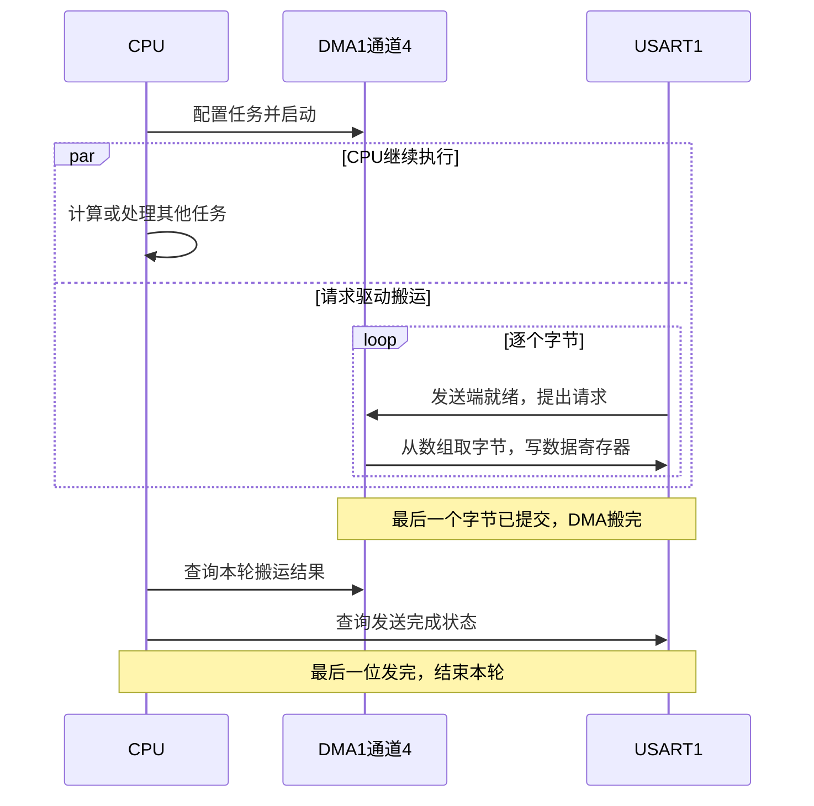
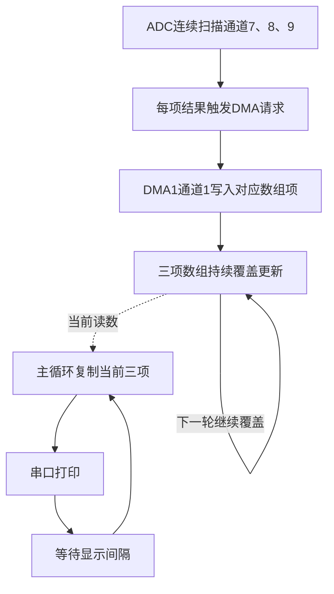

# STM32 入门培训教材

## 提高篇

### 提 5 DMA：给数据请一名搬运工

> 这一节回扣基础篇第 6 章和提高篇提 4，建议先跑通串口再回来看。先学习串口 DMA 发送，再回到基础篇第 10 章，学习 ADC 多路采集中的 DMA。

#### 5.1 CPU 为什么需要一名搬运工

##### 5.1.1 从熟悉的串口发送开始

第 6 章发送一行文字时，CPU 会逐个取出字符，检查串口能不能接收下一份数据，再把字符交给 USART1。如果上一份还没有被取走，就在 `while` 中等待。

可以把 CPU 想成仓库管理员：他既要安排工作，还要拿着一叠纸条，守在发货窗口，一张张递进去。窗口处理一张需要时间，管理员即使已经知道后面要送什么，也得等窗口空出位置。

当输出很少时，这种方法简单好用。数据较多，或者主循环还要计算、处理按键时，管理员就希望把“按顺序递纸条”交给专门的人。

**DMA（直接内存访问，Direct Memory Access）就是单片机内部的自动搬运硬件。**CPU 先告诉它数据从哪里来、送到哪里、每次搬多大、总共搬多少；随后 DMA 按配置进行搬运，CPU 可以继续执行其他代码。

##### 5.1.2 分工改变了，串口规则仍然相同

| 成员 | 运输站里的角色 | 在串口 DMA 发送中实际负责什么 |
|---|---|---|
| CPU | 管理员 | 准备字符数组，配置并启动任务，处理结束结果 |
| 内存 | 存放纸条的仓库 | 保存要发送的数据 |
| DMA | 搬运工 | 按顺序把字节从数组搬到串口数据寄存器 |
| USART1 | 按约定节奏工作的发货窗口 | 把字节转成串口波形，经 PA9 发出 |
| CH340 | 通往电脑的转接站 | 把 TTL 串口数据转交电脑的 USB 接口 |

DMA 帮 CPU 承担搬运，USART1 继续决定波特率和数据格式。两端还是使用 9600、8N1，`printf` 的数值格式化也仍然需要 CPU 执行。

在同样波特率下，DMA 不会把窗口的传输速度变快。以 9600、8N1 为例，100 个字节连续发出约需 `100 × 10 / 9600 ≈ 104ms`，两种发送方式都受这个节奏约束。DMA 的主要价值是减少 CPU 逐字节守候的工作。

CPU 仍要准备数据、配置任务并处理结果，DMA 与 CPU 也共享部分内部通路。理解“分担搬运工作”，比把 DMA 想成“CPU 完全不参与、所有操作都变快”更准确。

##### 5.1.3 本章要完成什么

学完这一章，你能：

1. 用一张“任务单”解释 DMA 的地址、方向、数量、宽度和递增设置。
2. 找到 STM32F103C8T6 中 USART1 发送与 ADC1 对应的 DMA 通道。
3. 使用普通模式发送一批串口数据，区分搬运完成和串口发送完成。
4. 说明源缓冲区的有效期，正确安排 DMA 与同步打印的使用顺序。
5. 配置 ADC1 三路扫描，让 DMA 循环更新采样数组。
6. 解释循环数组为什么只保存近期读数，以及为什么三次读取未必属于同一轮采样。

本章分成两个核心实验：**先看“数组→串口”，再看“ADC→数组”。**搬运工具相同，改变的是数据方向、数据宽度和结束后的安排。

#### 5.2 需要准备与硬件连接

##### 5.2.1 工程和文件

| 项 | 内容 |
|---|---|
| 开发板 | 培训使用的 STM32F103C8T6 开发板 |
| 工具 | Keil5、ST-Link、CH340 USB 转 TTL 模块、串口助手 |
| 供电 | 开发板独立供电，CH340 由电脑 USB 供电 |
| 开发环境 | 五目录标准工程、SPL V3.5.0、Arm Compiler 5 + MicroLIB |
| 串口前置 | 第 6 章与提 4，使用提 4 的完整 `Serial.c/.h` |
| ADC 前置 | 第 10 章，先跑通板载传感器的基本采集 |
| 复用文件 | `Hardware/Serial.c/.h`；模板已有 `Delay.c/.h`，提供 `Delay_ms` |
| 串口实验新增 | `Hardware/SerialDMA.c/.h` |
| ADC 实验新增 | `Hardware/ADCDMA.c/.h` |
| 入口 | `User/main.c`，每次只选本章两个版本之一 |

标准库源文件除了已有的 RCC、GPIO、USART、`misc.c`，还需要 `stm32f10x_dma.c`；ADC 实验再加入 `stm32f10x_adc.c`。这些文件来自配套 SPL，不要自行仿写库函数。新增模块文件放进 `Hardware`，并加入 Keil 工程分组和头文件搜索路径。

本章 ADC 部分提供**独立的 `ADCDMA` 模块示例**，明确展示全部配置。它负责 ADC1 和 DMA1 通道1；与第 10 章整合时，按已有模块实际接口保留一套初始化。本章没有把未知的公共 ADC 函数签名当成已经确定的接口。

##### 5.2.2 电脑、开发板与 CH340 怎样连接

DMA 位于单片机内部，两项实验复用串口输出接线。

| 开发板 | CH340 | 本章用途 |
|---|---|---|
| PA9，USART1_TX | RXD／RX | 把字符串或采样值发到电脑 |
| GND | GND | 建立公共电平参考 |
| PA10，USART1_RX | TXD／TX | 本章两个核心实验不依赖此方向；保留提 4 接线时沿用已核对的电平条件 |
| 电源引脚 | VCC、5V、3.3V 等 | 不连接，开发板沿用独立供电 |

本章最少用 PA9→RXD 和 GND→GND 两根线。ST-Link 继续通过 SWD 下载代码；串口助手打开的是 CH340 对应的 COM 端口。

可以沿用前面的比喻：PA9 是开发板的“嘴巴”，CH340 RXD 是模块的“耳朵”。DMA 只是帮忙把要说的内容递给串口，外面的通信路径保持相同。

串口助手设置：**9600、8 个数据位、1 个停止位、无校验、无流控，文本接收显示**。打开串口后复位开发板，观察启动提示。驱动未安装时使用 [沁恒官方 CH340／CH341 Windows 驱动下载页](https://www.wch.cn/downloads/CH341SER_EXE.html)。

##### 5.2.3 ADC 三路输入在哪里

| 板载输入 | 引脚 | 本例使用的 ADC1 输入通道 | 规则序列位置 | 数组位置 |
|---|---|---|---|---|
| 热敏电阻分压 | PA7 | `ADC_Channel_7` | 第1位 | `adc_values[0]` |
| 光敏电阻分压 | PB0 | `ADC_Channel_8` | 第2位 | `adc_values[1]` |
| 电位器抽头 | PB1 | `ADC_Channel_9` | 第3位 | `adc_values[2]` |

沿用第 10 章已经核对的传感器连接。这里是**一个 ADC1 依次测三个输入**，三个传感器的编号不代表使用三个 ADC 外设。

模拟输入的工作范围为 0～`VREF+`，参考电压按实际开发板核对。本章输出 12 位原始读数，范围 0～4095；温度、照度等物理量的换算，还需要对应电路参数和标定信息。

#### 5.3 写好一张 DMA 任务单

##### 5.3.1 地址：从哪间仓库取，送到哪个窗口

管理员交任务时，不能只说“帮我搬东西”，要给准确地址。代码中的变量和数组存放在内存里，地址告诉 DMA 到哪里读写；外设的数据寄存器也有固定地址。

本章串口任务使用字符数组地址和 `&USART1->DR`；ADC 任务使用 `&ADC1->DR` 和采样数组地址。

`tx_text[0]` 表示第一份数据，`&tx_text[0]` 表示第一份数据存放的位置。可以把前者想成纸条上的内容，后者想成纸条所在仓库的门牌。**给 DMA 配置地址时，需要门牌，不能把纸条内容当成地址。**

配置里的 `DMA_PeripheralBaseAddr` 总是填写外设侧地址，`DMA_MemoryBaseAddr` 总是填写内存侧地址；它们谁是来源、谁是目的地，由方向决定。

##### 5.3.2 方向：出库与入库

| 实验 | 来源 | 目的地 | 配置方向 |
|---|---|---|---|
| 串口发送 | 字符数组 | USART1 数据寄存器 | `DMA_DIR_PeripheralDST`，外设是目的地 |
| ADC 采集 | ADC1 结果寄存器 | 采样数组 | `DMA_DIR_PeripheralSRC`，外设是来源 |

可以把它们理解为“从仓库发货”和“把测量结果收入仓库”。`DST` 表示目的地，`SRC` 表示来源，库名称以**外设侧的角色**来命名。

##### 5.3.3 宽度和数量：一次搬一小盒，总共搬几盒

DMA 每次搬运的数据宽度可以选择字节、半字、字。先记住本章的两种：

| 数据 | 数组类型 | 每次搬运宽度 | 配置数量 | 实际数据字节数 |
|---|---|---|---|---|
| N 个串口字符 | `uint8_t` | 8 位，即1字节 | N | N |
| 三路 ADC 结果 | `uint16_t` | 16 位，即2字节 | 3 | 6 |

**`DMA_BufferSize` 表示搬运次数，不是任何场景下都表示字节数。**三路 ADC 每次搬一个半字，任务数量应填 3，不是 6。

可以把宽度想成盒子的大小，数量想成盒子的个数。三只大盒子占六个字节的位置，任务单上仍然写“搬三只”。

ADC 结果虽然只有 12 位，也需要能装下它的 16 位存储空间。使用 `uint16_t` 和半字搬运，能完整保存有效结果。

##### 5.3.4 地址递增：搬下一份时走不走到隔壁格子

串口寄存器是固定窗口，每次写入都使用相同地址，所以外设地址不递增。数组是一排格子，需要依次取下一个字符，所以内存地址递增。

ADC 也类似：三路测量结果依次出现在同一个 `ADC1->DR` 中，外设地址仍然不递增；DMA 把第一份、第二份、第三份写到数组不同位置，内存地址递增。

递增的步长与相应侧的数据宽度有关。字符按1字节走到下一格，`uint16_t` 数组按2字节走到下一项。**ADC 输入通道的切换由 ADC 完成，不靠 DMA 把寄存器地址加一来切换。**

##### 5.3.5 普通模式与循环模式：一张送货单，还是持续更新的白板

| 模式 | 本轮数量用完后 | 本章用途 |
|---|---|---|
| `DMA_Mode_Normal`，普通模式 | 停止继续搬运；下一批重新准备数量与配置 | 串口发送一段完整字符串 |
| `DMA_Mode_Circular`，循环模式 | 自动恢复初始数量和内部地址，继续响应请求 | ADC 持续更新三项数组 |

普通模式像送完这一单就等待下一张单。循环模式像白板上固定留三格：每轮测量写完三格，再从第一格写入新的读数，旧内容随之被覆盖。

循环模式不会自行制造新数据。持续更新还需要 ADC 继续转换并发出请求；串口循环发送则会按请求重复读取同一批源数据，因此本章串口实验使用普通模式。

##### 5.3.6 两个实验的完整任务单对照

`DMA_InitTypeDef` 有以下 11 个配置成员。本章全部明确赋值后再调用初始化函数。

| 成员 | 串口 DMA 发送 | ADC DMA 采集 |
|---|---|---|
| `DMA_PeripheralBaseAddr` | `&USART1->DR` | `&ADC1->DR` |
| `DMA_MemoryBaseAddr` | 本轮字符数组地址 | `adc_values` 地址 |
| `DMA_DIR` | `DMA_DIR_PeripheralDST` | `DMA_DIR_PeripheralSRC` |
| `DMA_BufferSize` | 有效字符字节数 | 3 |
| `DMA_PeripheralInc` | 禁止递增 | 禁止递增 |
| `DMA_MemoryInc` | 允许递增 | 允许递增 |
| `DMA_PeripheralDataSize` | `Byte` | `HalfWord` |
| `DMA_MemoryDataSize` | `Byte` | `HalfWord` |
| `DMA_Mode` | `Normal` | `Circular` |
| `DMA_Priority` | `Medium` | `High` |
| `DMA_M2M` | `Disable` | `Disable` |

表中的 `Byte`、`HalfWord` 等为便于比较的末尾名称，完整常量见代码。`DMA_Priority` 决定 DMA 通道之间怎样安排搬运，与提 4 的 NVIC 中断优先级是两套配置。

`DMA_M2M` 控制内存到内存模式。本章两种任务都由外设请求驱动，因此保持关闭。以后做内存之间的批量复制时，可以单独学习这个模式。

#### 5.4 搬运工为什么知道何时可以搬

##### 5.4.1 外设请求像窗口的提示灯

串口发送需要遵守窗口节奏。USART1 可以接收下一份待发送数据时，发送 DMA 请求告诉搬运工“可以递下一张了”；DMA 再从数组取下一字节写入数据寄存器。

ADC 的通知则是“这份测量结果已经好了，可以取走”。DMA 收到请求后读取结果，并写到数组中。

**请求解决何时搬，任务单解决怎样搬。**两者缺少任何一个，任务都无法按预期进行。

##### 5.4.2 本芯片的路线是固定的

| 请求来源 | STM32F103C8T6 使用的 DMA 通道 | 本章是否使用 |
|---|---|---|
| USART1 发送 | `DMA1_Channel4` | 串口实验使用 |
| ADC1 转换结果 | `DMA1_Channel1` | ADC 实验使用 |
| USART1 接收 | `DMA1_Channel5` | 本章核心实验不使用 |

通道像预先铺好的运输路线。USART1 名称里的“1”表示第一个串口外设，不表示必须选 DMA 通道1。ADC 输入通道7、8、9也与 DMA 通道号不同。

STM32F103 的请求对应关系由芯片硬件规定，需要查参考手册。一个 DMA 通道可能对应多个外设请求，在同一时刻应由一个任务使用，不能让共享该通道的多个外设同时发出请求。

##### 5.4.3 两个开关各管一件事

| 配置 | 作用 | 运输站比喻 |
|---|---|---|
| `DMA_Cmd(..., ENABLE)` | 开启已经配置好的 DMA 通道 | 搬运工开始值班 |
| `USART_DMACmd(..., ENABLE)` | 允许 USART 的指定方向发出 DMA 请求 | 发货窗口可以通知搬运工 |
| `ADC_DMACmd(ADC1, ENABLE)` | 允许 ADC1 发出 DMA 请求 | 测量窗口可以通知搬运工 |

开启通道以后，搬运工也要有请求才知道取送的时机。开启外设请求以后，也要有配置正确且已经启用的通道来完成任务。

DMA 可以在不启用 DMA 中断的情况下搬运。本章通过主循环查询完成状态；以后采用中断通知时，再增加 `DMA_ITConfig` 与 NVIC 配置。通知方式改变，自动搬运机制仍然相同。



图 5-1：CPU继续执行与DMA按请求搬运可以同时进行。DMA搬完以后，串口仍可能在发送最后的内容。

#### 5.5 配置和状态函数逐个说明

##### 5.5.1 `RCC_AHBPeriphClockCmd`：先让 DMA 能工作

调用形式：`RCC_AHBPeriphClockCmd(时钟标识, ENABLE或DISABLE)`，没有返回值。

本章使用 `RCC_AHBPeriphClockCmd(RCC_AHBPeriph_DMA1, ENABLE)`。第一个参数选 DMA1 的时钟开关，第二个参数表示打开。GPIO 和 USART1 的时钟仍由原来的 APB2 接口使能。

**它还可以做什么？**同一函数可以操作其他属于 AHB 的外设时钟，需使用相应标识；`DISABLE` 用于关闭指定时钟。本章运行期间保持 DMA1 时钟开启。

`RCC_AHBPeriph_DMA1` 是时钟标识，`DMA1_Channel4` 是传给通道操作函数的对象，不要互换。

##### 5.5.2 `DMA_Init` 与 `DMA_DeInit`：提交任务单与复位通道

`DMA_Init(DMA通道, &配置结构体)` 没有返回值。第一参数明确配置哪条路线，第二参数提供完整任务单。填写结构体不会自动改变硬件，调用函数才会应用设置。

本章串口使用 `DMA_Init(DMA1_Channel4, &DMA_InitStructure)`，ADC 使用通道1。`DMA_InitTypeDef` 是结构体类型，`DMA_InitStructure` 是当前填写的变量，`&` 取它的地址。

**它还可以做什么？**相同接口可配置其他支持的外设搬运或内存复制；方向、地址与模式必须配套改变。修改地址、数量等配置前先关闭通道，不能在正在搬运时换掉任务单。

`DMA_DeInit(DMA通道)` 同样没有返回值，用于关闭并复位该通道的配置和标志。它像清空这一条路线的旧任务，适合本章启动阶段建立确定的初始状态；它不会替你填写下一张任务单。

##### 5.5.3 `DMA_Cmd`：开始值班与停止值班

调用形式：`DMA_Cmd(DMA通道, ENABLE或DISABLE)`，没有返回值。

`ENABLE` 开启通道，`DISABLE` 关闭通道。它只控制这个通道，既不会修改 USART 波特率，也不会开启 ADC 转换。

**它还可以做什么？**普通模式重新配置前可以先关闭通道；循环任务也可以按设计停止。关闭通道本身不会把已用完的数量恢复到初始值，再次发送时仍需要重新准备。

##### 5.5.4 `USART_DMACmd` 与 `ADC_DMACmd`：允许外设发通知

| 接口 | 本章调用与参数 | 返回值与用途 |
|---|---|---|
| `USART_DMACmd` | `USART1`、`USART_DMAReq_Tx`、`ENABLE` | 无返回值，允许发送方向产生 DMA 请求 |
| `ADC_DMACmd` | `ADC1`、`ENABLE` | 无返回值，允许 ADC1 产生 DMA 请求 |

串口接口也可选择接收方向，但还需要匹配接收通道与缓冲区。本章完成发送，不把接收 DMA 的配置混入第一实验。

这两个函数属于外设侧控制。USART 和 ADC 本身仍需初始化、开启；DMA 侧也仍需正确配置通道。`DISABLE` 关闭相应请求，并不关闭整个 USART 或 ADC。

##### 5.5.5 `DMA_GetFlagStatus` 与 `DMA_ClearFlag`：看结果、清旧记录

`DMA_GetFlagStatus(标志)` 返回 `SET` 或 `RESET`，本章重点看传输完成 `TC` 与传输错误 `TE`。

| 标志示例 | 意义 |
|---|---|
| `DMA1_FLAG_TC4` | 通道4本批搬运完成 |
| `DMA1_FLAG_TE4` | 通道4发生传输错误 |
| `DMA1_FLAG_TC1` | 通道1的一轮搬运完成 |
| `DMA1_FLAG_GL4` | 清除通道4的一组标志时使用 |
| `DMA1_FLAG_GL1` | 清除通道1的一组标志时使用 |

这里接口按标志本身识别控制器和通道，不需要再给第一个参数传 `DMA1_Channel4`。也不要把 `DMA1_FLAG_TC4` 换成用于中断接口的 `DMA1_IT_TC4`。

`DMA_ClearFlag(标志)` 没有返回值。本章串口每次启动前清掉通道4旧记录，避免把上一单的“已完成”印章当成这一单的结果。

**它们还可以做什么？**也可查询和清除半传输状态，用于分区处理。清标志只处理状态记录，不会重新装载数量，也不会启动新任务。DMA 与 USART 的标志分别按各自规则处理，不能沿用一个通用清除方法。

##### 5.5.6 数量接口：还剩几份，与下一单搬几份

| 接口 | 参数与返回值 | 本次如何理解 |
|---|---|---|
| `DMA_GetCurrDataCounter(DMA通道)` | 返回 `uint16_t` | 查看当前剩余搬运次数，可在调试时观察 |
| `DMA_SetCurrDataCounter(DMA通道, 数量)` | 没有返回值 | 通道关闭时设置下一次搬运数量 |

普通任务像在单子上从 N 份逐次减到 0。循环模式减完后又恢复为初始数量，不适合靠“CPU 一定能读到 0”判断一轮完成；需要时查询完成标志。

本章串口为了让任务单清楚，每次用完整 `DMA_Init` 同时准备地址和数量。以后来源、宽度、方向都固定时，可以在关闭通道后用数量接口重装，再按约定处理地址和旧标志。

#### 5.6 实验一：让 DMA 发送一段字符串

##### 5.6.1 先跑通，再解释执行过程

1. 复制提 4 已跑通的工程，保留它的 `Serial.c/.h` 和模板的 `Delay.c/.h`。
2. 将 5.10.1、5.10.2 的 `SerialDMA.h/.c` 放进 `Hardware`，加入 Keil 分组；补齐 `stm32f10x_dma.c`。
3. 用 5.10.5 的完整串口 DMA 入口替换 `User/main.c`。本实验不需要加入 `ADCDMA`。
4. 保留 Arm Compiler 5 + MicroLIB 与提 4 的串口重定向配置。独立入口仍在启动时设置组2，整合工程按已有全局 NVIC 约定处理。
5. 编译、下载，按 5.2 接线。串口助手打开后复位。
6. 观察欢迎信息，随后应重复看到 `Hello, DMA!` 与一行 `cpu_work=...`。

`cpu_work` 是主循环在传输期间累计完成的简单计算次数，具体数值受主频、优化和运行情况影响，不要求与某个固定数字一致，也不作为严谨性能测试。

##### 5.6.2 本章三个接口怎样使用

| 自写接口 | 作用 | 返回值 |
|---|---|---|
| `SerialDMA_Init()` | 准备 DMA1 通道4，启动时调用一次 | 无 |
| `SerialDMA_Start(data, length)` | 提交一批数据，成功后即返回，由硬件继续搬运 | 1为已接受；0为参数不合要求或资源暂未空闲 |
| `SerialDMA_Poll()` | 查询并收尾本轮状态 | `IDLE`、`BUSY`、`DONE`、`ERROR` 四种状态之一 |

`Start` 先确认上一轮和此前同步发送都已结束，再关闭通道、清旧标志、填写地址与长度，最后开启请求和通道。

`Poll` 每次检查一下就返回。搬完以后关闭本轮 DMA 请求，并继续等串口最后一位发出，随后返回结束结果。结束结果保持到下一次启动，便于主循环处理；查询不是重新发一遍数据。

本例没有启用 DMA 中断，也没有在等待期间禁止其他中断。你看到的 `cpu_work++` 说明 CPU 仍在执行自己的任务，后续可按工程需要放入按键处理和其他计算。

##### 5.6.3 `sizeof(tx_text) - 1` 为什么减一

C 字符串末尾还有一个 `'\0'`，用来标记结束。`uint8_t tx_text[] = "ABC"` 占四个字节，但要显示的字符只有三个。

DMA 按你给的数量搬，不会像 `Serial_SendString` 那样遇到零字符就自动停下。因此本例减掉末尾零字符，只发送实际文本。

`sizeof` 对这里的数组计算整个数组大小。把数组传进函数以后，参数 `data` 是指针，在函数里对指针使用 `sizeof(data)` 得到的是指针大小，不是原字符串长度。任务数量应由调用者准确提供。

#### 5.7 送到窗口以后，还要等窗口发完

##### 5.7.1 三个状态各代表哪一步

| 状态 | 硬件意义 | 运输站里的含义 |
|---|---|---|
| `USART_FLAG_TXE` | 发送数据寄存器可接收下一份数据 | 窗口能收下一张纸条 |
| `DMA1_FLAG_TC4` | 最后一份数据已由 DMA 搬到 USART1 | 搬运工把这一批交完 |
| `USART_FLAG_TC` | 串口待发送数据的最后一帧已发送结束 | 窗口把最后一张也送出 |

DMA 把最后一个字节写进串口时，这个字节可能仍在等待或正在发送。因此，“搬运工交完”与“通信线路发完”是两个时刻。

本章 `SerialDMA_Poll` 的 `DONE` 采用较保守、好用的约定：**既确认 DMA 正常搬完，又确认 USART1 发送完成。**收到 `DONE` 后，主循环再开始下一项同步输出。

`Start` 前的串口状态查询读取状态寄存器，随后 DMA 写入数据寄存器按本芯片规则开始新发送并处理发送完成状态；结束时再查询这一轮的完成状态。代码先确认 DMA 本轮结束，再判断串口 `TC`，不拿启动前的一次检查当作本轮结束。

`TE` 发生时，本例停止继续搬运，等待已提交到串口的内容发完，再返回 `ERROR`。错误说明任务没有按预期完整完成，应按 5.11 检查地址、配置与资源使用。

##### 5.7.2 缓冲区：搬运工还没取完，仓库不能撤

`SerialDMA_Start` 使用调用者提供的地址，**不复制源数据**。返回 1 只表示任务已启动，数据还可能留在原数组里等待取走。

想象你把仓库钥匙交给搬运工，却在他还没搬完时撤掉仓库或改写箱子，后续取到的东西就无法保证正确。

本例用 `static` 字符数组保存字符串，使其整个运行期间都有效，并在本轮结束前保持内容不变。普通局部数组如果在函数返回后失效，就不能继续供异步 DMA 使用；局部变量即使暂时仍有效，也要避免在搬运中改写。

`const uint8_t *data` 表示本函数不通过该指针修改源数据，并不会阻止其他代码修改同一块内存。缓冲区有效期和独占使用仍由调用约定保证。

##### 5.7.3 `printf` 与 DMA 怎样配合

提 4 的路径仍是：`Serial_Printf → vprintf → fputc → Serial_SendByte → USART1`。新增 DMA 模块不会自动改变这条重定向路径。

本章约定所有发送调用都在主循环中有序使用：

1. 先完成需要的同步欢迎信息。
2. 提交 DMA 任务。
3. 任务进行时执行其他工作，按需查询状态。
4. `DONE` 或 `ERROR` 表示串口这一轮已经结束，再使用同步打印。

如果 CPU 和 DMA 同时往同一个串口数据寄存器写，数据可能被插入或覆盖。把这个窗口交给一个发送任务使用，直到它结束，再交给下一个任务。

后续想通过 DMA 输出数值，可以先把文字格式化到容量足够且长期有效的缓冲区，再交给 DMA。格式化与发送是两步，源数组还要遵守本节的有效期约定。本章先用固定字符串把搬运路径讲清。

#### 5.8 从串口转向 ADC：同一工具，任务方向变了

##### 5.8.1 测量员负责量，搬运工负责存

第 10 章把 ADC 想成量电压的尺子。现在让这位测量员轮流测三个位置，每得到一份结果，就交给 DMA 放进指定格子。

串口实验中，搬运工从数组取数据送给外设；ADC 实验中，搬运工从外设取结果写进数组。DMA 负责搬运，ADC 负责转换，主循环负责显示或计算，三个环节各自分工。

##### 5.8.2 三种设置怎样一起工作

| 设置 | 本例选择 | 谁负责什么 |
|---|---|---|
| ADC 扫描 | `ADC_ScanConvMode = ENABLE` | 按规定顺序依次测通道7、8、9 |
| ADC 连续转换 | `ADC_ContinuousConvMode = ENABLE` | 测完三路后开始下一轮 |
| DMA 循环模式 | `DMA_Mode_Circular` | 写完三项后从数组开头继续写 |

扫描像按名单逐个点名，连续转换像点完一遍名单再来一遍，DMA 循环像记录员写完三格后用新记录更新这三格。

每个开关都解决不同问题。ADC 持续测量而 DMA 只搬一轮，数组就只更新一次；DMA 允许循环但 ADC 没有产生后续结果，数组也不会持续变化。

##### 5.8.3 顺序怎样与数组对应

`ADC_RegularChannelConfig(ADC外设, 输入通道, 序列位置, 采样时间)` 没有返回值。本例为通道7、8、9分别设置位置1、2、3，DMA 再按请求顺序写数组0、1、2。

序列位置从1开始，C 数组索引从0开始。就像“第一个同学”在名单中的位置是1，但代码保存第一项时用下标0。

`ADC_NbrOfChannel = 3` 告诉 ADC 这张名单有三项。调整采样顺序后，输出标签和数组映射要同步调整；DMA 不会自动知道哪项叫 NTC、哪项叫 LIGHT。

##### 5.8.4 ADC 初始化中需要理解的函数

| 函数 | 本章用途 | 参数、返回与其他用途 |
|---|---|---|
| `RCC_ADCCLKConfig` | 选择 APB2÷6 的 ADC 时钟 | 参数是分频标识，无返回值；其他分频需核对实际时钟 |
| `ADC_Init` | 设置独立、扫描、连续、软件触发、右对齐和三项序列 | ADC对象与完整结构体地址，无返回值；可按任务选单通道等配置 |
| `ADC_RegularChannelConfig` | 确定输入、顺序与采样时间 | 四个参数如上；可改变输入及序列，但图表和DMA数量需对应 |
| `ADC_Cmd` | 开启 ADC1 | ADC对象与 `ENABLE／DISABLE`，无返回值 |
| `ADC_ResetCalibration`／`ADC_GetResetCalibrationStatus` | 复位校准并等待完成 | 前者无返回值，后者以 `SET／RESET` 表示是否仍忙 |
| `ADC_StartCalibration`／`ADC_GetCalibrationStatus` | 内部校准并等待完成 | 用法与上项对应；不是传感器物理量标定 |
| `ADC_SoftwareStartConvCmd` | 准备完成后开始转换 | ADC对象与 `ENABLE`，无返回值 |

本章使用 APB2÷6；若 APB2 是72MHz，ADC 时钟就是12MHz。按实际时钟树核对结果应在本芯片允许的 0.6～14MHz 范围内，不把 CPU 主频直接当成 ADC 时钟。

三个通道采用 `ADC_SampleTime_239Cycles5`，即较长的239.5个 ADC 时钟采样周期。采样保持电容可以想成一个要跟随输入电压的小量杯，需要足够时间建立读数；采样时间按输入电路和手册选择。这里的长采样时间不等于软件平均滤波。

完整代码先开启 ADC 并给上电稳定时间，再完成校准。**先准备 DMA 存放结果的地方，最后启动转换**，就像先摆好记录本，再让测量员开工。

#### 5.9 实验二：让三路 ADC 结果自动进入数组

##### 5.9.1 操作步骤

1. 在已具备串口输出的工程中加入 5.10.3、5.10.4 的 `ADCDMA.h/.c`，以及 `stm32f10x_adc.c` 和 `stm32f10x_dma.c`。
2. 对照 5.2.3 核对板载传感器与引脚，沿用基础 ADC 实验的连接。
3. 用 5.10.6 的完整入口替换 `main.c`。本实验用 `Serial_Printf` 显示结果，重点观察 ADC 到数组的搬运；它不要求使用 `SerialDMA`。
4. 编译、下载，打开串口后复位。先看到准备提示，随后看到就绪提示和三路原始数值。
5. 转动电位器，观察 `POT` 变化；改变光敏器件的光照，观察 `LIGHT` 变化；温度变化时观察 `NTC` 的响应。

光敏、热敏读数的增减方向与实际分压接法有关。依据实物和电路判断变化方向，不凭一个数值直接换算温度或照度。

##### 5.9.2 循环数组像三格白板，不是历史仓库

DMA 自动更新 `adc_values[0]`、`[1]`、`[2]`，写到最后一项后回到第一项。主循环每隔约500ms取一次当前读数，期间 ADC 和 DMA 持续工作。

这像一块不断刷新三格数字的白板：你隔一会儿抄一次，看见的是各格当前内容，中间的旧读数已经被后来读数覆盖。

`Delay_ms(500)` 控制电脑显示频率，不控制 ADC 采样频率。想严格控制采样节奏，需要另行设计转换触发方式，不能只修改打印间隔。



图 5-2：数组持续更新，主循环按显示节奏读取。虚线代表读取数据，两部分使用各自的工作节奏。

##### 5.9.3 `volatile` 能做什么，不能保证什么

采样数组用 `volatile` 声明，告诉编译器数据会由 DMA 改写，CPU 应实际读取内存。它与提 4 中共享变量的用途相通，只是这次更新者是 DMA。

主循环复制三个数时，DMA 也可能继续更新。例如刚取完第0项，新一轮又覆盖了后续项。因此 `ADCDMA_ReadLatest` 约定返回各项当前读数，**不保证三个数来自同一轮扫描**。

对观察缓慢变化的电位器、光敏和热敏输入，本章先用这种方式认识数据流；需要同步成组计算时，另选单次扫描或分区缓冲方案。

CPU 屏蔽中断不会暂停 DMA，`volatile` 也不会冻结数组。要拿到一组稳定数据，可以让一轮采集与搬运结束后停止更新再读取，或用较大缓冲区、半完成／全完成通知处理暂时未被写入的区域，同时保证处理速度跟得上。

#### 5.10 完整代码

两个实验各自使用一个入口，不同时加入两个 `main`。共同复用提 4 的完整 `Serial.c/.h`，保留模板的启动、系统、CMSIS、SPL 和延时文件。

| 实验 | 新模块 | 入口版本 | DMA资源 |
|---|---|---|---|
| 串口 DMA | `SerialDMA.c/.h` | 5.10.5 | DMA1通道4 |
| ADC DMA | `ADCDMA.c/.h` | 5.10.6 | DMA1通道1 |

新增文件在下方给出完整内容。`Serial` 的发送、重定向与接收接口保持提 4 版本；本章没有另写第二套 `fputc` 或 `USART1_IRQHandler`。

##### 5.10.1 `Hardware/SerialDMA.h`

```c
#ifndef __SERIALDMA_H
#define __SERIALDMA_H

#include "stm32f10x.h"

#define SERIAL_DMA_IDLE  0u
#define SERIAL_DMA_BUSY  1u
#define SERIAL_DMA_DONE  2u
#define SERIAL_DMA_ERROR 3u

void SerialDMA_Init(void);
uint8_t SerialDMA_Start(const uint8_t *data, uint16_t length);
uint8_t SerialDMA_Poll(void);

#endif
```

##### 5.10.2 `Hardware/SerialDMA.c`

```c
#include "SerialDMA.h"
#include "stm32f10x_dma.h"

static uint8_t tx_state = SERIAL_DMA_IDLE;
static uint8_t tx_dma_finished = 0;
static uint8_t tx_error = 0;

/**
 * @brief  准备USART1发送使用的DMA1通道4，先调用Serial_Init
 * @param  无
 * @retval 无；启动时调用一次，不在传输中重新初始化
 */
void SerialDMA_Init(void)
{
    RCC_AHBPeriphClockCmd(RCC_AHBPeriph_DMA1, ENABLE); /* 打开DMA1控制器时钟。 */
    USART_DMACmd(USART1, USART_DMAReq_Tx, DISABLE);     /* 暂不让USART1提出发送DMA请求。 */
    DMA_DeInit(DMA1_Channel4);                        /* 关闭并复位本通道，不影响通道1。 */

    tx_state = SERIAL_DMA_IDLE;
    tx_dma_finished = 0;
    tx_error = 0;
}

/**
 * @brief  提交一批字节，返回后由DMA搬运，不复制源缓冲区
 * @param  data：长期有效的数据地址，本轮结束前不得修改
 * @param  length：实际有效字节数，范围1～65535，不得超过缓冲区
 * @retval 1：已开始；0：参数无效或发送资源尚未空闲
 */
uint8_t SerialDMA_Start(const uint8_t *data, uint16_t length)
{
    DMA_InitTypeDef DMA_InitStructure;

    if ((data == 0) || (length == 0))
    {
        return 0;
    }

    if (SerialDMA_Poll() == SERIAL_DMA_BUSY)
    {
        return 0;
    }

    /* 先确认此前的同步输出也已结束，避免两套发送方式争用USART1。 */
    if (USART_GetFlagStatus(USART1, USART_FLAG_TC) == RESET)
    {
        return 0;
    }

    DMA_Cmd(DMA1_Channel4, DISABLE);           /* 配置地址、数量时保持通道关闭。 */
    DMA_ClearFlag(DMA1_FLAG_GL4);             /* 清掉通道4上一轮的完成、半完成、错误标志。 */

    DMA_InitStructure.DMA_PeripheralBaseAddr = (uint32_t)&USART1->DR; /* 固定的串口发送数据寄存器。 */
    DMA_InitStructure.DMA_MemoryBaseAddr = (uint32_t)data;            /* 本轮字符数组的起始地址。 */
    DMA_InitStructure.DMA_DIR = DMA_DIR_PeripheralDST;               /* 从内存搬到外设。 */
    DMA_InitStructure.DMA_BufferSize = length;                       /* 本轮搬length个字节。 */
    DMA_InitStructure.DMA_PeripheralInc = DMA_PeripheralInc_Disable; /* 每次写同一个串口寄存器。 */
    DMA_InitStructure.DMA_MemoryInc = DMA_MemoryInc_Enable;           /* 依次取数组中的下一个字节。 */
    DMA_InitStructure.DMA_PeripheralDataSize = DMA_PeripheralDataSize_Byte; /* 串口按8位数据提交。 */
    DMA_InitStructure.DMA_MemoryDataSize = DMA_MemoryDataSize_Byte;         /* 源数组每项为一个字节。 */
    DMA_InitStructure.DMA_Mode = DMA_Mode_Normal;                     /* 一批完成后停止搬运。 */
    DMA_InitStructure.DMA_Priority = DMA_Priority_Medium;             /* DMA通道之间的搬运优先级。 */
    DMA_InitStructure.DMA_M2M = DMA_M2M_Disable;                       /* 由USART请求驱动，不启用内存到内存模式。 */
    DMA_Init(DMA1_Channel4, &DMA_InitStructure);                      /* 提交完整任务单。 */

    tx_dma_finished = 0;
    tx_error = 0;
    tx_state = SERIAL_DMA_BUSY;

    USART_DMACmd(USART1, USART_DMAReq_Tx, ENABLE); /* 允许发送端在就绪时提出请求。 */
    DMA_Cmd(DMA1_Channel4, ENABLE);               /* 启动已准备好的通道。 */
    return 1;
}

/**
 * @brief  查询本轮状态，搬完后继续等待串口最后一位发出
 * @param  无
 * @retval IDLE：尚未提交；BUSY：进行中；DONE：正常结束；ERROR：传输错误
 */
uint8_t SerialDMA_Poll(void)
{
    if (tx_state != SERIAL_DMA_BUSY)
    {
        return tx_state;
    }

    if (tx_dma_finished == 0)
    {
        if (DMA_GetFlagStatus(DMA1_FLAG_TE4) == SET)
        {
            tx_error = 1;
            tx_dma_finished = 1;
        }
        else if (DMA_GetFlagStatus(DMA1_FLAG_TC4) == SET)
        {
            tx_dma_finished = 1;
        }

        if (tx_dma_finished != 0)
        {
            /* 不再提交新字节，已经进入USART1的字节仍由串口发完。 */
            DMA_Cmd(DMA1_Channel4, DISABLE);
            USART_DMACmd(USART1, USART_DMAReq_Tx, DISABLE);
        }
    }

    if ((tx_dma_finished != 0) &&
        (USART_GetFlagStatus(USART1, USART_FLAG_TC) == SET))
    {
        DMA_ClearFlag(DMA1_FLAG_GL4);
        tx_state = (tx_error != 0) ? SERIAL_DMA_ERROR : SERIAL_DMA_DONE;
    }

    return tx_state;
}
```

##### 5.10.3 `Hardware/ADCDMA.h`

```c
#ifndef __ADCDMA_H
#define __ADCDMA_H

#include "stm32f10x.h"

#define ADCDMA_CHANNEL_COUNT 3u

void ADCDMA_Init(void);
void ADCDMA_ReadLatest(uint16_t *values);

#endif
```

##### 5.10.4 `Hardware/ADCDMA.c`

```c
#include "ADCDMA.h"
#include "Delay.h"
#include "stm32f10x_adc.h"
#include "stm32f10x_dma.h"

/* DMA会持续改写数组；volatile要求CPU每次从内存读取。 */
static volatile uint16_t adc_values[ADCDMA_CHANNEL_COUNT] = {0, 0, 0};

/**
 * @brief  用ADC1依次采集PA7、PB0、PB1，DMA循环更新三项数组
 * @param  无
 * @retval 无；等待首次三项搬运完成后返回
 */
void ADCDMA_Init(void)
{
    GPIO_InitTypeDef GPIO_InitStructure;
    ADC_InitTypeDef ADC_InitStructure;
    DMA_InitTypeDef DMA_InitStructure;

    RCC_APB2PeriphClockCmd(RCC_APB2Periph_GPIOA | RCC_APB2Periph_GPIOB |
                          RCC_APB2Periph_ADC1, ENABLE); /* 打开两个引脚端口和ADC1时钟。 */
    RCC_AHBPeriphClockCmd(RCC_AHBPeriph_DMA1, ENABLE);   /* DMA1位于AHB，单独使能。 */
    RCC_ADCCLKConfig(RCC_PCLK2_Div6);                   /* ADC时钟为APB2时钟的1/6，核对实际时钟树。 */

    ADC_DeInit(ADC1);           /* 本独立示例重新建立ADC1配置。 */
    DMA_DeInit(DMA1_Channel1);  /* ADC1对应通道1；不改变串口使用的通道4。 */

    GPIO_InitStructure.GPIO_Pin = GPIO_Pin_7;          /* PA7：热敏分压输入。 */
    GPIO_InitStructure.GPIO_Speed = GPIO_Speed_50MHz;  /* 完整赋值，模拟输入不使用输出速度档位。 */
    GPIO_InitStructure.GPIO_Mode = GPIO_Mode_AIN;      /* 将引脚用于模拟输入。 */
    GPIO_Init(GPIOA, &GPIO_InitStructure);              /* 应用PA7配置。 */

    GPIO_InitStructure.GPIO_Pin = GPIO_Pin_0 | GPIO_Pin_1; /* PB0光敏、PB1电位器。 */
    GPIO_InitStructure.GPIO_Speed = GPIO_Speed_50MHz;      /* 完整赋值，含义同上。 */
    GPIO_InitStructure.GPIO_Mode = GPIO_Mode_AIN;          /* 两个引脚同为模拟输入。 */
    GPIO_Init(GPIOB, &GPIO_InitStructure);                  /* 对GPIOB应用配置。 */

    DMA_InitStructure.DMA_PeripheralBaseAddr = (uint32_t)&ADC1->DR;       /* 每次从同一ADC结果寄存器取值。 */
    DMA_InitStructure.DMA_MemoryBaseAddr = (uint32_t)&adc_values[0];      /* 从数组第0项开始写。 */
    DMA_InitStructure.DMA_DIR = DMA_DIR_PeripheralSRC;                   /* 从外设搬到内存。 */
    DMA_InitStructure.DMA_BufferSize = ADCDMA_CHANNEL_COUNT;             /* 一轮为3次半字搬运。 */
    DMA_InitStructure.DMA_PeripheralInc = DMA_PeripheralInc_Disable;     /* 三路共用同一个结果寄存器。 */
    DMA_InitStructure.DMA_MemoryInc = DMA_MemoryInc_Enable;               /* 依次写第0、1、2项。 */
    DMA_InitStructure.DMA_PeripheralDataSize = DMA_PeripheralDataSize_HalfWord; /* 从ADC取16位。 */
    DMA_InitStructure.DMA_MemoryDataSize = DMA_MemoryDataSize_HalfWord;         /* uint16_t数组每项16位。 */
    DMA_InitStructure.DMA_Mode = DMA_Mode_Circular;                      /* 写完3项后自动从开头继续。 */
    DMA_InitStructure.DMA_Priority = DMA_Priority_High;                  /* DMA通道之间的搬运优先级。 */
    DMA_InitStructure.DMA_M2M = DMA_M2M_Disable;                          /* 由ADC转换完成请求驱动。 */
    DMA_Init(DMA1_Channel1, &DMA_InitStructure);                         /* 提交通道1完整配置。 */

    ADC_InitStructure.ADC_Mode = ADC_Mode_Independent;             /* 使用ADC1独立模式。 */
    ADC_InitStructure.ADC_ScanConvMode = ENABLE;                   /* 按规则序列遍历三路。 */
    ADC_InitStructure.ADC_ContinuousConvMode = ENABLE;             /* 一轮结束后继续下一轮。 */
    ADC_InitStructure.ADC_ExternalTrigConv = ADC_ExternalTrigConv_None; /* 本例由软件启动。 */
    ADC_InitStructure.ADC_DataAlign = ADC_DataAlign_Right;          /* 结果放在低位，便于uint16_t读取。 */
    ADC_InitStructure.ADC_NbrOfChannel = ADCDMA_CHANNEL_COUNT;      /* 规则序列有3项。 */
    ADC_Init(ADC1, &ADC_InitStructure);                            /* 应用ADC1配置。 */

    ADC_RegularChannelConfig(ADC1, ADC_Channel_7, 1, ADC_SampleTime_239Cycles5); /* PA7放在序列第1位。 */
    ADC_RegularChannelConfig(ADC1, ADC_Channel_8, 2, ADC_SampleTime_239Cycles5); /* PB0放在序列第2位。 */
    ADC_RegularChannelConfig(ADC1, ADC_Channel_9, 3, ADC_SampleTime_239Cycles5); /* PB1放在序列第3位。 */

    ADC_Cmd(ADC1, ENABLE); /* 先开启ADC1。 */
    Delay_ms(1);          /* 给ADC上电稳定时间；这不是采样间隔。 */

    ADC_ResetCalibration(ADC1); /* 复位校准状态。 */
    while (ADC_GetResetCalibrationStatus(ADC1) == SET)
    {
        /* 等待硬件完成，不能在仍忙时跳到下一步。 */
    }

    ADC_StartCalibration(ADC1); /* 开始内部校准，不是传感器温度标定。 */
    while (ADC_GetCalibrationStatus(ADC1) == SET)
    {
    }

    DMA_ClearFlag(DMA1_FLAG_GL1);                 /* 清掉通道1旧标志。 */
    DMA_Cmd(DMA1_Channel1, ENABLE);               /* 先准备好接收结果的搬运通道。 */
    ADC_DMACmd(ADC1, ENABLE);                     /* 允许ADC1提出DMA请求。 */
    ADC_SoftwareStartConvCmd(ADC1, ENABLE);       /* 最后开始扫描转换。 */

    while (DMA_GetFlagStatus(DMA1_FLAG_TC1) == RESET)
    {
        /* 至少写完第一轮三项后再让主循环读取。 */
    }
    DMA_ClearFlag(DMA1_FLAG_TC1); /* 只确认首次完成，循环搬运会继续。 */
}

/**
 * @brief  将数组中当前三个读数复制给主循环
 * @param  values：至少能保存3个uint16_t的有效数组地址
 * @retval 无；各项为最新读数，不保证来自同一轮扫描
 */
void ADCDMA_ReadLatest(uint16_t *values)
{
    if (values == 0)
    {
        return;
    }

    values[0] = adc_values[0];
    values[1] = adc_values[1];
    values[2] = adc_values[2];
}
```

##### 5.10.5 `实验一的 User/main.c：串口 DMA 发送`

```c
#include "stm32f10x.h"
#include "misc.h"
#include "Delay.h"
#include "Serial.h"
#include "SerialDMA.h"

/**
 * @brief  DMA发送固定字符串，同时让主循环继续完成示例计算
 * @param  无
 * @retval 正常运行时不返回
 */
int main(void)
{
    static uint8_t tx_text[] = "Hello, DMA!\r\n";
    uint8_t tx_started = 0;
    uint8_t status;
    uint32_t cpu_work = 0;

    NVIC_PriorityGroupConfig(NVIC_PriorityGroup_2); /* 沿用提4独立示例的全局分组。 */
    Serial_Init();                               /* 复用提4完整Serial.c/.h。 */
    SerialDMA_Init();                            /* 准备发送DMA，暂不开始搬运。 */

    Serial_SendString("uart DMA: ready\r\n");

    while (1)
    {
        if (tx_started == 0)
        {
            if (SerialDMA_Start(tx_text, (uint16_t)(sizeof(tx_text) - 1u)) != 0)
            {
                tx_started = 1; /* 本轮已经提交，避免每圈重复交同一任务。 */
                cpu_work = 0;
            }
        }
        else
        {
            cpu_work++; /* 用简单计算观察CPU在发送期间继续执行。 */
            status = SerialDMA_Poll();

            if ((status == SERIAL_DMA_DONE) || (status == SERIAL_DMA_ERROR))
            {
                /* Poll确认串口最后一位也已发完，再进行同步打印。 */
                if (status == SERIAL_DMA_DONE)
                {
                    Serial_Printf("cpu_work=%lu\r\n", (unsigned long)cpu_work);
                }
                else
                {
                    Serial_SendString("DMA transfer error\r\n");
                }

                tx_started = 0;
                Delay_ms(1000); /* 降低展示频率，不代表DMA需要每秒才能工作。 */
            }
        }
    }
}
```

##### 5.10.6 `实验二的 User/main.c：ADC 三路 DMA 采集`

```c
#include "stm32f10x.h"
#include "misc.h"
#include "Delay.h"
#include "Serial.h"
#include "ADCDMA.h"

/**
 * @brief  读取DMA持续更新的三路ADC值，定期输出到电脑
 * @param  无
 * @retval 正常运行时不返回
 */
int main(void)
{
    uint16_t values[ADCDMA_CHANNEL_COUNT];

    NVIC_PriorityGroupConfig(NVIC_PriorityGroup_2); /* 配合复用的提4串口模块。 */
    Serial_Init();
    Serial_SendString("ADC DMA: preparing\r\n");

    ADCDMA_Init(); /* 返回前已完成首次三项搬运，之后持续循环更新。 */
    Serial_SendString("ADC DMA: ready\r\n");

    while (1)
    {
        ADCDMA_ReadLatest(values);

        Serial_Printf("NTC=%u, LIGHT=%u, POT=%u\r\n",
                      (unsigned int)values[0],
                      (unsigned int)values[1],
                      (unsigned int)values[2]);

        Delay_ms(500); /* 控制电脑显示频率；ADC与DMA仍在背景持续运行。 */
    }
}
```

#### 5.11 现象验证与常见错误

##### 5.11.1 分两步验收

串口实验预期显示：

```text
uart DMA: ready
Hello, DMA!
cpu_work=...
Hello, DMA!
cpu_work=...
```

省略号代表实际输出的数字。验收时确认字符串完整、顺序正确、每批只有一份；主循环计数会输出实际数值。仅看到文字正确还不足以证明用了 DMA，可在调试中查看通道4的配置和剩余数量，确认地址、计数与请求设置。

ADC 实验预期显示：

```text
ADC DMA: preparing
ADC DMA: ready
NTC=..., LIGHT=..., POT=...
NTC=..., LIGHT=..., POT=...
```

实际数字由输入电压决定。本章示例输出是预期格式，实板结果应另行记录。

| 验证动作 | 应观察到什么 | 能确认什么 |
|---|---|---|
| 串口实验连续观察数批 | 字符串每批完整，随后出现计数 | 普通模式能够重新提交任务 |
| 查看串口 DMA 配置 | 通道4、内存递增、外设固定、字节宽度 | 数据按数组顺序搬向同一串口寄存器 |
| 查看 ADC DMA 配置 | 通道1、三项、半字、循环 | 三路结果按指定格式写入数组 |
| 转动电位器 | `POT` 明显变化 | PB1输入与数组第2项对应 |
| 改变光敏器件光照 | `LIGHT` 随条件变化 | PB0输入与数组第1项对应 |
| 观察热敏器件温度变化 | `NTC` 随条件变化 | PA7输入与数组第0项对应 |
| 持续观察 ADC 输出 | 多次输出都能反映输入变化 | 循环搬运持续工作，而非只完成一次 |

ADC 模块启动时等待第一次三项搬运完成，避免主循环一开始读到尚未更新的初始数组。代码中的校准、首次搬运等待基于已正确配置的硬件；如果程序停在等待处，按下表检查时钟、请求和通道，不把欢迎信息已经出现当成采集已成功。

##### 5.11.2 常见错误对照表

| 问题 | 优先检查 | 处理方式 |
|---|---|---|
| 没有串口输出 | CH340端口、驱动、独立供电、PA9→RXD、共地 | 先恢复第6章的同步发送现象 |
| 欢迎信息有，DMA字符串没有 | DMA时钟、通道4、USART发送请求、长度 | 对照任务单，确认两个开关都开启 |
| 只收到相同字符重复多次 | 内存地址递增 | 源数组需要 `DMA_MemoryInc_Enable` |
| 字符不完整、额外字符或控制字符 | 长度、数组有效期、是否发送结尾零字符 | 数量与实际字节一致，保持源数据不变 |
| 第一批正常，后面没有 | 普通模式数量已到0，未重新准备任务 | 关闭通道、清旧标志、重装地址与数量，再开启 |
| 刚开始就误以为完成 | 上一批完成标志残留 | 启动前清通道4旧标志，区分DMA与USART状态 |
| DMA期间插入了其他文字 | 同步打印与DMA同时使用USART1 | 按完成状态串行安排发送调用 |
| 一直返回 `ERROR` | `TE4`、源地址、长度、资源占用 | 核对地址有效、数据区域足够、通道未被其他模块改写 |
| ADC停在首次搬运等待处 | ADC已开始吗、请求开关、DMA1通道1 | 按准备DMA→允许请求→启动ADC顺序检查 |
| ADC数组只更新一次 | DMA普通模式，或ADC没有持续转换 | 本例扫描、连续与循环三个设置配套使用 |
| 只有一项变化，其余一直不更新 | 数组递增、数量、ADC序列长度 | 内存递增，DMA数量3，ADC序列长度3 |
| 三路名称与实物变化不对应 | 序列位置与数组标签 | 第1位对应下标0，调整后同步修改输出标签 |
| 数值异常或有效位缺失 | 数组类型、两侧宽度、对齐、ADC时钟 | `uint16_t`配半字，右对齐，时钟范围按手册核对 |
| 输出约500ms一行，误以为只采500ms一次 | 把显示间隔当成采样周期 | 采样由ADC配置决定，显示由主循环决定 |
| 期待三个数严格同一轮，结果却不一致 | DMA正在改写三项数组 | 按5.9.3设计稳定的成组读取方案 |
| 链接提示DMA或ADC库函数未定义 | 标准库源文件未加入工程 | 补齐 `stm32f10x_dma.c`／`stm32f10x_adc.c` |
| 找不到 `Delay.h` 或延时函数 | 模板延时文件及头文件路径 | 沿用已确认的 `Delay_ms` 模块 |

排错可以沿着运输站检查：**管理员给的地址对不对 → 搬运工有没有上班 → 窗口有没有发通知 → 目的地有没有按预期变化。**先查一条路径，再加入下一项功能。

#### 5.12 小练习与下一章

1. **改变发送内容。**修改固定字符串并正确更新长度。验收：每批完整显示，没有把结尾零字符当成文本发送。
2. **说清楚三项关键参数。**分别说明方向、递增、宽度对串口实验和 ADC 实验有什么影响，再解释为何三路 ADC 的数量填3。
3. **观察普通与循环。**将 ADC DMA 改为普通模式，观察数组后续更新情况，再恢复循环模式。说明“ADC继续测”和“DMA继续搬”分别由哪项配置负责。
4. **改变规则序列顺序。**把电位器放到第1位，同时调整数组解释和输出标签。验收：操作电位器时新的对应项变化，数量与宽度保持正确。
5. **合并两种 DMA。**先把三路数值格式化到容量明确的缓冲区，再用 `SerialDMA_Start` 发送。验收：发送期间缓冲区不被改写，输出没有混入同步打印；下一批在上一批结束后提交。
6. **选做：显示到 OLED。**复用基础篇第11章的实际显示接口，把当前三路读数显示出来。使用已经提供的 OLED 模块，不猜测函数参数。

如果你能用“谁测、谁搬、谁处理”“从哪里到哪里”“一轮结束后怎么办”解释两个实验，就已经抓住了 DMA 的主要作用。

下一章是 **提 7：IIC 时序详解**。你将从已经能显示内容的 OLED 出发，看懂通信中的起始、地址、应答与数据，以及软件和硬件 IIC 如何分工。

参考资料：

- [ST RM0008 参考手册](https://www.st.com/resource/en/reference_manual/rm0008-stm32f101xx-stm32f102xx-stm32f103xx-stm32f105xx-and-stm32f107xx-advanced-armbased-32bit-mcus-stmicroelectronics.pdf)：DMA请求映射、普通／循环模式、USART DMA与ADC扫描。
- [ST RM0008 参考手册（Keil 托管历史版本）](https://www.keil.com/dd/docs/datashts/st/stm32f10xxx.pdf)：官方主链接访问受限时用于查阅；版本以文档封面为准。
- [ST AN2548：DMA控制器介绍](https://www.st.com/resource/en/application_note/an2548-introduction-to-dma-controller-for-stm32-mcus-stmicroelectronics.pdf)：自动搬运、外设请求与内部资源共享。
- [ST STM32F103x8／xB 数据手册](https://www.st.com/resource/en/datasheet/stm32f103c8.pdf)：引脚、ADC时钟和采样条件。
- [沁恒 CH340 官方资料](https://www.wch.cn/products/CH340.html)：通信芯片资料和驱动入口。

